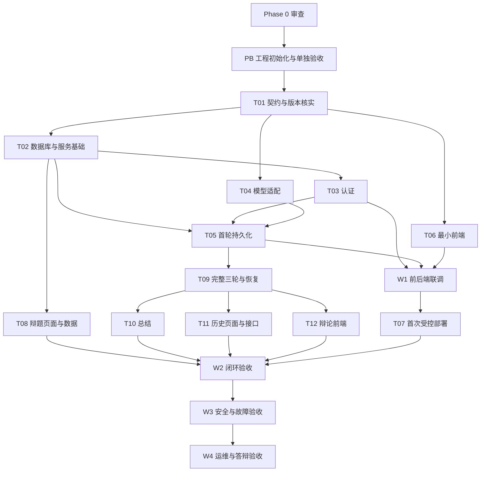

# 思弈阁 Lite 四周工程计划

状态：用户于 2026 年 11 月 1 日审查并批准 Project Bootstrap（PB）工程初始化，完成后单独等待人工审查。使用相对周次，不把原申报书日期作为工期；PB 只授权 W1 的前置骨架，不代表完整 W1 已获实施授权或已完成。各任务详情见 [TASKS](TASKS.md)。

## 目标与执行约束

目标是在约四周内交付 [PRD](PRD.md) 的全部 P0。第二周末形成注册、选题、三轮、总结、历史的闭环，后两周用于故障、安全、运维和答辩；SSE 为 P1，可以取消。

当前只执行 PB：骨架、存活检查、本地代理、基础测试和 README，不接入数据库、认证、模型或部署。后续每个阶段都先核对授权范围，完成小任务并验收，阶段结束报告修改内容、验证结果和未解决问题，经审查后再继续。阶段验收或编码授权不等于提交、推送、购买或部署授权。

初始工时假设：A 每周约 24 至 30 小时，B 每周约 6 至 8 小时；第一周基础链路和部署风险集中，需共同核实可用时间。任务估算含学习、AI 输出审查和测试，但不含采购等待、域名手续或大幅返工。不能把“AI 能生成”当作工时保证。

## 里程碑与验收

| 阶段 | 依赖 | 可交付成果 | 阶段通过条件 |
| --- | --- | --- | --- |
| Phase 0 已审查进入 PB | 两份原始资料与明确范围 | 八个规划文件、假设与 ADR | 用户已批准受限初始化；资源假设仍按各任务门槛确认 |
| PB 工程初始化 | 用户明确批准的初始化方案 | Go/Gin 与 Vue/TS/Vite/Arco 骨架、live、本地代理、基础测试、README | 实际执行前后端检查；浏览器真实联通及停止/恢复验证；留下 INIT_ACCEPTANCE，待人工验收后再进入下一任务；不代表 T02/T06/W1 完成 |
| W1 最小端到端 | Phase 0 审查，模型资源与实施授权；部署另需授权 | 单仓库应用骨架、版本化初始迁移、注册登录、一个预设题的一轮真实回复、持久化详情、最小前端；首次受控 HTTPS 部署 | 浏览器经 Gin/Eino 得到真实模型回复，记录写入 MySQL，刷新和重启后仍可读；公网部分有部署授权、有效 HTTPS，以及通过的认证限流、输入/生成限额、模型并发/超时、供应商硬预算和健康端点代理检查；缺授权或检查未通过则不开放并保持门槛未完成 |
| W2 产品闭环 | W1 认证、持久化与模型链路，已冻结 API | 至少 5 个题、正反立场、三轮状态机、失败重试、结构化总结、历史分页及页面联调 | 完整走通 AC01 至 AC08 的正常与核心失败场景，六条正式消息，总结和历史可重读；两用户隔离验证；公网回归须在获准部署后进行 |
| W3 可靠性与可选 SSE | W2 P0 功能闭环 | 并发/重复提交/崩溃恢复回归、既有限流与安全回归、脱敏日志、AI 人工评估；可选 SSE | AC04、AC05、AC08 及 AC10 安全部分通过；模型故障可恢复，无高优先级缺陷；若交付 SSE，AC12 通过 |
| W4 运维与答辩 | W3 稳定功能，真实环境操作授权 | HTTPS 与续期检查、持久化/异机备份/恢复、告警验证、发布回退说明、回归记录、使用说明和双人演练 | AC01 至 AC11 全通过，P1 仅在交付时验 AC12；独立库恢复成功，告警收到，两人能解释所负责模块 |

W1 的“一轮”是生产三轮业务链路的第一段验收，不建立另一套临时聊天接口；W2 在同一接口、实体和权限机制上完成剩余轮次及异常规则。第一周已经具备的保护不得为了联调临时关闭。

## 阶段依赖与并行关系

模型适配可以与认证、最小前端并行，前提是 T01 固定 DTO 和 Fake 接口。B 用匿名固定数据做页面时只模拟协议，不引入独立业务规则。A 负责 API 实现和复杂聊天集成，B 不承担关键后端状态机。详细并行标识见 TASKS。

## 第一周最小端到端任务

目标链路：浏览器注册登录 → 创建预设题会话 → 发送第 1 轮 → Gin 鉴权与持久化 → Eino 真实模型 → 保存完整回复 → 浏览器刷新重读。部署许可具备后，在真实服务器重复该流程。

1. **T01 契约与资源确认**：双方阅读 PRD 和架构，固定首批 API 示例、状态、错误码及负责人；核实兼容版本、模型连通性与费用上限，确认服务器/域名可用情况，不在未经授权时购买或部署。
2. **T02 服务和持久化基础**：A 在获准编码后创建后端最小入口、配置校验、日志、健康检查、初始迁移和测试库。先验证迁移、连接、重启持久化，不做完整通用框架。
3. **T03 注册登录**：A 实现用户、Argon2id、Session、CSRF、所有权基础，以及请求体/凭据长度和注册/登录限流；B 联调注册/登录界面。此后核心 API 全部依赖真实认证，不用匿名公网模型接口绕过。
4. **T04 模型适配**：A 先用 Fake 验证中文 Prompt、相反立场和超时，核实供应商硬预算/额度后做一次受控真实模型冒烟；Key 只注入后端，硬预算未落实不开放公网真实模型入口。
5. **T05 一轮业务**：A 用未来正式接口创建会话、认领首轮、保存 user/assistant、查询详情，建立请求标识、事务和失败状态基础，并实现请求体/字符、生成次数与并发限制；B 提供空白、等待、失败和成功页面样例。
6. **T06 前端联调**：B 负责最小登录/注册页面，A 带领接入单题首轮面板；用浏览器验证真实 API、刷新、登录失效及错误提示。
7. **T07 首次受控部署**：获得明确部署授权后，A 创建部署配置并操作，B 记录公网验证；先验收 T03/T04/T05 的限流、输入边界、生成额度/并发/超时及供应商硬预算，再开放公网。有效 HTTPS、必要端口、数据卷与日志一起完成；健康端点经 Nginx 精确转发，验证 JSON、DB 断开 503、Go 停止非 2xx 或连接失败，不能回退成网页 200。

首次上线的保护与验证前移后，W1 重估 A 约 30 至 41 人时，须在 T01 确认投入或调整排期；工时不足时推迟首次部署，不跳过前置检查。建议前两天并行做契约、后端基础和登录页面；中间三天打通认证、模型与持久化；后两天留给集成、首次部署和问题修复。按实际可投入小时调整，不要求 B 在竞赛期间承担每天固定开发量。

第一周验收必须留下：一次完整浏览器路径、MySQL 中对应记录的脱敏证据、重启后重读结果、模型失败时的状态、测试命令结果。只有“网页显示 AI 文本”但缺少认证或持久化不算通过。

## 后三周实施顺序

W2：先完成 T08 的辩题与选择，再完成 T09 三轮规则与失败重试；T10 总结依赖完整三轮，但可先用六条匿名固定消息验证解析；T11 历史接口和页面按契约并行；T12 集成聊天与总结交互。周末先关闭产品闭环，不开始额外功能。

W3：T13 集中复验 W1 已落实的越权、CSRF、限流、限额、日志及异常路径并调优参数，T14 做 5 场人工 AI 质量评估。T15 SSE 只有 W2/W3 的核心门槛满足且有余量时才开始，投入上限约 6 小时，超过则保留普通响应。涉及修改状态机的缺陷由 A 处理，B 协助复现和回归。

W4：先完成 T16 备份恢复与告警，再做 T17 全链路回归和小规模性能测量，最后 T18 使用文档、部署说明与双人答辩演练。最后三天冻结功能，只修复影响 P0、数据和安全的缺陷，保留现场演示与恢复缓冲。

## 风险与缩减顺序

| 风险信号 | 响应 |
| --- | --- |
| 第 2 天尚无可用模型凭据 | A 继续用 Fake 开发并记录阻塞；模型所有者提供资源后做真实冒烟，不能将 Fake 冒充最终验收 |
| 第一周服务器或域名未就绪 | 本地先完成全链路，通过 SSH 隧道等受控方式验证；公网与 HTTPS 门槛明确未通过，优先解决资源，不以截图冒充上线 |
| B 因比赛无法投入计划工时 | 保留 B 独立的辩题与历史页面，A 接管复杂聊天和集成；用固定组件，取消装饰性界面和 SSE，不把 B 调整为只做 PPT |
| W2 闭环落后 | 首先取消 SSE，然后减少界面装饰、预设题数量只保留最低 5 个、合并历史与总结展示；不能取消注册、权限、持久化、三轮、总结或 HTTPS |
| 仍无法在四周内满足全部 P0 | 及时报告剩余任务、工时及影响，由用户选择调整考核目标或期限；不能自行降级 P0 并宣布完成 |
| 模型回复不稳定或费用过高 | 限制篇幅、调用次数和并发，人工检查 Prompt；切换供应商须先验证兼容性并更新 ADR，不引入 RAG/多 Agent 补救 |

## 验证与阶段报告

编码后预期执行：后端 `go test ./...`、`go vet ./...`，涉及并发时运行相关 `go test -race`；集成测试只连接显式隔离 MySQL。前端以 T01 固定的 npm scripts 执行类型检查、测试和生产构建。E2E 覆盖核心用户流程及跨用户拒绝，真实模型只做少量受控冒烟。

PB 实际执行范围及结果见 [INIT_ACCEPTANCE](INIT_ACCEPTANCE.md)，不能把其技术通过记录当成 W1 业务验收。数据库、认证、AI、E2E 业务链路和生产部署的检查仍待对应任务；本次不建立 CI 或 Docker 配置。

每阶段报告统一包含：任务编号与实际改动文件；已经执行的验证、环境和结果；未执行检查及原因；遗留问题、影响与负责人；资源和下一阶段前置条件。只有阶段审查通过且授权明确，才进入下一阶段。
