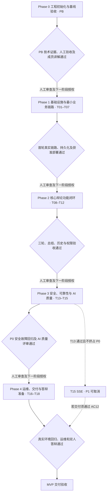

# 思弈阁 Lite 阶段工程计划

当前健康路径已于 2026 年 11 月 8 日经负责人确认统一为 `/api/health/live`、`/api/health/ready`，见 [API](API.md) 与 [ADR-012](DECISIONS.md#adr-012-健康端点统一为当前-gin-路径)。下文 PB 历史交付中的旧路径仅为当时记录，不改变任务验收状态。

2026 年 11 月 2 日调整计划与任务组织，11 月 6 日同步 Phase 0 结项，11 月 7 日同步 T01 结项与验收流程简化。任务详情与依赖见 [TASKS](TASKS.md)，产品验收编号见 [PRD](PRD.md)，技术契约见 [ARCHITECTURE](ARCHITECTURE.md)。

## 整体目标与推进规则

交付可访问、可维护、可测试、可答辩的 AI 文字辩论训练 MVP，满足 PRD 全部 P0：注册登录、辩题与立场、三轮辩论、持久化历史、结构化总结、失败恢复及公网运行保障。SSE 保持 P1，可以不实施。

项目按阶段目标推进，不规定各阶段的自然日数、周次、完成日期或成员固定投入时长。课程、考试、ACM 训练与技术学习可以使项目暂停；恢复时从已有验收记录继续，不清零进度，也不要求追赶旧时间表。

TASKS 中 S/M/L 和人时仅是开发、学习、AI 输出理解审查与验证的粗略工作量估算，不是自然日或完成期限。实际投入和 A/B 分工可按情况调整并记录；超出估算不降低验收标准。采购等待、资源手续和重大返工另记，不能把 AI 生成速度作为工时保证。

阶段内部按依赖选择任务，不要求按编号串行。依赖满足后可分工并行；固定数据只用于按已确认契约准备页面和测试，不能代替真实模型、MySQL、浏览器或部署验收。同一成员的投入与共享文件冲突仍需协调。

自 T01 起，只有当前阶段的必要 P0 任务、Codex 技术审查、必要的自动化测试及相关高风险专项验证通过并有证据，且经项目负责人最终验收，才能认定阶段完成。开发成员在实施中理解自己负责的模块，不再强制 A/B 互审或正式契约讲解登记；决策见 [ADR-011](DECISIONS.md#adr-011-简化验收流程与-t01-结项)。人工审查通过且下一阶段授权明确后才能继续；Codex 声称完成、文件存在或计划调整均不能自动改变任务状态。提交、推送、合并、发布、购买、部署及生产迁移/恢复仍须各自明确授权。

## 当前阶段与证据

**Phase 0（工程初始化与基线验收）已结项，PB 已完成。** [INIT_ACCEPTANCE](INIT_ACCEPTANCE.md) 记录了前后端检查、真实 HTTP/Vite 代理、浏览器停止后端失败与恢复重试、独立代码审查等技术证据。

用户已确认 PB 人工验收、A 讲解及 B 互审完成，历史结论见 [验收登记](INIT_ACCEPTANCE.md#人工验收与成员讲解互审登记)。现有骨架成果计入 PB。**T01 已于 2026 年 11 月 7 日经项目负责人验收结项，仅完成 Phase 1 首批 8 个 API 契约设计，不代表业务代码已实现。** T02 进行中，仅首个隔离 MySQL 环境子任务获准实施，技术验证后待人工验收，见 [环境记录](T02_MYSQL_ENV_ACCEPTANCE.md)。其余 T02 和 T03–T18 尚未实施；批次 2 的其他工作仍须明确授权，完整 T02 和 Phase 1 均未完成。

旧版“Phase 0 规划审查”是 PB 之前的历史活动，不是新版 Phase 0 的通过记录；旧 W1–W4 分别映射为 Phase 1–4，仅用于理解历史材料，不再作为工期。历史验收记录保持原样，决策替代关系见 [DECISIONS](DECISIONS.md#adr-010-按阶段目标推进)。

本轮后续授权增量：用户要求从 T02 最靠前的未完成工作实施一个可独立验证的闭环。后端连接、readiness 与测试目标保护已进入实施，技术证据见 [后端接入记录](T02_DATABASE_CONNECTION_ACCEPTANCE.md)，当前子任务待人工验收。上段“仅环境子任务”保留为历史授权记录；完整 T02 仍未完成，迁移/种子为下一闭环，不进入 T03–T18。

## 阶段推进关系

图中只表达阶段门槛，任务级依赖以 TASKS 为准。门槛未满足时留在当前阶段处理阻塞或其他满足依赖的任务；SSE 不在必要推进路径上。

## Phase 0：工程初始化与基线验收

- **目标与任务**：PB；建立 Go/Gin 和 Vue/TypeScript/Vite/Arco 最小骨架、`GET /health/live`、本地代理、基础测试、README/API 与验收记录。
- **前置条件**：初始化范围、健康契约和规划资料明确，用户已授权受限 PB。
- **可并行工作**：健康契约确定后，后端存活接口与前端联通页可分工；README 和检查用例随实现准备，真实代理验证待两端可运行后进行。
- **交付成果**：可本地启动的前后端、锁定依赖、测试及类型检查、运行说明和 INIT_ACCEPTANCE。不接入数据库、认证、Eino、真实模型、辩论业务或生产部署配置。
- **验收标准**：后端 test/vet/build、前端 typecheck/test/build 实际通过；直连与代理 JSON 正确；真实浏览器验证停止后端失败、恢复后手动重试成功。A 能讲解请求链路，B 至少一次相关审查，用户核对证据并人工验收。
- **进入下一阶段**：PB 独立人工验收及成员讲解互审通过并登记，Phase 0 必要事项全部通过，Phase 1 对应任务实施授权明确。

## Phase 1：基础设施与最小业务链路

- **目标与任务**：T01–T07；固定 API 契约，建立 MySQL/GORM 与后端基础设施，实现注册登录和 Session 认证、Eino 真实模型适配、首轮消息持久化、前后端联调及首次获准部署。
- **前置条件**：Phase 0 通过人工验收，后续实施授权明确；T01 确认资源、接口、版本与费用边界，资源操作具备相应授权。
- **可并行工作**：T01 通过后，T02、T04 和 T06 页面准备可分工推进；T03 依赖 T02，T05 依赖 T02/T03/T04；T06 真实联调依赖 T03/T05。测试和文档可按契约提前准备，T07 待本地联调、安全检查及部署授权全部具备。
- **交付成果**：业务 API 示例、版本化迁移与至少 5 条种子、隔离集成库、认证和费用保护、真实首轮链路、本人详情查询、最小前端及获准的 Linux/Compose/Nginx/HTTPS 环境。
- **验收标准**：浏览器完成注册登录、创建预设题会话、发送第一轮并经 Gin/Eino 获得真实 AI 回复；记录写入 MySQL，刷新、退出重登及应用/数据库重启后仍可读取，模型失败状态有证据。它是正式三轮业务的首段验收，沿用同一接口、实体与权限机制，不另建临时聊天接口。
- **部署门槛**：首次公网开放前验收 T03 的 Argon2id、Session/CSRF、凭据边界和认证限流，T04 的服务端密钥、超时及供应商硬预算，T05 的输入校验、生成次数/并发限制与用户隔离。有效 HTTPS、内部 DB 网络、数据卷和日志就绪；经 Nginx 验证健康 JSON、DB 不可达 ready=503、Go 停止为非 2xx/连接失败，禁止 SPA HTML 假 200。不得为联调关闭已有保护。
- **进入下一阶段**：T01–T07 全部 P0 独立验收及阶段审查通过，下一阶段授权明确。无部署授权、资源或安全证据时，T07 和本阶段保持未完成；本地或 SSH 隧道证据不能替代公网与 HTTPS 验收。

## Phase 2：核心辩论功能闭环

- **目标与任务**：T08–T12；完成辩题与立场选择、三轮状态机、失败重试与恢复、结构化总结、本人历史分页和详情、完整前后端联调。
- **前置条件**：Phase 1 审查通过并获准继续，认证、持久化、真实模型和 API 契约可用。
- **可并行工作**：T08 页面/API 与 T09 三轮逻辑可分工；T10 依赖 T04，可用六条匿名固定消息先验 schema，完整联调依赖 T09；T11 页面可按 T01 契约准备，联调依赖 T09。T12 在 T08/T09/T10/T11 通过后整合验收。
- **交付成果**：至少 5 个题与双方立场、完整轮次与重试接口、租约恢复、总结存储和固定结构展示、历史与详情页面及联调记录。
- **验收标准**：用户能完成三轮，恰好六条正式消息，第 4 轮被拒；完整 AI 回复落库才计轮。失败保留原文、不计轮，重复与并发不多写，迟到结果不覆盖新尝试；轮次和总结重试绑定 `expected_attempt_version`，旧版本冲突不重调模型。总结三类数组合法、失败可单独重试，历史刷新重登可重读，两用户数据隔离。AC01–AC08 的正常与核心失败场景留证。
- **进入下一阶段**：T08–T12 全部 P0 验收及阶段审查通过，无阻塞闭环的遗留问题，下一阶段授权明确。

## Phase 3：安全、可靠性与 AI 质量

- **目标与任务**：T13–T15；安全故障回归、并发/重复请求/超时/异常恢复验证和人工 AI 质量评估，修订 Prompt；有余量时才选做 T15 SSE。
- **前置条件**：Phase 2 核心闭环通过人工审查并获准继续；已有真实链路和可复现场景，安全保护已在首次公网开放前实现。
- **可并行工作**：T13 与 T14 在满足 T12 依赖后分工推进，A 处理关键状态机与安全缺陷，B 组织复现和匿名样例。T15 仍依赖 T13 通过及可用投入，不挤占 T14 等必要 P0 的修复与验收。
- **交付成果**：安全和故障回归记录、脱敏可关联日志、至少 5 场完整对话的人工评估（至少 3 题、双方立场）、失败样例和有版本的 Prompt；可选 SSE 及其专门验收证据。
- **验收标准**：AC04/AC05/AC08 及 AC10 安全部分通过，关键模型/数据库故障可恢复，无高优先级核心缺陷，T14 人工质量评审通过。T13 是对既有认证、限流、限额和预算的回归与调优，不能推迟这些保护的首次实现。若交付 SSE，须通过 AC12 的代理、UTF-8 分块、断线与落库确认；不通过则关闭增强，普通 JSON 继续满足 P0。
- **进入下一阶段**：T13/T14 两项 P0 和阶段审查通过，下一阶段授权明确；T15 不实施不阻塞，保持 P1 并记录取舍。原 A 最多约 6 人时的 SSE 投入上限是成本约束，不是期限，超过则保留普通响应。

## Phase 4：运维、交付与答辩准备

- **目标与任务**：T16–T18；备份恢复、告警和证书续期检查、真实环境全链路回归、运行/部署文档与答辩材料准备。
- **前置条件**：Phase 3 必要 P0 与人工审查通过；T07 部署环境、T13 稳定基线及真实资源操作授权具备。迁移、备份、恢复先在隔离环境验证，禁止在生产做恢复试验。
- **可并行工作**：T16 运维演练期间可准备 T17 回归场景和 T18 文档、演示材料；T17 正式验收仍依赖 T13/T14/T16，交付 SSE 时另依赖 T15；T18 最终验收依赖 T17。交付验收时冻结新增功能，优先修复 P0、数据及安全缺陷，不按日期设冻结期。
- **交付成果**：异机加密备份、独立库恢复与实测 RPO/RTO、告警到达与续期检查、发布回退说明、真实部署回归和负载测量记录、使用/部署/故障文档及可用于答辩的模块与失败路径说明。
- **验收标准**：AC01–AC11 全部通过；备份在独立库恢复后历史可读，应用/DB/备份故障告警可达；10 在线/2 模型并发假设下无轮次错乱，非模型 API p95 注明环境和实测结果。交付说明覆盖模块职责、关键链路和失败路径，验证记录可追溯；开发成员在实施中理解各自负责的模块。交付 SSE 时累计满足 AC12。
- **交付完成条件**：T16–T18 全部 P0、累计回归、Codex 技术审查、相关高风险专项验证与项目负责人最终验收通过，遗留问题和限制如实记录。不自动发布、提交、推送、部署或开始额外功能。

## 暂停、恢复与阻塞处理

允许暂停项目或暂时搁置技术阻塞任务。记录任务状态、已通过的交付、证据位置、阻塞和恢复条件即可，不要求连续开发或固定日报。可在依赖满足且授权范围内先完成独立小任务，调整负责人时同步接口责任与交接，不跳过阻塞依赖。

每次恢复只需核对：

1. 当前阶段及尚未通过的验收门槛。
2. 已完成且有人工验收证据的任务和可复用成果。
3. 正在进行或待人工验收的任务及工作区改动。
4. 未解决的技术、资源、授权阻塞及恢复条件。
5. 下一项满足依赖且已获授权的任务；若无则处理阻塞，不强制赶进度。

暂停不等于验收失败或重置任务；恢复前核实环境、依赖版本及凭据，必要时重验受影响链路，不能把过期证据当作当前运行保证。

## 风险与缩减原则

| 风险信号 | 响应 |
| --- | --- |
| T04 尚无可用模型凭据或硬预算 | 用 Fake 准备接口和失败用例，登记真实冒烟阻塞；不替代最终验收，不开放公网真实模型入口 |
| 服务器、域名或部署授权未就绪 | 先做当前阶段满足依赖的本地工作，记录 T07 和阶段门槛未通过；不开放明文登录，不以截图代替上线 |
| 课程、考试或比赛影响投入 | 暂停或调整 A/B 分工与交接，保留 B 对辩题和历史页的独立开发和模块理解；A 可接管复杂聊天集成，不把 B 缩减为只做演示材料 |
| 闭环工作量超出估算 | 先取消 SSE，再减少装饰、合并历史与总结展示；预设题仍至少 5 个，不取消注册、隔离、持久化、三轮、总结、恢复或 HTTPS |
| 必要 P0 持续阻塞 | 报告剩余工作、原因和影响，请用户决定资源或目标调整；保持未完成，不自行降级 P0 或缩减验收 |
| 模型回复不稳或费用过高 | 限制篇幅、调用次数与并发，按人工评估修订 Prompt；供应商切换先验证兼容性并更新 ADR，不引入 RAG/复杂 Agent 补救 |

## 验证与阶段报告

后续编码按任务运行后端 `go test ./...`、`go vet ./...`，涉及并发时运行相关 `go test -race`；MySQL 集成测试必须显式隔离。前端运行约定的类型检查、测试、生产构建及关键浏览器交互。E2E 覆盖核心流程、跨用户拒绝和失败恢复；真实模型只做少量受控冒烟，不能作为每次单测的前提。运维保留真实环境与恢复证据。

本轮仅做文档一致性、编号、依赖、优先级、链接及改动范围检查，不执行或宣称业务测试、部署验证通过。PB 的历史技术记录不能替代后续业务验收。

每阶段报告包含任务与文件范围、实际验证的命令/环境/结果及证据、未执行检查和原因、遗留问题/影响/负责人、Codex 技术审查与相关高风险专项验证结论、下一阶段资源与授权条件。阶段报告完成后等待项目负责人最终验收；证据完整并经负责人确认才更新“已完成”。
