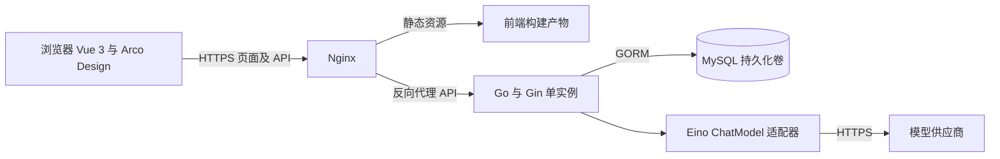
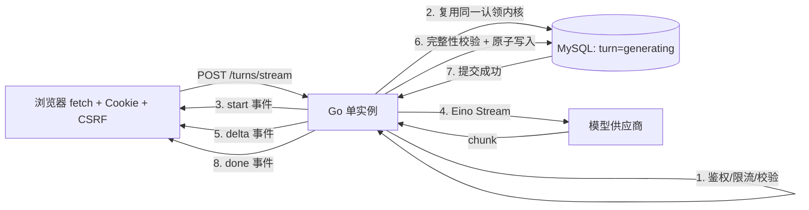

# 思弈阁 技术架构

**当前 T07 费用准入（2026-11-09）。** 真实模型公网试运行遵循 [ADR-019](../decisions/DECISIONS.md#adr-019-受控公网模型费用准入)。以下 T04/T05 阶段快照中的旧硬预算门槛保留当时语境。

**T05 无收费范围正式结项（2026-11-08）：项目负责人确认三关人工验收全部通过，批准 T05 无收费实现范围结项并授权 Git Commit。** 四接口、累计无收费验证与新会话独立复审 PASS，T05-R01/R02/R03 三项 P2 均已独立确认关闭；已接受限制及后续任务见 [T05 验收](../acceptance/T05_FIRST_TURN_ACCEPTANCE.md)。本轮仅登记验收、核对提交范围，并从 `codex/docs-reorganization` 当前 HEAD 创建 `feat/t05-first-turn` 后提交；不修改已验收业务代码、不重跑完整测试或独立审查，无需 DSH。禁止收费调用、Push、Merge、Rebase、Reset、PR 或部署，不进入 T06。真实模型链路未验收，仍须另行授权；T07-COST-01 继续阻塞公网真实入口。单进程并发未来评估提升至 4–8，当前仍为 2。T03 已接受的 P2/P3 延期及 T04 已结项事实保留；下方旧授权与状态保留当时语境，以本段及最新验收记录为准。

**T04 实施增量（2026 年 11 月 8 日）：新增独立 `internal/ai`，业务接口 `Generator.Generate(context.Context, Request)` 由 Eino 官方 OpenAI 协议适配器和 Fake 实现。** `debate-v1` 仅由服务端构建消息；45 秒模型 Context 和 60 秒请求辅助函数、显式 Token 上限、完整历史/窗口预检及响应校验已实现并通过最终集成检查与独立审查，5 项 P2 均已复验关闭。提交 T04 时 main 尚未装配 AI、未增加业务路由，该装配由 T05 完成。供应商硬预算未落实，公网真实入口按 [T07-COST-01](../planning/TASKS.md#t07-cost-01-供应商硬预算缺失) 保持阻塞。历史 T04 未启动表述不覆盖本增量。

**T04 结项（2026 年 11 月 8 日，覆盖上段的历史快照）：项目负责人已正式通过最终人工验收，T04 标记已完成并正式结项。** 上段“真实调用仍待单独授权”“T04 未完成”为结项前的历史状态，不再代表当前结论。经负责人批准的一次本地受控冒烟例外已执行唯一一次真实请求，HTTP 200、正常结束，授权已消耗、入口已停止；实际用量 250 输入 / 48 输出 Token，按实际用量计价 0.000442 元，**精确结算费用仍为未知**，负责人已接受该残余风险。**T07-COST-01 继续未关闭，保持 P0 公网开放阻塞**，不得据此开放公网真实模型入口或再次发起真实调用。依据见 [T04 最终人工验收与结项](../acceptance/T04_AI_ACCEPTANCE.md#最终人工验收与结项) 和 [ADR-017](../decisions/DECISIONS.md#adr-017-一次本地受控冒烟费用保护例外)。

**T03 实施增量（2026 年 11 月 8 日）：认证四接口、auth 分层、可复用认证/Origin/CSRF 中间件与 `current_user` 已实现并通过 Codex 技术验证，待独立审查和人工验收。** 复用 T02 连接与表；见 [认证记录](../acceptance/T03_AUTH_ACCEPTANCE.md) 和 [ADR-015](../decisions/DECISIONS.md#adr-015-t03-认证实现与-cookie-名称)。Cookie 名已在 T03 具体化；历史“业务未实现”和不启动 T03 的表述不覆盖本增量，T04–T06 未启动。

**当前结项状态（2026 年 11 月 8 日）：T02 已通过最终独立技术审查及项目负责人人工验收，标记已完成。** M01/M02 按本次审查结论关闭；M03 及已接受的恢复/验证边界继续保留。验收依据见 [种子与持久化记录](../acceptance/T02_SEEDS_PERSISTENCE_ACCEPTANCE.md)。此前“进行中/待验收”等为各子任务当时状态，不覆盖本次结项。T03–T18 不因结项自动启动，Phase 1 尚未完成。

2026 年 11 月 6 日，Phase 0 已结项，T01 的 8 个首批业务接口见 [API](../api/API.md)。当前运行基线为 Go/Gin、Vue/TypeScript/Vite/Arco 骨架与本地健康联通。数据库、认证、AI 和部署按 [TASKS](../planning/TASKS.md) 交付。产品边界见 [PRD](../product/PRD.md)，资源状态和方案依据见 [DECISIONS](../decisions/DECISIONS.md)，PB 证据见 [INIT_ACCEPTANCE](../acceptance/INIT_ACCEPTANCE.md)。

## 架构与技术栈

使用单仓库、单个 Go 服务和单个 MySQL 实例。按业务模块组织代码，在进程内调用，不引入 RPC、服务发现、Redis、消息队列或分布式事务。浏览器只访问同源站点，模型 Key 仅存在服务端。

上述单实例描述为目标应用部署形态。T02 本地开发库与集成测试库按冻结要求使用独立 MySQL 容器、卷、账户与回环端口，环境配置见 [本地 MySQL](../../infra/mysql/README.md)。本次只建立环境，后端连接、业务迁移和 readiness 留待 T02 后续获准实施。

后续实施增量：本轮用户已明确授权继续 T02。后端现接入 GORM/MySQL 和 `/api/health/ready` 就绪检查，测试入口验证固定测试目标。2026 年 11 月 8 日负责人确认健康路径以 `/api/health/live`、`/api/health/ready` 为准，见 [API](../api/API.md)；此前 [后端接入记录](../acceptance/T02_DATABASE_CONNECTION_ACCEPTANCE.md) 保留当时验收证据。版本化迁移和种子仍未实施，未改变本文的数据及业务接口设计。

2026 年 11 月 8 日迁移增量：六张 Phase 1 表的版本化 SQL 已在隔离测试库验证，工具为独立 Goose v3.29.0 CLI module，仅显式 up/status，使用迁移账户及会话锁。服务仍不自动迁移；逻辑实体及 API 不变，物理类型、执行与失败恢复见 [迁移说明](../../backend/migrations/README.md)。上段“迁移未实施”保留为历史，种子仍未实施，总结表仍归 T10；当前闭环已获有条件独立审查，负责人已接受验证边界及延期项并授权提交/推送；学习讲解尚未登记，延期门槛见 [任务登记](../planning/TASKS.md#t02-迁移延期问题登记)。

2026 年 11 月 8 日种子增量：新增 00007–00009 字节精确枚举 CHECK，保留原六份 SQL/冻结列类型；00010 在 Goose 事务中插入固定 ID 1–5，重复 up 不多写，ID 冲突失败且不覆盖。服务启动不迁移或播种。历史保护与重启持久化已技术验证，详见 [当前记录](../acceptance/T02_SEEDS_PERSISTENCE_ACCEPTANCE.md) 和 [ADR-014](../decisions/DECISIONS.md#adr-014-t02-精确枚举与版本化种子)。待独立审查、辩题人工审阅及最终验收，完整 T02 未完成；上方“种子未实施”为历史状态。



| 层次 | 选择 | 使用边界 |
| --- | --- | --- |
| 前端 | Vue 3、TypeScript、Arco Design、Vue Router、Vite | 复用组件库，路由手工声明，先用页面局部状态与轻量共享登录状态 |
| HTTP | Go、Gin | 路由、校验、认证、权限、限流、日志与错误转换 |
| AI | CloudWeGo Eino ChatModel | 一个配置化供应商，先完整响应，再按需流式；无 Agent 或工具调用 |
| 数据访问 | GORM、MySQL InnoDB | 事务、唯一约束和外键，不用 SQLite 代替生产与集成测试数据库 |
| 部署 | Linux、Docker Compose、Nginx | 一个应用副本，TLS 终止，数据库内网，独立持久化卷 |
| 观察与维护 | JSON 日志、健康端点、主机和容器检查 | 不新增 Prometheus/Grafana 集群；复用可用的主机告警能力 |

Bootstrap 环境固定为 Go 1.27.1、Node.js 24.11.1、npm 11.6.2。后端模块为 `github.com/bingqilin456/DebateForge/backend`，Gin v1.12.0。前端精确版本由 package.json 与 package-lock.json 固定，使用 npm。依赖说明与实际验证见 README、INIT_ACCEPTANCE。MySQL、GORM、迁移工具候选与 Eino 版本确认节点见 [T01 资源登记](../decisions/DECISIONS.md#t01-资源与版本登记)。对应任务验证后固定精确版本和镜像标签。

本地后端默认监听 `127.0.0.1:8080`，`HTTP_ADDR` 仅接受回环 IP 与有效端口；若变更后端端口，须同步 Vite target。前端监听 `127.0.0.1:5173`，端口占用时直接失败，Vite 将 `/api/` 原路径代理到后端，不增加宽泛 CORS。当前注册 `/api/health/live`、`/api/health/ready`，2026 年 11 月 8 日负责人已确认以这两个路径为准；历史无 `/api` 的健康路径不再适用，也不保留开发代理规则。单页面阶段暂不安装 Vue Router、Pinia、Axios，不预建业务空模块。

## 模块职责

| 模块 | 职责 | 不承担的职责 |
| --- | --- | --- |
| `auth` | 注册、密码验证、Session、当前用户、退出、CSRF token | 辩论轮次或模型调用 |
| `topic` | 读取人工维护的预设辩题 | 爬取热点、自定义辩题或后台编辑 |
| `debate` | 创建与查询、所有权、轮次状态机、幂等、消息、总结流程 | HTTP 细节或供应商 SDK 参数 |
| `ai` | Prompt 构建、Eino 适配、响应解析与结构校验、调用元数据 | 直接查用户数据或决定业务状态 |
| `platform` | 配置、DB 连接、HTTP 中间件、日志、健康检查 | 通用工作流引擎或跨服务基础设施 |

Handler → Service → Repository。`debate` Service 在校验身份与所有权后读取数据库上下文，再交给 `ai`；`ai` 不持有数据库访问权限。只为模型替换和测试建立小接口，Repository 不预先抽象成万能 CRUD 框架。

## 推荐目录结构

以下是完整 MVP 的目标结构，不是当前已经实现的文件清单。Bootstrap 只创建入口、platform、健康页面及其配置和测试；其他文件按任务逐步增加。

```text
backend/
  cmd/server/main.go                 # 组装依赖与启动、优雅退出
  internal/
    auth/{handler,service,repository,model,dto}.go
    topic/{handler,service,repository,model,dto}.go
    debate/{handler,service,repository,model,dto}.go
    debate/state.go                  # 赛制轮数与环节规则、状态转换
    ai/{client,prompts,summary}.go    # 小接口、Eino 适配和结构校验
    platform/{config,database,router,middleware,health}.go
  migrations/                       # 有版本号的建表、种子和升级 SQL
  tests/integration/                # 隔离 MySQL 集成测试
frontend/
  src/
    api/{client,auth,topics,debates}.ts
    types/api.ts                    # 共享契约类型
    router/index.ts
    views/{Login,Register,Topics,Debate,History,Summary}View.vue
    components/{MessageList,MessageInput,SummaryPanel}.vue
    composables/useAuth.ts
  tests/                            # 关键交互与端到端测试
deploy/                             # 后续获准后创建 Compose、Nginx 和运维说明
docs/                               # 本阶段共享规划与后续验收记录
.env.example                        # 后续创建，不含真实凭据
```

每个模块只创建当前任务需要的文件。测试文件优先靠近业务文件，集成测试集中存放。[API](../api/API.md) 是 PB 健康检查及 Phase 1 业务 HTTP 契约的来源，本文保留数据和实现约束，以及 Phase 2 接口草案。

## 数据实体与关系

时间统一 UTC；业务 ID 用 MySQL `BIGINT UNSIGNED`，JSON 用字符串防止 JavaScript 精度丢失；文本使用 `utf8mb4`。状态用有明确枚举范围的字符串和应用校验，避免为少量状态引入难变更的数据库枚举。默认无软删除，也不开放删除接口。

| 实体 | 关键字段草案 | 约束与索引 |
| --- | --- | --- |
| `users` | `id, username, password_hash, created_at` | 归一化后的 username 唯一；不采集其他身份信息 |
| `auth_sessions` | `id, user_id, token_hash, csrf_token, expires_at, created_at` | token_hash 唯一；user_id 外键；expires_at 索引，退出删除对应行 |
| `topics` | `id, title, description, enabled, created_at` | 版本化种子至少 5 条；已使用条目不物理删除 |
| `debates` | `id, user_id, topic_id, topic_title_snapshot, topic_description_snapshot, user_stance, mode, ai_style, status, completed_rounds, created_at, updated_at` | user_id 与 topic_id 外键；索引 `(user_id, created_at, id)`；`mode` 取 `quick_3`/`standard_4`，`ai_style` 取 `logical`/`aggressive`/`empathic`/`data`，均有字节精确 CHECK；`completed_rounds` 数据库粗边界 0–6，按模式的精确上限由业务代码校验 |
| `debate_turns` | `id, debate_id, round_no, client_request_id, status, attempt_version, lease_expires_at, error_code, model_name, prompt_version, input_tokens, output_tokens, latency_ms` | 唯一 `(debate_id, round_no)` 和 `(debate_id, client_request_id)`；debate_id 外键；status 与 lease_expires_at 索引；`round_no` 数据库粗边界 1–6 |
| `messages` | `id, turn_id, role, content, created_at` | turn_id 外键；role 只允许 user/assistant；唯一 `(turn_id, role)` |
| `debate_summaries` | `id, debate_id, status, schema_version, content_json, attempt_version, lease_expires_at, error_code, model_name, prompt_version, input_tokens, output_tokens, latency_ms, updated_at` | debate_id 外键且唯一；content_json 仅在成功后有值；status 与 lease_expires_at 索引 |

所有表有主键，迁移时补齐必要的创建时间。T02 以版本化种子写入至少 5 个经人工审阅的中文辩题。T05 在 `GET /api/v1/topics` 查询真实 MySQL 中启用的辩题并按 ID 升序返回，T06 和 T08 复用。创建会话时检查辩题可用并将文字快照写入 `debates`，从而保留旧会话的原题。API 的 `topic` 字段由 `topic_id` 和会话快照投影，`ai_stance` 由用户立场反转得到。

关系为：User 1:N AuthSession，User 1:N Debate，Topic 1:N Debate，Debate 1:N Turn（上限由该会话 `mode` 决定，3 或 4），Turn 1:N Message（最多 2），Debate 1:0..1 Summary。`debate_turns` 独立保存生成状态与幂等标识，`messages` 保存正式内容，避免把半条流式回复当作历史消息。

使用版本化 SQL 迁移及种子文件，由受控流程执行；GORM 执行 CRUD 与事务。生产启动不运行 `AutoMigrate`，不自动重置或重建表。服务账户仅有必要业务读写权限，迁移使用单独权限。GORM 支持显式事务，跨表业务仍需自行定义事务边界。[GORM 事务文档](https://gorm.io/docs/transactions.html)

T02 优先交付首轮所需的 `users`、`auth_sessions`、`topics`、`debates`、`debate_turns`、`messages`。总结表由 T10 使用版本化迁移加入。Phase 1 的会话详情按 [API](../api/API.md) 返回固定的未开始总结状态。

## 会话与轮次状态机

`debates.status` 只取 `active`、`completed`。达到该场赛制的轮数上限后立即成为 completed，与总结是否成功无关。总结状态为 `generating`、`completed`、`failed`，尚未请求时无总结行，API 统一返回 `not_started`。

**赛制模式是轮数的唯一事实来源（[ADR-021](../decisions/DECISIONS.md#adr-021-赛制阶段化与-eino-流式输出)）。** 代码不保留固定轮数常量，一律经 `RoundsFor(mode)` 取得：

| 赛制 `mode` | 轮数上限 | 环节序列 | 用途 |
| --- | --- | --- | --- |
| `quick_3` | 3 | 立论 / 攻辩 / 结辩 | 历史数据兼容与隔离 E2E 测试 |
| `standard_4` | 4 | 立论 / 驳立论 / 自由辩 / 结辩 | 新建会话的默认赛制 |

新建会话由服务端固定 `standard_4`，请求体传入的 `mode` 被忽略；`quick_3` 不开放生产创建入口。未知赛制一律受控失败，不静默降级到任何默认轮数。

**环节由 `(赛制, 轮号)` 推导，不落库。** 第 3 轮是两种赛制的分叉点：`quick_3` 第 3 轮为结辩，`standard_4` 第 3 轮为自由辩、第 4 轮才是结辩。环节若单独存列会产生第二个事实源，一旦不一致即为脏数据，因此一律由推导函数计算，并按 `(赛制, 环节)` 分派该轮的 Prompt 指令。新增赛制只登记轮数与环节映射，不改状态机。

`debate_turns.status` 只取 `generating`、`completed`、`failed`。初次接收发言即创建 generating 轮次及 user 消息；完整回复持久化才创建 assistant 消息。生成中的增量不作为正式消息保存。

**T05 首轮范围。** 仅接受 `round_no=1`，保留轮次、消息、幂等键、租约与 `attempt_version`，完成首轮后会话仍为 `active`。处理可观察的模型失败、超时和请求取消。**T09 扩展范围。** 加入第 2/3 轮、越界轮次拒绝、显式重试及过期租约回收。**赛制升级后**，每一处轮次校验（认领、重试认领、完成、总结认领、总结写回）都必须从该会话行读取 `mode` 后再取上限；任何使用全局常量或默认值的分支均属缺陷。Phase 1 进程硬崩溃或数据库故障可能遗留 `generating`，客户端在有限轮询后提示稍后查询。

一次新轮次的处理顺序：

1. 在短事务内按用户所有权锁定会话行，先查 `client_request_id`。同键同轮同原文已完成返回 200，生成中返回 202，已失败返回 `409 turn_failed`。同一标识附带不同内容或轮次返回 `409 idempotency_conflict`。重放不重新调用模型。
2. 对新标识校验会话 `active`、`round_no = completed_rounds + 1`，且本阶段允许该轮、该轮无已有记录，否则返回 `409 round_conflict`。T09 上线后，已有失败轮通过显式重试恢复。唯一约束作为最终保护。
3. 对真正需要生成的新请求，先非阻塞取得模型并发槽；没有槽则回滚并返回 429，不新增轮次或消息。在同一短事务创建 Turn 与 user 消息，记录 `attempt_version = 1`、生成租约后提交。失败重试和总结使用相同的准入顺序，重复查询或已完成结果重放不占模型槽。**不能持有数据库事务或行锁等待模型响应，也不在锁内排队等并发槽。**
4. 在事务外，用服务端构建的上下文调用 Eino。普通完整回复和 SSE 最终都进入同一完成逻辑。
5. 成功时再次短事务锁定会话，校验轮次仍 `generating` 且 `attempt_version` 匹配，保存唯一 assistant 消息、完成 Turn、增加 `completed_rounds`。T09 支持达到 3 时完成 Debate。失败只标记本次尝试为 `failed` 并保存受控 `error_code`。请求取消时，在独立、有界的数据库上下文中尽力以 `generation_cancelled` 标记失败，仍校验状态及版本。成功事务提交后才能返回结果。提交结果不明时返回 503，前端先查询真实状态。

失败轮重试通过独立 POST 入口，必须携带从查询结果取得的 `expected_attempt_version`（正整数），复用已保存 user 原文。在同一短事务内，仅当状态为 failed 且当前 attempt_version 等于期望版本时，才允许取得并发槽、更新 `failed → generating` 并将版本加 1；准入或事务失败则不消耗该版本。成功轮不支持重新生成。数据库提交失败时不得向前端报告 done；查询数据库状态后再决定恢复路径。

重试请求遇到 completed 返回已保存结果，遇到 generating 返回 202，均不调用模型；遇到 failed 但版本已变化返回 409（`attempt_version_conflict`），附当前状态、attempt_version 和查询地址。缺失或非法期望版本返回 400。前端收到 409 后只查询并展示状态，不自动替换版本重发；只有用户再次明确点击重试，才使用最新失败版本。因此，即使一次重试已再次失败，延迟到达的同版本重复请求也不会再触发模型。该规则同样适用于总结重试。attempt_version 同时用于写回检查，旧尝试的成功或失败结果均不能覆盖新尝试。

进程崩溃恢复由 T09 实现轮次扫描，T10 复用到总结。租约暂定 90 秒，服务启动及每 30 秒扫描过期 `generating` 记录，以状态和 `attempt_version` 作条件更新标为 `failed`。总请求预算不超过 60 秒，可重试恢复窗口目标为开始生成后不超过 120 秒加一次状态查询。过期只结算状态，重调模型需显式请求。

同一会话的轮次串行，单用户最多 1 个在途模型调用，全局最多 2 个；使用单实例内有界并发控制，满载直接 429 并返回 Retry-After，不排长队。认领事务失败、模型失败、断线、成功等所有退出路径都释放已取得的槽，不能因请求失败永久占用。以上并发约束不支持多副本，未来扩容需重做协调 ADR。

幂等保证数据库中每轮结果至多一份，不保证供应商计费恰好一次。响应丢失先查状态，失败重试可能再次计费；不启用供应商 SDK、代理或前端的隐式模型重试。

## Phase 2 API 草案

Phase 1 的 8 个接口与健康路径见 [API](../api/API.md)。本节保留 Phase 2 接口形成时的设计语义；历史分页、轮次重试与总结接口现已实现并晋升至 API/OpenAPI 正式路径，当前 DTO、状态与例子以 [API](../api/API.md) 为准。路径统一带 `/api/v1` 前缀，复用 Phase 1 的 JSON 信封、Session、写请求 Origin/CSRF 和会话所有权规则；SSE 实现仍为后续 Phase 3 任务。

| 方法与路径 | 请求要点 | 响应与行为 |
| --- | --- | --- |
| `GET /debates?page=1&page_size=20` | page_size 最大 50 | 200，仅本人，按 created_at、id 倒序，返回 items、total、page、page_size |
| `POST /debates` | `topic_id`、`user_stance` 必填；Phase 3 目标新增可选 `ai_style`（四枚举、省略 logical），不接受客户端选择 mode | 201；赛制固定 standard_4；目标流派校验后持久化，非法值 400；当前 Phase 2 仍固定 logical，自主选择待 T14-STYLE 实现 |
| `POST /debates/:id/turns/:turn_id/retry` | expected_attempt_version（必填）；无新内容；CSRF Header | failed 且版本匹配才认领；成功 200，进行中 202，已完成重放 200；失败版本已变化为 409，不调模型 |
| `POST /debates/:id/summary` | `retry` 默认 false；为 true 时必填 expected_attempt_version | 仅 completed 辩论；首次成功 201，已完成重放 200，进行中 202；失败须 retry=true 且版本匹配才认领，版本冲突 409；not_started 时 retry=true 为 400 |
| `GET /debates/:id/summary` | 本人会话 | 200，返回 status 和可选 content；未开始也返回 not_started |
| `POST /debates/:id/turns/stream` | 与普通发送同体：`round_no`、`content`、`client_request_id`；`Accept: text/event-stream`；CSRF Header | 200 + `text/event-stream`，事件 `start`/`delta`/`done`/`error`；**复用同一认领内核**；鉴权/校验失败仍返回普通 JSON；生成中重复请求返回 202 JSON |

重试接口也校验 `turn_id` 属于 URL 会话及当前用户。GET 仅查询已存状态。202 表示查到 `generating`，前端沿用 [API](../api/API.md#错误码与客户端恢复) 的查询规则。

会话 DTO 增补 `mode`、`ai_style`、`total_rounds` 三个字段；`total_rounds` 由 `mode` 推导，前端据此确定轮次上限，**不自行硬编码轮数**。

**Phase 3 自主流派选择契约（待实现，依据 ADR-023）：** 创建前用户可选 logical（逻辑型）、aggressive（进攻型）、empathic（共情型）、data（数据型）。Handler 解析可选 ai_style，必须区分字段缺失与显式 null；Service 对精确枚举校验，字段缺失才默认 logical，null/空串/未知值/非字符串返回 400 invalid_request 且无创建副作用。Repository 与辩题快照一起在创建事务保存 debates.ai_style，数据库已有该列及枚举约束，不因开放选择而另建迁移。创建后的会话流派不可改，详情/历史/后续 Prompt 与策略卡均读取该值；不信任后续发言请求传入的流派，不重新读取用户全局偏好。选择不改变相反立场、mode、轮次、状态机或额度，历史会话保持原值。

建会话不调用模型；策略卡生成不放入创建事务或隐式触发，其 API、触发时机、额度与失败契约在 T14-STYLE 实施前细化。本次只更新契约，当前代码仍固定 logical；接口和 OpenAPI 必须保留这一实现差距。总结 V2 战报为 P1，缺席不阻塞核心验收，交付时仍须遵守 V1 兼容与发布顺序。

总结查询及会话详情的 `summary_status` 同时返回 `status` 和 `attempt_version`（`not_started` 时为 `null`），成功总结另含 `schema_version` 和 `content`。轮次与总结重试版本冲突用 `409 attempt_version_conflict` 和受控 `error.details` 提供当前状态、版本及查询地址。总结失败提供总结查询地址。Phase 2 实施时补齐这些新增接口的 JSON 示例。

## AI 上下文与总结

**Phase 3 真实模型 Demo 装配目标（T15-DEMO-REAL，P0，尚未实现/验收）：** 复用现有 Vue → 本地 Go → Eino → 供应商与本地隔离 MySQL 链路；维护者按批准的模型与服务器秘密配置启用真实模式，浏览器不保存密钥、不直连供应商，不新建绕过鉴权/CSRF/认领/额度的演示接口。用户通过正常业务页面输入内容，完成四轮 SSE、真实总结及持久化重读；Demo 不是独立的临时聊天程序，也不同于 P1 不落库的双 AI 演示。

真实体验前以 Fake 验证费用、次数/Token 限制与体验窗口停止控制，真实请求继续共用现有生成预算、并发、超时与无隐式重试规则。维护者在授权的体验窗口内启用，窗口到期、费用/次数/Token 边界触达即停止新请求；拒绝路径不得自动切换供应商或 Fake 来伪装成功。已发出的在途调用可能仍计费，须计入预留并如实记录，不能声称供应商绝对费用封顶。实施时补齐并验证本地体验的受控启停，不借用 ADR-017 已消耗的一次调用例外。

交付说明须列实际版本、依赖、准备隔离库/秘密的方法、启动、模式确认、体验与停止步骤及限制；不提交秘密，不在此提供尚未经验证的启动命令。至少一场用户在浏览器完成真实四轮及总结才满足 AC17；可复用同版本、同授权范围的 T14-EVAL 合格场次，不重复计费/计场。SSE 的直连与本地 Nginx Fake 专项仍按 AC12 独立取证，不额外要求用真实模型重复注入故障。Phase 3 本地 Demo 不开放公网，不替代 Phase 4 部署与费用准入。

先通过 Eino 的 ChatModel 组件调用 `Generate`；流式阶段接入同一 `ChatModel` 的 `Stream`，不使用 Agent Runner 或工具循环。Eino 官方文档提供完整响应和流式响应两类接口，具体包及签名以实施时锁定版本为准。[Eino ChatModel 文档](https://www.cloudwego.cn/zh/docs/eino/core_modules/components/chat_model_guide/)

**`ai.Generator` 需要同时提供 `Generate` 与 `Stream`。** `Fake` 实现位于生产文件（`AI_MODE=fake` 由服务端装配），因此新增 `Stream` 时 `Fake` 必须同批实现，否则无收费回归链路直接编译失败。流式适配器与完整响应适配器共用同一 `Request` 构造与响应校验逻辑，不复制一份。

辩论上下文由服务器构建：固定 system 规则 + 辩题快照 + AI 相反立场与辩手流派 + 当前轮次与总轮数 + 当前环节指令 + 本场已完成轮次的有序 user/assistant 消息 + 本轮 user 原文。system 不接受浏览器传入；不把其他会话、失败的 AI 片段或用户伪造的 role 纳入历史。四轮规模仍然足够小，保留完整历史，不引入摘要压缩或向量检索。

Prompt 要求中文回应、针对本轮具体论点、保持立场、遵守篇幅、贴合当前环节，不伪造引用或宣称已检索。用户要求“忽略规则”等属于发言数据；模型不决定用户权限、轮数或数据库写入。供应商输入窗口须覆盖完整赛制（最坏为四轮）与总结提示，估算超限时明确报错，不静默丢弃历史。窗口按 `MaxRounds()` 建模最坏情况，因此四轮覆盖三轮，不因赛制变化而放宽校验。

最后一轮成功后前端调用独立总结接口；刷新 completed 会话时若总结 not_started，可自动补发一次。总结失败只显示明确的人工重试入口，不循环调用。总结生成同样使用短事务认领、事务外模型调用、版本检查写回和租约恢复；首次生成 attempt_version=1，失败后仅接受 retry=true 且 expected_attempt_version 匹配的显式重试。一场辩论只保存一份成功总结；retry=false 遇到 failed 仅返回失败状态，不重新生成。总结的期望消息条数与合法轮号范围均由该会话 `mode` 推导。

总结基于已持久化的六条消息和辩题快照，采用独立的“训练反馈者”Prompt，聚焦用户表现。目标 JSON schema_version 为 1：

```json
{
  "strengths": [{"round_no": 1, "point": "具体优点", "reason": "与用户发言对应的依据"}],
  "issues": [{"round_no": 2, "point": "具体问题", "reason": "为什么影响论证"}],
  "suggestions": [{"round_no": 2, "action": "可执行的改进动作", "example": "针对原问题的表达示例"}]
}
```

三组各 1 至 3 项；`round_no` 必须落在该赛制的合法范围内（`standard_4` 为 1 至 4，`quick_3` 为 1 至 3）；每个文本字段 1 至 300 个 Unicode 字符，总 JSON 最大 16 KiB。若供应商支持结构化输出可启用，但服务端仍做 JSON 解析与字段校验；无效则 failed，不保存为成功，不自动追加修复调用。前端用固定组件展示字段，不直接展示原始 JSON 或执行模型 HTML。

每次调用记录 model_name、prompt_version、时延、供应商返回的 token 用量；未返回用量时记为未知而非 0。错误日志不保存完整 Prompt 或发言。单场成功训练的调用次数随赛制变化：`quick_3` 为 3 次辩论 + 1 次总结 = 4 次，`standard_4` 为 4 + 1 = 5 次，失败重试另计。

### 总结 Schema 升级（V2）

`schema_version = 2` 在 V1 的三数组基础上**增量**增加四维训练维度参考值，其余字段与校验规则不变：

```json
{
  "schema_version": 2,
  "strengths": [{"round_no": 2, "point": "具体优点", "reason": "与用户发言对应的依据"}],
  "issues": [{"round_no": 3, "point": "具体问题", "reason": "为什么影响论证"}],
  "suggestions": [{"round_no": 4, "action": "可执行的改进动作", "example": "针对原问题的表达示例"}],
  "scores": {"argumentation": 62, "rebuttal": 55, "logic": 70, "presentation": 58}
}
```

- `scores` 四键固定为 `argumentation` / `rebuttal` / `logic` / `presentation`，各为 0–100 整数；**无综合总分、无胜负字段**。
- 四维为**训练维度参考值**，受 PRD 六条硬约束：单场有效、不跨会话累计、不排名、不汇总为总分、不产生胜负、不用于任何评价或选拔。实现与验收须逐条对照（AC14）。
- **版本为判别式而非断言式。** 客户端必须按 `schema_version` 分支处理：读到 `2` 渲染四维，读到 `1` **只渲染三栏并隐藏四维**，不得把 V1 判为格式错误。服务端保持向下兼容，既有 `content_json` 为 V1 的行继续可读。
- **向前兼容无法靠代码实现。** 旧客户端读到 V2 会失败，只能靠发布顺序保证：前端先发布支持 V2 的版本，后端再切换输出 V2。

### 逻辑谬误抽取 Schema（F11）

谬误透视以独立分析结果返回，沿用同一「服务端解析 + 字段校验、无效即失败」的纪律：

```json
{
  "fallacy_tags": [
    {"type": "straw_man", "quote": "引用用户原文片段", "rebuttal": "建议的反驳切入点"}
  ]
}
```

- `type` 必须落在受控枚举内（如 `straw_man`、`false_dilemma`、`hasty_generalization`、`appeal_to_authority`、`slippery_slope`、`ad_hominem`）；未知类型判为无效，不放行。
- `quote` 必须能在该轮用户原文中定位，否则视为伪造引用并拒绝——这是防止模型编造原文的关键约束。
- `rebuttal` 非空且受长度上限约束。
- 该结果**不参与轮次状态机**，不改变 `completed_rounds`；存储位置需独立迁移，不复用 `messages.content`。

## Eino 流式双轨管道

SSE 自 2026-11-14 起为 **P0 必做**（[ADR-021](../decisions/DECISIONS.md#adr-021-赛制阶段化与-eino-流式输出) 修订 [ADR-006](../decisions/DECISIONS.md#adr-006-普通-json-优先-sse-可选)）。核心原则是**推送与落库双轨、幂等只有一处**。



**双轨的职责边界。** `delta` 流只负责尽快把字符送到浏览器；`debates` / `debate_turns` / `messages` 的写入仍走与普通发送完全相同的短事务。两条轨不得各自维护状态：流式端点必须复用 `POST /turns` 的同一认领内核——`client_request_id` 幂等、`attempt_version` 版本检查、90 秒租约、并发配额。**禁止为流式另建第二套幂等键或第二张状态表**，否则会出现「流式成功但轮次未落库」或「两套版本各自推进」的双写风险。

**事件序列（四个事件，缺一不可）。**

| 事件 | 时机 | 载荷 | 约束 |
| --- | --- | --- | --- |
| `start` | 鉴权、限流、请求校验**全部通过且认领成功之后** | `turn_id`、`request_id` | 恢复锚点，最新版本查详情取得；此处之后失败不能再改 HTTP 状态 |
| `delta` | 模型每个增量 | `text` | 临时展示内容，非正式消息；刷新后以数据库为准 |
| `done` | 最终事务**提交成功之后** | 正式消息、`completed_rounds`、会话状态 | 未提交成功绝不能发 |
| `error` | 流内任意失败 | 受控 `code`、`message` | 发送后关闭连接 |

`start` 不得省略：turn_id 定位已认领轮次，request_id 用于请求关联，二者为恢复锚点；request_id 不等于 client_request_id，也不代表版本。事件不携带 attempt_version，最新版本一律从本人详情/状态查询获取，不能从 start、delta 或本地计数推断。未收到 start 就断线时仍须按原 client_request_id 查询详情定位，暂未查到也不自动重发。事件名固定为 start/delta/done/error，不使用 chunk 等别名。

**持久化与顺序保证。**

- 提交成功是 `done` 的**唯一**前提。数据库提交失败时不得报告完成，只能发 `error` 并按状态查询恢复。
- 认证、限流、请求校验、并发配额在发送任何事件之前完成；这些阶段失败仍返回普通 HTTP JSON（可用正常状态码），因为此时尚未开始事件流。
- 生成中的重复请求按约定返回 202 JSON，不进入流。

**断线与取消。**

- 连接断开即取消本次模型请求，并尽力在独立有界上下文内以 `generation_cancelled` 标记失败；若完成事务已提交则保持 `completed`。
- 不做事件重放、自动断点续传或事件日志表。断线、error 或缺少 done 时先 GET 会话详情，按 turn_id（尚无 start 时按 client_request_id）读取轮次最新 status/attempt_version。completed 读正式结果，generating 每 2 秒查询、最多 120 秒，超时或未定位提示稍后查询；failed 才显示手动重试。
- 用户显式重试调用已有 POST /debates/:id/turns/:turn_id/retry，expected_attempt_version 使用查询到的失败版本，复用原文与同一轮次，沿用普通 JSON 响应及状态查询，不另建流式重试入口。202 继续查询，409 attempt_version_conflict 只刷新状态，不自动换版本重发；再次失败须用户看过最新状态后再次点击。总结版本只能从总结状态读取，不能代替轮次版本。
- 崩溃残留由既有租约扫描回收，流式不引入新的恢复机制。

**代理层（AC12 硬门槛）。** 缓冲与超时必须在代理层单独处理，应用层无法弥补：

- 为 `turns/stream` 单设 location，**`proxy_buffering off`**、`gzip off`，并返回 `Cache-Control: no-cache`。默认 buffering 为 on，会把整段响应攒齐再下发，导致「逐步显示增量」直接不成立。
- `proxy_read_timeout` 必须长于「生成请求总预算 60s + 心跳间隔 + 落库余量」；当前通用片段为 68s，SSE 专用片段取 75s。读取超时指**相邻读取间隔**，不能替代应用总超时。
- 每 15 秒发送注释心跳，避免中间层因空闲而断流。
- 配置落点：[`deploy/nginx/proxy-sse.conf`](../../deploy/nginx/proxy-sse.conf) 与 [`site.conf.template`](../../deploy/nginx/site.conf.template) 的 SSE location；片段须被 [`deploy/Dockerfile`](../../deploy/Dockerfile) 复制进镜像，否则 include 失败、Nginx 无法启动。

SSE 未通过直连、Nginx 中文分块及断线恢复验收时，按 AC12 不得宣称交付；普通 JSON 入口必须始终可用，不得因流式改造而削弱。

## 安全与资源控制

后续供应商扩展沿用 `ai.Generator`，分别适配协议、模型能力、用量语义与错误映射。预算准入、重试约束、超时和审计在共同调用边界执行。新增供应商须核对其计价、实际返回用量及取消语义，经单独验证及授权再启用。本轮仅记录方向。

认证方案为数据库 Session：登录生成至少 32 字节密码学随机 token，浏览器保存原值，数据库只存 SHA-256 token_hash；该哈希仅用于高熵 Session 查找，**不用于密码哈希**。生产 Cookie 设置 Secure、HttpOnly、SameSite=Lax、Path=/，不设 Domain，可用 `__Host-` 前缀；固定有效期暂定 24 小时，无刷新 token。退出删除当前 Session；开发环境可用单独 Cookie 名关闭 Secure，但不能复用生产配置。

使用成熟 Argon2id 实现，基线内存 19 MiB、迭代 2、并行度 1，每个密码独立随机盐，保存包含参数的哈希编码，常量时间验证。实施时测量服务器耗时和认证并发，避免登录接口耗尽资源，不自行实现密码算法。该参数基线依据 [OWASP 密码存储建议](https://cheatsheetseries.owasp.org/cheatsheets/Password_Storage_Cheat_Sheet.html)。

T03 现行用户名契约为 3 至 32 位 ASCII 字母、数字及下划线，trim 后小写归一化。注册和登录均按密码原文校验 12–128 个 Unicode 码点、最多 512 个 UTF-8 字节，不 trim、不强制字符类别。产品政策不将 12 位作为普通用户的统一门槛，兼容调整归 T03-AUTH-01，本轮保留现行行为。注册/登录限制请求体与尝试频率，登录错误统一提示用户名或密码错误。

Session 绑定独立随机 `csrf_token`，登录和 `GET /api/v1/auth/me` 返回，浏览器仅在内存持有。按 [API](../api/API.md#phase-1-业务接口) 校验配置中的完整 Origin，拒绝缺失、`null` 和不匹配值。需要 Session 的写路由同时校验 `X-CSRF-Token`。注册和登录即使携带旧 Cookie，也按匿名路由的规则校验 Origin。生产与 Vite 开发代理均使用浏览器同源请求。[OWASP Session 建议](https://cheatsheetseries.owasp.org/cheatsheets/Session_Management_Cheat_Sheet.html)

前端默认纯文本渲染；不启用未净化 Markdown HTML。GORM 使用参数绑定并限制可写字段；所有资源读写检查 user_id。Nginx 与 Gin 配合限制请求体 32 KiB，普通列表 page_size 最大 50。可信代理只配置 Nginx 的已知地址，不能盲信外部 X-Forwarded-For。

初始限额假设：注册同 IP 每小时 5 次，登录按 IP 与用户名每分钟各 10 次；生成接口每用户每分钟 6 次、每天最多 20 次尝试，失败尝试也计入防刷额度；单用户并发 1，全局并发 2。单实例内存计数每日额度重启会丢失，不能把它当成可靠计费账本。真实模型公网试运行费用准入见 [T07-COST-01](../planning/TASKS.md#t07-cost-01-供应商硬预算缺失)。若无合格供应商硬上限，须验证全站调用及 Token 预算、单次上限、既有用户限额与并发、超额拒绝/自动熔断/紧急停用、用量费用及余额监控，以及重试与在途边界。费用控制通过验证并取得单独授权后，方可开展受控公网试运行。

上述请求体/字符限制、注册与登录限流、生成次数与并发限制、超时均为 T07 首次公网开放的前置条件。认证、模型适配及生成准入分别在 T03、T04、T05 实现验证。T13 只做累计回归与参数调优，不能作为首次实现的时间点。总结与重试入口上线时即复用同一限额机制，只有成功认领的新尝试消耗每日生成额度，重复重放与版本冲突不消耗该额度；HTTP 防刷限流仍对请求生效。

已批准的本地例外仅覆盖 T04 随后单独明确授权的一次人工模型生成尝试，执行条件以 [T04 例外记录](../acceptance/T04_AI_ACCEPTANCE.md#已批准的一次本地受控冒烟例外) 为准：固定匿名首轮输入，完整 Prompt 保守预检不超过 8192 输入 Token，本次输出上限 512 Token，关闭思考/工具/搜索/流式，模型最多 45 秒、总执行最多 60 秒、在途最多 1 次，不重试、不自动修复或故障切换；失败或结果不明也不补发。使用独立可撤销测试 Key，核对账户余额并停止共享余额的其他调用，按 0.10 元人工费用目标事前估算、事后核实结算。所有这些控制都是本地费用风险控制，不构成供应商金额硬封顶；超时/取消、撤销 Key 不保证已受理请求停止计费，独立 Key 不必然隔离余额。

该例外已在 T04 执行，授权已消耗，精确结算费用未知。该例外不适用于 T05 联调或后续真实模型请求。此前“仅保留本地或 SSH 隧道验收”只描述可用访问方式，不是持续收费调用授权；其他真实调用仍须另行明确授权。

请求总预算 60 秒，模型 45 秒，数据库操作 3 秒；生成租约 90 秒，前端请求超时 70 秒，Nginx 代理读取超时暂定 75 秒。普通接口单独使用短超时；生成接口不套会截断 SSE 的通用短超时中间件。结果超长、空回复、非法结构或含供应商拒绝类型均转为受控失败，拒绝输出不伪装成成功训练。

当前 PB 入口的 [HTTP `WriteTimeout`](../../backend/cmd/server/main.go) 为 5 秒，短于首轮的模型和请求预算。T05 真实 HTTP 联调前调整写期限以覆盖请求预算，推荐 70 秒，普通接口仍用独立短预算。验收用耗时超过 5 秒的 Fake 走真实 HTTP 并读到成功 JSON，另验证模型超时、取消与查询结果。T07 验证 Nginx、Go 和前端的超时配合。T01 仅登记该要求。

## 日志、错误与监控

服务输出结构化 JSON 到 stdout/stderr，Nginx 与容器日志设置轮转。字段包含 timestamp、level、request_id、route、status、latency_ms、匿名业务 ID、受控 error_code；模型事件附时延及用量。不记录密码、Cookie、CSRF token、Key、DSN、完整 Prompt、用户发言或供应商原始错误体。

入口生成或校验 request_id，贯穿业务、模型调用和响应；HTTP 边界统一错误映射，保留内部 cause 供脱敏诊断。panic recovery 返回受控 500；退出时停止接新请求、取消在途模型调用并关闭连接，未完成状态通过恢复规则处理。

基本监控由 A 负责，B 演练检查：每分钟经公网 Nginx 探测一次 HTTPS `/api/health/ready`，同时核对 HTTP 200、JSON Content-Type 和 `status=ready`，连续 3 次失败告警；主机磁盘使用超过 80%、容器反复退出、24 小时内没有有效备份、证书剩余不足 14 天应能被发现并通知维护者。尽量复用主机或云厂商告警，渠道和费用待资源确认，不为此搭建监控平台。人工每日查看只作补充，不能替代存活异常通知。

T07 即经 Nginx 验证 `/api/health/live`、`/api/health/ready` 返回约定 JSON；数据库不可达时 ready 为 503，Go 停止时探测为非 2xx 或连接失败，任何 HTML 200 都不能算健康。T16 再分别模拟数据库不可达、应用停止和备份过期，核对健康返回、日志和告警到达。供应商故障通过模型错误率和受控冒烟发现，不在每分钟健康探测中调用收费模型。

## 部署、持久化与恢复方案

T07 配置、隔离验收与发布步骤见 [部署准备](../../deploy/README.md)，实跑及资源操作各需明确授权。以下为阶段实施顺序：

1. 单台 Linux 主机，先确认资源预算、域名和网络要求；Nginx 提供静态 Vue 构建产物和 `/api/` 反向代理。另为 `/api/health/live`、`/api/health/ready` 配置精确匹配，原路径转发到 Go，保留上游状态码与 JSON Content-Type；其他 `/health/` 路径返回 404。SPA 回退仅用于前端页面，API 与健康端点均不得回退为 HTML，健康端点不得用 Nginx 固定 200 代替后端检查。[Nginx 请求路由文档](https://nginx.org/en/docs/http/request_processing.html)
2. Compose 管理 Nginx、Go、MySQL；公网仅开放 80/443，SSH 按管理来源限制，应用与 MySQL 端口只在内部网络可达。MySQL 使用命名卷或受控目录，重建容器不得删除卷。
3. 首次公网开放前，须通过注册/登录限流、请求体与字符边界、生成次数/并发/超时检查。先在隔离环境用 Fake 验证部署与 HTTPS，真实模型调用及公网开放分别审查和授权。首次真实账号或消息通过公网传输前必须启用 HTTPS；80 只用于证书验证和跳转，配置自动续期并演练检查。域名未就绪时先保留本地或 SSH 隧道验收，不开放明文登录。
4. 真实配置通过权限受限的环境文件或 secrets 注入，示例文件只含占位值。数据库账户和服务端密钥高强度随机生成，宿主机秘密文件及 TLS 证书的权限、轮换和恢复纳入运维计划。服务非 root 运行，限制资源，配置 restart 与健康检查；就绪失败不能靠无穷重启解决。
5. 首发使用全新隔离数据库，显式执行获准迁移。升级前确认备份可用、保留可核对镜像标识的上一版应用，并验证旧应用与目标 Schema 兼容。应用回退与数据库恢复分别授权。
6. 每日执行一致性逻辑备份，备份加密并复制到主机之外，暂定保留 7 个日备份。日志暂定 7 天，业务历史试用期保留至考核结束后 30 天，届时由维护者按确认策略清理；不实施自动删除。
7. 在独立临时数据库恢复一份备份，验证账号、会话和历史记录可读并记录耗时。RPO 暂定 24 小时，RTO 目标 2 小时，均为待演练验证的目标；命名卷和同机 dump 不等于异机备份。

Phase 1 完成部署准备及本地隔离的首轮链路和安全机制验证，真实模型首轮须单独取得费用与调用授权。Phase 4 验收正式 ECS 部署、公网 HTTPS、生产环境应用回退、恢复和告警。具体边界见 [PLAN](../planning/PLAN.md)。部署、迁移或恢复须明确授权。
