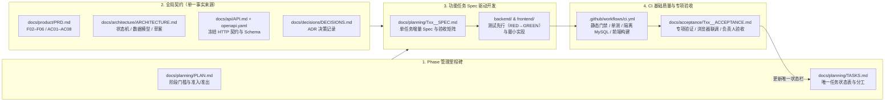
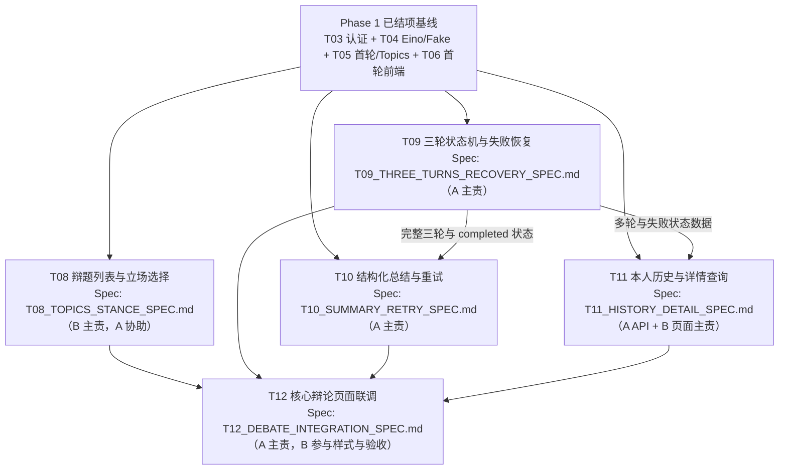

# 思弈阁 Phase 2 轻量 SDD 开发工作流（T08～T12）

本文定义 Phase 2（核心辩论功能闭环，`T08`～`T12`）的轻量级 Spec-Driven Development（SDD）工作方式。本工作流直接复用仓库既有文档与 GitHub Actions CI，不引入外部 Spec Kit、复杂工具链或平行的重复文档目录。

本轮仅建立工作流规范与 Phase 2 任务 Spec 拆解基线，**不启动 `T08`～`T12` 的实际功能代码开发**。各任务进入编码前仍须按 [AGENTS](../../AGENTS.md#操作授权边界) 与 [PLAN](PLAN.md#phase-2核心辩论功能闭环) 核对前置条件及本轮明确授权。

---

## 1. 核心原则与四层职责映射

Phase 2 采用 **「Phase 管理里程碑、功能任务驱动开发、Spec 明确需求、CI 负责基础质量」** 的四层结构，所有角色直接映射到现有文件：



| 维度 | 权威载体 | 职责边界 | 明确不做的事 |
| --- | --- | --- | --- |
| **Phase 管理里程碑** | [PLAN](PLAN.md)、[TASKS](TASKS.md) | `PLAN.md` 管理阶段级准入/准出与 `AC01–AC08` 汇总门槛；`TASKS.md` 作为各任务「当前状态」的**唯一主入口** | 不再每次子任务推进都在 `README.md`、`PLAN.md`、`ARCHITECTURE.md`、`API.md` 顶部叠加长篇「当前状态快照」横幅 |
| **全局契约层** | [PRD](../product/PRD.md)、[ARCHITECTURE](../architecture/ARCHITECTURE.md)、[API](../api/API.md)、[OpenAPI](../api/openapi.yaml)、[DECISIONS](../decisions/DECISIONS.md) | 维护跨任务共享的产品边界、数据库关系、轮次/总结状态机与已冻结的 HTTP 接口规范 | 不新建 `.specify/`、`specs/` 等平行契约目录，不在任务文档中大段复制粘贴全局契约原文 |
| **Spec 明确需求（功能任务驱动）** | `docs/planning/Txx_<SLUG>_SPEC.md` | 在具体任务（`T08`～`T12`）获准启动时，用**单文件轻量 Spec** 明确本任务的契约增量、状态转换、失败分支、子切片（Slice）与测试矩阵 | 不在任务尚未启动时预先批量编写长篇实现细节；不为简单样式微调拆分多份计划文件 |
| **CI 负责基础质量** | [.github/workflows/ci.yml](../../.github/workflows/ci.yml)、`docs/acceptance/Txx_<SLUG>_ACCEPTANCE.md` | GitHub CI 自动守住代码格式、禁止路径、密钥扫描、相对链接、前后端单测、构建及隔离 MySQL `8.4.13` 迁移与集成测试；验收记录聚焦业务 AC、并发/边界专项与人工验收 | 不在验收文档中重复粘贴 CI 已覆盖的常规静态检查与全量单测控制台长日志 |

---

## 2. 功能任务五步开发闭环（Task SDD Lifecycle）

Phase 2 的每个任务（`T08`～`T12`）均按以下五步推进：

### Step 1 · Spec 确认与契约对齐（Spec & Contract Align）

1. **核对基线**：确认所属阶段前置条件、[TASKS](TASKS.md) 上游依赖、当前 Git 分支/Worktree 状态与负责人本轮授权范围。
2. **编写/冻结任务 Spec**：在 `docs/planning/` 创建或更新对应任务的 `Txx_<SLUG>_SPEC.md`（命名见第 4 节）。
3. **API 与数据库增量先行**：
   - 若任务涉及 Phase 2 草案接口落地（如 `T09` 重试、`T10` 总结、`T11` 历史列表），先在任务 Spec 中明确请求/响应 DTO、HTTP 状态码与 `error.code`，实施时将其从 [ARCHITECTURE Phase 2 草案](../architecture/ARCHITECTURE.md#phase-2-api-草案) / [openapi.yaml `x-phase2-drafts`](../api/openapi.yaml) 晋升至 [API](../api/API.md) 正文与 `openapi.yaml` 的正式 `paths`（标记 `x-implementation-status: implemented`）。
   - 若任务涉及数据库变更（如 `T10` 新增 `debate_summaries`），先定义前向 SQL 迁移编号与精确枚举 CHECK 约束，绝不修改已执行的 `00001–00010` 迁移文件。
   - 若发现现有文档存在冲突或未裁定假设，先提出并更新 [DECISIONS](../decisions/DECISIONS.md)，不自行扩大 MVP 范围。

### Step 2 · 测试先行（Spec-to-Test / RED）

1. 按任务 Spec 中的「验收矩阵与失败路径」，在修改业务实现前先编写对应的自动化测试（Go 单元测试、隔离 MySQL 集成测试或 Vitest 前端测试）。
2. 运行新增测试并确认其因未实现目标功能而按预期失败（RED），杜绝只断言 Mock 返回值的空洞测试。
3. 必须覆盖：有效输入、边界输入（如 2000/2001 Unicode 码点、分页上下界）、所有权越权（非本人会话统一 `404 not_found`）以及状态/版本冲突（`409 round_conflict`、`409 attempt_version_conflict`）。

### Step 3 · 最小实现与子切片推进（Minimal Implementation / GREEN）

1. 严格遵循既有分层：
   - 后端：`HTTP Handler（协议与参数校验）→ Service（状态机、准入与事务边界）→ Repository（GORM 持久化）`，模型调用在短事务外通过 `ai.Generator` 完成。
   - 前端：`Vue 3 SFC（Composition API）+ 强类型 API Client（src/api/）+ 局部/实例化状态`，纯文本渲染，不存储敏感凭据。
2. **大任务分片（Slicing）**：复杂度为 `L` 的任务（如 `T09`、`T10`）在单份任务 Spec 下拆分为 2～3 个可独立验证的子切片（Slice），逐片完成 `RED → GREEN → 定向验证`，不在未验证前一次性堆砌全部改动。

### Step 4 · 本地定向验证与 GitHub CI 基础门禁（Local + CI Gate）

1. **本地快速反馈**：开发过程中优先运行受影响包或文件的定向测试；涉及并发、限额、状态争抢或租约扫描时，必须在本地显式执行 `go test -race`；修改 `openapi.yaml` 时运行 OpenAPI 规范校验。
2. **CI 统一基础门禁**：分支推送或发起 PR 后，由 [.github/workflows/ci.yml](../../.github/workflows/ci.yml) 在云端洁净环境自动执行 4 项基础门禁（详见第 5 节）。CI 未全绿前不进入人工验收。

### Step 5 · 专项验收与状态收敛（Focused Acceptance & Sign-off）

1. **专项验证**：按改动影响范围完成 CI 不覆盖的高风险专项验证（如真实浏览器跨组件交互、并发/超时故障注入），直接复用未受影响的既有证据，不做无关全量复跑或强制重复独立审查。
2. **轻量留证**：在 `docs/acceptance/Txx_<SLUG>_ACCEPTANCE.md` 简明记录本次交付文件范围、专项验证命令与结果、未执行项及遗留风险。常规静态与单测门禁直接引用本地汇总结论或 GitHub CI 运行结果。
3. **单一状态更新**：验证通过后，在 [TASKS](TASKS.md#phase-2核心辩论功能闭环) 将任务状态更新为 `待人工验收`（并在 [docs/README.md](../README.md#历史计划与验收证据) 补充一行验收链接）；待项目负责人最终确认后更新为 `已完成`。不跨文件散落更新状态快照。

---

## 3. 轻量任务 Spec 模板（Task Spec Template）

为避免文档膨胀，Phase 2 的每份 `docs/planning/Txx_<SLUG>_SPEC.md` 固定采用以下 6 小节结构（建议控制在 80～150 行以内，只写增量与可执行判定条件）：

```markdown
# Txx <任务名称> Spec

- **任务编号与负责人**：Txx / <A 或 B 主责说明>
- **关联需求与契约**：PRD <Fxx, ACxx> · ARCHITECTURE <[对应小节](../architecture/ARCHITECTURE.md)> · API <[对应小节](../api/API.md)>
- **前置依赖与授权边界**：<上游已完成任务>；<本轮授权允许与禁止的操作>

## 1. 目标与非目标（Scope & Non-Goals）
- **本任务交付**：<1～3 条可验证的核心交付物>
- **明确不做**：<排除相邻任务或后续阶段内容，防止范围蔓延>

## 2. 契约与数据增量（Contract & Schema Delta）
- **API 变更/晋升**：<方法、路径、请求/响应关键字段、成功状态码、新增或复用的 error.code；无变更写“复用既有接口，无契约变更”>
- **数据库/迁移增量**：<新增 SQL 迁移文件编号、表/索引/精确枚举 CHECK；无变更写“无”>

## 3. 状态流转与关键不变量（State & Invariants）
- <列出本任务必须满足的短事务锁顺序、attempt_version 校验、并发槽/每日额度消费规则或前端状态守卫>

## 4. 实施子切片与文件范围（Slices & Files）
- **Slice 1**：<目标> — 涉及文件：`<path>`
- **Slice 2**：<目标> — 涉及文件：`<path>`

## 5. Spec 验收矩阵（Verification Matrix）
| 场景编号 | 输入 / 前置状态 | 预期响应 / 状态变化 | 验证层级（Unit / MySQL / FE / Browser） |
| --- | --- | --- | --- |
| S01 | ... | ... | ... |

## 6. 交付检查清单（Definition of Done）
- [ ] Spec 验收矩阵全部用例先红后绿
- [ ] API/OpenAPI 同步更新并通过校验（如适用）
- [ ] 本地定向测试（含 `-race` / 隔离 MySQL / 前端 typecheck+test+build）通过
- [ ] GitHub CI 四项基础门禁通过（或本地同口径命令全绿）
- [ ] 专项验证证据与遗留问题简明写入 `docs/acceptance/Txx_<SLUG>_ACCEPTANCE.md`，任务状态置为 `待人工验收`
```

---

## 4. Phase 2（T08～T12）任务 Spec 拆解基线

基于当前仓库已完成 Phase 1（`T01`～`T07` 本地结项）的真实代码与契约状态，Phase 2 五个任务的 Spec 边界、文件名约定与推进关系固定如下：

### 4.1 任务推进与并行关系



### 4.2 各任务 Spec 核心边界一览

| 任务 | 预定 Spec 与验收文档路径 | 契约与数据库增量 | 推荐实施切片（Slices） | 关键 AC 与专项验证重点 |
| --- | --- | --- | --- | --- |
| **T08**<br/>辩题列表与立场选择 | `docs/planning/T08_TOPICS_STANCE_SPEC.md`<br/>`docs/acceptance/T08_TOPICS_STANCE_ACCEPTANCE.md` | **无后端契约/迁移新增**：完全复用 T05 已实现的 `GET /api/v1/topics` 与 `POST /api/v1/debates` | **Slice 1**：辩题卡片列表、加载/空/错误重试视图与正反方立场显式选择组件（B）<br/>**Slice 2**：创建会话防连点、成功后跳转/进入对应会话及真实后端联调（B+A） | `AC02`；至少 5 条真实预设题展示、正反切换明确、未选立场禁提交、401/503 错误提示受控 |
| **T09**<br/>三轮状态机与失败恢复 | `docs/planning/T09_THREE_TURNS_RECOVERY_SPEC.md`<br/>`docs/acceptance/T09_THREE_TURNS_RECOVERY_ACCEPTANCE.md` | **扩展已有接口**：`POST /api/v1/debates/{id}/turns` 开放 `round_no=2,3`，第 3 轮完成将 `debates.status` 置为 `completed`，第 4 轮拒绝（`409 round_conflict`）<br/>**晋升草案接口**：`POST /api/v1/debates/{id}/turns/{turn_id}/retry`（必填正整数 `expected_attempt_version`，新增 `409 attempt_version_conflict`）<br/>**无新增表**（复用 `debate_turns.attempt_version` 与 `lease_expires_at`） | **Slice 1**：第 2/3 轮连续推进、上下文拼装有序历史、第 3 轮完成转 `completed`、第 4 轮及存在未恢复失败轮时拒绝下一轮<br/>**Slice 2**：失败轮显式重试入口、`expected_attempt_version` 原子校验与版本递增、旧版本迟到写回拦截、同版本重复重试返回 `409 attempt_version_conflict`（不占模型槽/不扣每日额度）<br/>**Slice 3**：服务启动与每 30s 扫描回收超过 90s 租约的 `generating` 轮次（条件更新为 `failed`） | `AC03`、`AC04`、`AC05`；必须执行 `go test -race` 覆盖同轮并发、重试并发与迟到写回竞争；隔离 MySQL 验证崩溃残留租约回收 |
| **T10**<br/>结构化总结与重试 | `docs/planning/T10_SUMMARY_RETRY_SPEC.md`<br/>`docs/acceptance/T10_SUMMARY_RETRY_ACCEPTANCE.md` | **新增迁移**：`00011` 创建 `debate_summaries` 表及 `status`（`generating/completed/failed`）字节精确枚举 CHECK<br/>**晋升草案接口**：`POST /api/v1/debates/{id}/summary`（`retry` 默认 `false`；`retry=true` 必填 `expected_attempt_version`）、`GET /api/v1/debates/{id}/summary`；同步 `GET /api/v1/debates/{id}` 的 `summary_status` 返回真实状态与版本 | **Slice 1**：`00011` 迁移与迁移测试 + `internal/ai` 总结 Prompt 构建与 `schema_version=1` 严格校验（`strengths`/`issues`/`suggestions` 各 1–3 项、`round_no` 1–3、单字段 1–300 码点、总 JSON ≤ 16 KiB，用 6 条固定匿名消息先验）<br/>**Slice 2**：总结短事务认领、完成写回、显式重试版本控制、90s 租约回收复用、共享生成限额/并发槽及隔离 MySQL 集成测试 | `AC06`、`AC08`；未完成辩论（`<3` 轮）拒绝生成总结；非法 JSON/越界 `round_no`/空数组转为受控 `failed` 且不毁坏已完成辩论；`retry=false` 遇 `failed` 不重调模型 |
| **T11**<br/>本人历史与详情查询 | `docs/planning/T11_HISTORY_DETAIL_SPEC.md`<br/>`docs/acceptance/T11_HISTORY_DETAIL_ACCEPTANCE.md` | **晋升草案接口**：`GET /api/v1/debates?page=1&page_size=20`（`page_size` 最大 50，仅本人，按 `created_at DESC, id DESC` 返回 `items`、`total`、`page`、`page_size`）<br/>**复用详情接口**：`GET /api/v1/debates/{id}` 与 `GET /api/v1/debates/{id}/summary` | **Slice 1**：后端本人历史分页查询 API、参数边界（`page<1`、`page_size>50` 为 `400`）与两用户隔离测试（A）<br/>**Slice 2**：前端历史列表页（空状态、多页切换、进行中/已完成/失败状态展示）与点击打开会话详情重读、未完成会话继续入口（B） | `AC07`、`AC08`；用户甲列表绝不含用户乙数据，访问他人会话详情返回统一 `404`；刷新、重登后历史与详情一致可读 |
| **T12**<br/>核心辩论页面联调 | `docs/planning/T12_DEBATE_INTEGRATION_SPEC.md`<br/>`docs/acceptance/T12_DEBATE_INTEGRATION_ACCEPTANCE.md` | **无新增后端接口**：全面消费并校验 T08～T11 冻结的全部 Phase 1 + Phase 2 契约 | **Slice 1**：辩论页第 1～3 轮连续发言、等待锁、202/传输不明先查状态、失败轮原文保留与携带所见 `attempt_version` 的显式重试（遇 `409` 只刷新展示不自动换版本重发）<br/>**Slice 2**：第 3 轮完成后自动发起总结（及刷新 `completed` 且 `not_started` 会话时自动补发一次）、`SummaryPanel` 结构化三栏展示、总结失败独立重试及 `AC01–AC08` 浏览器全链路联调 | `AC01`～`AC08` 完整闭环；真实浏览器 + 隔离 MySQL + Fake 模型端到端验证通过 |

---

## 5. CI 基础质量门禁与本地验证分工

仓库已上线 [.github/workflows/ci.yml](../../.github/workflows/ci.yml)，在 `pull_request`、推送 `main`/`develop` 或手动触发时自动运行（默认强制 `AI_MODE=disabled`，零真实模型费用）。Phase 2 开发中，**CI 基础质量**与**开发者本地/专项验收**按以下边界协同：

| 检查类别 | GitHub CI 自动负责（`ci.yml`） | 本地开发与任务验收负责（按需执行并写入 Acceptance） |
| --- | --- | --- |
| **仓库与文档规范** | `repo-guard` Job 自动检查：禁止入库目录/后缀/真实 `.env`、残留冲突标记、私钥与 `sk-` 字面量、`git diff --check`、`gofmt -l backend`、全仓受跟踪 Markdown 本地相对链接完整性、`deploy/compose*.yaml` 静态配置 | 新增或移动文档后，可在本地运行一次链接与 `git diff --check` 预检；修改 `docs/api/openapi.yaml` 时在本地运行 `openapi-spec-validator` 核对 Schema 与示例 |
| **后端与迁移单测** | `backend-unit` Job 自动检查：`backend` 与 `backend/tools/migrate` 的 `go mod verify`、`go vet ./...`、`go test -p 1 -count=1 ./...`、`go build ./...` 及 Nginx 413 上游透传测试 | 开发中针对修改包运行快速单测；涉及并发状态机、限流器、租约扫描（如 `T09`、`T10`）时，本地必须加跑 `go test -race ./...` |
| **隔离 MySQL 集成** | `backend-mysql-integration` Job 自动拉起官方 `mysql:8.4.13` 容器，验证迁移 CLI 首次执行与重复执行幂等（`up` / `status`）、运行 `SIYIGE_MIGRATION_TEST=1` 迁移集成测试及 `SIYIGE_INTEGRATION=1` 后端集成测试 | 新增迁移（如 `T10` 的 `00011`）时，须同步更新 `ci.yml` 中的预期迁移版本计数断言（如 `applied=10` → `applied=11`），并在本地隔离 `mysql-test`（`127.0.0.1:13307`）先行验证 |
| **前端质量门禁** | `frontend` Job 自动执行：`npm ci`、`npm run typecheck`（`vue-tsc`）、`npm run test`（Vitest）、`npm run build` | 本地按组件/状态模块运行 Vitest 定向测试；涉及页面联调（`T08`、`T11`、`T12`）时，使用真实浏览器通过 Vite 代理连接本地后端与隔离 MySQL（`AI_MODE=fake`）留存交互证据 |
| **人工验收与阶段结项** | 不由 CI 代替 | 按 [AGENTS](../../AGENTS.md#测试与阶段验收) 与 [ADR-011](../decisions/DECISIONS.md#adr-011-简化验收流程与-t01-结项) 要求：不强制 A/B 互审、正式契约讲解登记或多轮重复独立审查，完成受影响范围专项验证后由项目负责人最终人工验收 |
