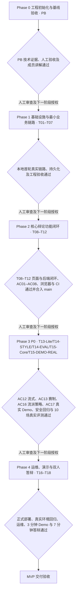

# 思弈阁 阶段工程计划

**2026-11-14 当前状态。** Phase 1 本地结项，Phase 2 经 PR #17 合入 main 结项（见 [最终验收记录](../acceptance/PHASE2_FINAL_ACCEPTANCE.md)）。A1 的 T13-Lite 本地技术回归通过，待负责人确认；[首批矩阵/样例与 Demo 方案](PHASE3_A_INTEGRATION_SPEC.md) 保留。A2 延续 `codex/p3-a-integration` 与草稿 PR #19，实现 [T14-STYLE 后端](../acceptance/T14_STYLE_BACKEND_ACCEPTANCE.md)，允许本轮 Commit/普通 Push。B 前端未修改，完整 AC16 待联调与负责人确认；SSE/P1/真实 Demo/10 场评测未执行。新会话 standard_4、quick_3 历史兼容、Batch 0–5 保留。Phase 3 未结项，不合 main、不调用真实模型或部署；[T07-COST-01](TASKS.md#t07-cost-01-供应商硬预算缺失) 未关闭。

## 历史阶段快照（2026-11-08）

本小节的进度、风险政策及授权仅记录当时状态。当前进度以 [TASKS](TASKS.md) 和各任务验收记录为准。

**T05 无收费范围正式结项（2026-11-08）：项目负责人确认三关人工验收全部通过，批准 T05 无收费实现范围结项并授权 Git Commit。** 四接口、累计无收费验证与新会话独立复审 PASS，T05-R01/R02/R03 三项 P2 均已独立确认关闭；已接受限制及后续任务见 [T05 验收](../acceptance/T05_FIRST_TURN_ACCEPTANCE.md)。本轮仅登记验收、核对提交范围，并从 `codex/docs-reorganization` 当前 HEAD 创建 `feat/t05-first-turn` 后提交；不修改已验收业务代码、不重跑完整测试或独立审查，无需 DSH。禁止收费调用、Push、Merge、Rebase、Reset、PR 或部署，不进入 T06。真实模型链路未验收，仍须另行授权；T07-COST-01 继续阻塞公网真实入口。单进程并发未来评估提升至 4–8，当前仍为 2。T03 已接受的 P2/P3 延期及 T04 已结项事实保留；下方旧授权与状态保留当时语境，以页首及最新验收记录为准。

**T03 实施与技术验证快照（2026 年 11 月 8 日）：用户另行授权完整认证实现，现已完成实施及 Codex 技术验证，待独立审查与人工验收。** 证据见 [T03 记录](../acceptance/T03_AUTH_ACCEPTANCE.md)。T04–T06 仍未开始，Phase 1 未完成；不自动提交、推送或部署。历史不启动 T03 的边界不覆盖本轮明确授权。

**T02 结项快照（2026 年 11 月 8 日）：T02 已通过最终独立技术审查及项目负责人人工验收，标记已完成。** M01/M02 按本次审查结论关闭；M03 及已接受的恢复/验证边界继续保留。验收依据见 [种子与持久化记录](../acceptance/T02_SEEDS_PERSISTENCE_ACCEPTANCE.md)。此前“进行中/待验收”等为各子任务当时状态，不覆盖本次结项。T03–T18 不因结项自动启动，Phase 1 尚未完成。

## 当前健康契约

健康路径已于 2026 年 11 月 8 日经负责人确认统一为 `/api/health/live`、`/api/health/ready`，见 [API](../api/API.md) 与 [ADR-012](../decisions/DECISIONS.md#adr-012-健康端点统一为当前-gin-路径)。下文 PB 历史交付中的旧路径仅为当时记录，不改变任务验收状态。

2026 年 11 月 2 日调整计划与任务组织，11 月 6 日同步 Phase 0 结项，11 月 7 日同步 T01 结项与验收流程简化。任务详情与依赖见 [TASKS](TASKS.md)，产品验收编号见 [PRD](../product/PRD.md)，技术契约见 [ARCHITECTURE](../architecture/ARCHITECTURE.md)。

## 整体目标与推进规则

交付可访问、可维护、可测试、可答辩的 AI 文字辩论训练 MVP，满足 PRD 全部 P0：注册登录、辩题与立场、赛制化辩论、持久化历史、结构化总结、失败恢复、自主流派选择与赛前策略卡、SSE 及公网运行保障，并完成 10 场真实模型质量评测。默认四轮，三轮仅历史兼容与隔离测试；SSE 自 ADR-021 起为 Phase 3 必做。P1 增强项缺席不阻塞 MVP 核心验收；P2 仅留需求池。

项目按阶段目标推进，不规定各阶段的自然日数、周次、完成日期或成员固定投入时长。课程、考试、ACM 训练与技术学习可以使项目暂停；恢复时从已有验收记录继续，不清零进度，也不要求追赶旧时间表。

TASKS 中 S/M/L 和人时仅是开发、学习、AI 输出理解审查与验证的粗略工作量估算，不是自然日或完成期限。实际投入和 A/B 分工可按情况调整并记录；超出估算不降低验收标准。采购等待、资源手续和重大返工另记，不能把 AI 生成速度作为工时保证。

阶段内部按依赖选择任务，不要求按编号串行。依赖满足后可分工并行；固定数据只用于按已确认契约准备页面和测试，不能代替真实模型、MySQL、浏览器或部署验收。同一成员的投入与共享文件冲突仍需协调。

自 T01 起，只有当前阶段的必要 P0 任务、必要的自动化测试及相关高风险专项验证通过并有证据，且经项目负责人最终验收，才能认定阶段完成。开发成员在实施中理解自己负责的模块，不再强制 A/B 互审、正式契约讲解登记或重复独立审查；决策见 [ADR-011](../decisions/DECISIONS.md#adr-011-简化验收流程与-t01-结项)。人工验收通过且下一阶段授权明确后才能继续；Agent 声称完成、文件存在或计划调整均不能自动改变任务状态。提交、推送、合并、发布、购买、部署及生产迁移/恢复仍须各自明确授权。

开发测试在本地或隔离 Docker 环境完成，部署测试在部署阶段集中完成。只有无法在本地可靠复现且确实依赖目标环境的特性，才提前申请 ECS 测试。申请须写明本地已验证范围、目标环境的独有条件、所需证据和操作范围，并取得负责人明确授权。直接复用仍适用的既有验证证据，按受影响范围运行必要检查，不做无意义复验或强制多轮复审。

## 当前阶段与证据

Phase 0 已结项。T01–T06 按各自范围完成，T03 延期与 T05 无收费范围保留；2026-11-10 负责人批准 T07 和 Phase 1 本地结项。本轮将 Phase 2 早先仅后端核心闭环的范围补充为 T08–T12 页面与后端整合，实际证据、CI 和正式合并门槛见 [最终记录](../acceptance/PHASE2_FINAL_ACCEPTANCE.md)。正式部署及生产费用准入归 Phase 4。

### 历史阶段快照（PB 至 T02）

以下段落保留各轮的进度、技术证据和授权范围。文中的「本轮」「当前」「待验收」「尚未实施」均指对应记录形成时。

**Phase 0（工程初始化与基线验收）已结项，PB 已完成。** [INIT_ACCEPTANCE](../acceptance/INIT_ACCEPTANCE.md) 记录了前后端检查、真实 HTTP/Vite 代理、浏览器停止后端失败与恢复重试、独立代码审查等技术证据。

用户已确认 PB 人工验收、A 讲解及 B 互审完成，历史结论见 [验收登记](../acceptance/INIT_ACCEPTANCE.md#人工验收与成员讲解互审登记)。现有骨架成果计入 PB。**T01 已于 2026 年 11 月 7 日经项目负责人验收结项，仅完成 Phase 1 首批 8 个 API 契约设计，不代表业务代码已实现。** T02 进行中，仅首个隔离 MySQL 环境子任务获准实施，技术验证后待人工验收，见 [环境记录](../acceptance/T02_MYSQL_ENV_ACCEPTANCE.md)。其余 T02 和 T03–T18 尚未实施；批次 2 的其他工作仍须明确授权，完整 T02 和 Phase 1 均未完成。

旧版“Phase 0 规划审查”是 PB 之前的历史活动，不是新版 Phase 0 的通过记录；旧 W1–W4 分别映射为 Phase 1–4，仅用于理解历史材料，不再作为工期。历史验收记录保持原样，决策替代关系见 [DECISIONS](../decisions/DECISIONS.md#adr-010-按阶段目标推进)。

本轮后续授权增量：用户要求从 T02 最靠前的未完成工作实施一个可独立验证的闭环。后端连接、readiness 与测试目标保护已进入实施，技术证据见 [后端接入记录](../acceptance/T02_DATABASE_CONNECTION_ACCEPTANCE.md)，当前子任务待人工验收。上段“仅环境子任务”保留为历史授权记录；完整 T02 仍未完成，迁移/种子为下一闭环，不进入 T03–T18。

2026 年 11 月 8 日新增授权与进展：仅实施版本化初始迁移、重复执行保护及失败处置，六张 Phase 1 表已在隔离测试库完成技术验证，见 [迁移记录](../acceptance/T02_MIGRATIONS_ACCEPTANCE.md)。此闭环已获有条件独立审查，负责人接受验证边界及两个 P2/一个 P3 延期，并授权本轮提交/推送；学习讲解尚未登记。延期项见 [任务登记](TASKS.md#t02-迁移延期问题登记)，枚举 CHECK 必须在业务状态写入前通过新增迁移解决。不包括 5 条种子、不进入其他 T02 子任务或 T03，不创建 PR、合并或部署。上段“迁移/种子为下一闭环”是历史状态，种子及其重启持久化验证现单列为后续工作；完整 T02 和 Phase 1 保持未完成。

2026 年 11 月 8 日种子与重启闭环：用户另行授权新增精确枚举 CHECK、五条种子、历史保护测试与测试 MySQL 服务重启验证，技术验证通过，见 [记录](../acceptance/T02_SEEDS_PERSISTENCE_ACCEPTANCE.md)。原六份 SQL 保持不变，服务不自动迁移/播种；只在隔离测试库验证。T02-M01/M02 待独立复验，M03 仍延期；本闭环等待独立审查、辩题人工审阅、最终验收及学习讲解，完整 T02/Phase 1 不标完成，不进入 T03。本轮禁止 commit/push/merge，之前的提交授权仅属于历史闭环。

## 阶段推进关系

SSE 自 2026-11-14 起为 Phase 3 的 P0 必做，不再作为可取消的旁支；图中不再保留「有余量才选做」的可选分支。

图中只表达阶段门槛，任务级依赖以 TASKS 为准。门槛未满足时留在当前阶段处理阻塞或其他满足依赖的任务；SSE 属于必要推进路径，P1 增强项不作为核心门槛。

## Phase 0：工程初始化与基线验收

- **目标与任务**：PB；建立 Go/Gin 和 Vue/TypeScript/Vite/Arco 最小骨架、`GET /health/live`、本地代理、基础测试、README/API 与验收记录。
- **前置条件**：初始化范围、健康契约和规划资料明确，用户已授权受限 PB。
- **可并行工作**：健康契约确定后，后端存活接口与前端联通页可分工；README 和检查用例随实现准备，真实代理验证待两端可运行后进行。
- **交付成果**：可本地启动的前后端、锁定依赖、测试及类型检查、运行说明和 INIT_ACCEPTANCE。不接入数据库、认证、Eino、真实模型、辩论业务或生产部署配置。
- **验收标准**：后端 test/vet/build、前端 typecheck/test/build 实际通过；直连与代理 JSON 正确；真实浏览器验证停止后端失败、恢复后手动重试成功。A 能讲解请求链路，B 至少一次相关审查，用户核对证据并人工验收。
- **进入下一阶段**：PB 独立人工验收及成员讲解互审通过并登记，Phase 0 必要事项全部通过，Phase 1 对应任务实施授权明确。

## Phase 1：基础设施与最小业务链路

- **目标与任务**：T01–T07。完成 API 契约、MySQL/GORM 基础设施、认证、Eino 适配、首轮持久化、前后端联调及部署准备与本地隔离验证。
- **前置条件**：Phase 0 通过人工验收，后续实施授权明确。T01 确认资源、接口、版本与费用边界，资源操作具备相应授权。
- **可并行工作**：T01 通过后，T02、T04 和 T06 页面准备可分工推进。T03 依赖 T02，T05 依赖 T02/T03/T04，T06 联调依赖 T03/T05。T07 可提前准备配置与检查清单，联调和验证按任务依赖推进。
- **交付成果**：业务 API 示例、版本化迁移与至少 5 条种子、隔离集成库、认证和费用保护、本地真实首轮链路、本人详情查询、最小前端及 Compose/Nginx 部署准备。
- **本地工程验收**：在本机或隔离 Docker 验证认证与会话隔离、Go 上游 413 透传、Fake 失败与超时、认证和生成限流、并发以及费用保护机制。完成回归及必要的独立复审后，在本地隔离环境经浏览器完成注册登录、创建预设题会话、发送第一轮并经 Gin/Eino 获得真实 AI 回复。记录写入隔离 MySQL，刷新、退出重登及应用和数据库分别重启后仍可读取，并保留模型失败证据。真实调用前须单独取得费用和调用授权，明确次数、预算和停止条件。
- **进入下一阶段**：T01–T07 在本阶段范围内的全部必要 P0、本地工程验收及阶段审查通过，经负责人最终验收并获下一阶段授权。正式 ECS 部署、公网 HTTPS 与生产环境回退在 Phase 4 验收。

## Phase 2：核心辩论功能闭环

- **工作流规范**：采用「Phase 管理里程碑、功能任务驱动开发、Spec 明确需求、CI 负责基础质量」的轻量 SDD 模式，实施规则、任务 Spec 模板及 T08–T12 拆解基线见 [Phase 2 轻量 SDD 工作流](PHASE2_SDD_WORKFLOW.md) 与 [ADR-020](../decisions/DECISIONS.md#adr-020-phase-2-采用基于现有文档与-ci-的轻量-sdd-工作流)。
- **目标与任务**：T08–T12；完成辩题与立场选择、轮次状态机、失败重试与恢复、结构化总结、本人历史分页和详情、完整前后端联调。
- **前置条件**：Phase 1 审查通过并获准继续，认证、持久化、真实模型和 API 契约可用。
- **可并行工作**：T08 页面/API 与 T09 轮次逻辑可分工；T10 依赖 T04，可用固定匿名消息先验 schema，完整联调依赖 T09；T11 页面可按 T01 契约准备，联调依赖 T09。T12 在 T08/T09/T10/T11 通过后整合验收。
- **交付成果**：至少 5 个题与双方立场、完整轮次与重试接口、租约恢复、总结存储和固定结构展示、历史与详情页面及联调记录。
- **验收标准**：用户能完成一场完整辩论，正式消息数与赛制一致（`standard_4` 为 8 条、`quick_3` 为 6 条），越界轮次被拒；完整 AI 回复落库才计轮。失败保留原文、不计轮，重复与并发不多写，迟到结果不覆盖新尝试；轮次和总结重试绑定 `expected_attempt_version`，旧版本冲突不重调模型。总结三类数组合法、失败可单独重试，历史刷新重登可重读，两用户数据隔离。AC01–AC08 的正常与核心失败场景留证。
- **2026-11-14 最终整合**：在既有后端闭环上补齐 T08 辩题页、T11 本人历史分页页与详情交接；保留 Batch 0–5 赛制迁移、轮数驱动及契约成果。累计无收费检查、页面浏览器测试和真实隔离 MySQL + Fake 联调见 [最终验收记录](../acceptance/PHASE2_FINAL_ACCEPTANCE.md)。先前「仅后端核心闭环」是同日早先状态，由本轮完整整合范围补充。
- **正式结项（随 PR #17 合入 main 生效）**：T08–T12 必要交付、累计回归与本轮专项已通过，分支 Actions 四项成功；[PR #17](https://github.com/bingqilin456/DebateForge/pull/17) 当前提交全部 Actions 成功并合入 `main` 后，按负责人本轮授权正式结项。不虚构额外人工演示或验收活动。
- **进入下一阶段**：Phase 2 正式结项后仍须取得下一阶段授权。本轮止于合并与结项，不启动 Phase 3。

## Phase 3：赛制流式与破局亮点

- **目标与任务**：P0 为 T13-Lite 安全故障回归、T14-STYLE 自主流派选择与策略卡、T14-EVAL 10 场真实模型质量评测、T15-Core SSE 与断线回退、T15-DEMO-REAL 真实模型可体验 Demo。P1 为 T14-REPORT 四维战报、T15-B-FALLACY 谬误透视、T15-B-DEMO 双 AI 演示，分别验收且不阻塞 MVP 核心；F14 演化树为 P2，仅留需求池。任务组定级见 [ADR-023](../decisions/DECISIONS.md#adr-023-phase-3-优先级流派选择与查询恢复契约)，真实 Demo 阶段边界见 [ADR-024](../decisions/DECISIONS.md#adr-024-phase-3-交付真实模型可体验-demo)。
- **前置条件**：Phase 2（含 T08/T11 页面）正式结项并获下一阶段授权；赛制驱动已落地（`debates.mode` 为唯一事实来源）；流式端点契约已在 [API](../api/API.md) 与 [ARCHITECTURE](../architecture/ARCHITECTURE.md#eino-流式双轨管道) 定稿；Nginx 流式片段已具备。
- **可并行工作**：A 可先独立完成 T13-Lite；T15-Core 实施须其通过，T14 子任务可独立准备。流派/策略卡与四维战报不依赖 SSE，可与其并行；A 后端 Stream 与 B 增量解析按四事件及 HTTP JSON 分支契约并行。SSE 以 turn_id/request_id 定位，最新 attempt_version 从详情/状态查询获取。T14-EVAL 可先准备样本，待受测功能就绪且费用/调用另获授权后执行；P1 谬误须先定存储与迁移（00013 已用于策略表，下一候选 00014，实施前核号），双 AI 演示依赖 SSE 展示。共享后端核心与迁移编号由 A 统一协调。
- **交付成果**：必要交付为安全回归记录、自主流派选择与策略卡、10 场真实质量评测结论、流式对辩及恢复证据，以及用户能按说明启动、亲自输入并使用真实模型的本地浏览器 Demo（含启动、配置、体验、停止及限制说明）。Demo 覆盖登录、选题/立场/流派、策略卡、真实四轮 SSE、真实总结与历史重读；P1 战报/谬误/双 AI 演示按实际交付登记。
- **验收标准**：AC04/AC05/AC08/AC10 安全部分、AC12 流式全项、AC13 赛制环节、AC16 自主流派/策略与 AC17 真实 Demo 通过，10 场真实模型完整评测有人工结论。至少一场由用户在浏览器自主输入完成真实 standard_4 四轮及总结，刷新/重登后可读，记录实际版本、模型、授权与脱敏用量证据；仅 Fake、录屏或脚本不能替代。SSE 包含代理中文拆块、查询版本、显式重试、提交后 done，无双写。P1 仅验实际交付范围。
- **真实体验边界**：Demo 运行于本地回环地址与明确指定的本地隔离 MySQL，浏览器通过 Go/Eino 调用真实供应商，密钥仅在服务端。先以 Fake 验证费用、次数/Token 限制、窗口停止和故障，再按单独明确的模型、参与人、体验窗口、次数/Token/费用上限启用真实体验；窗口结束或额度触顶停止新调用，不自动重试、补调或以 Fake 冒充真实回复。合格体验场次可纳入 10 场评测，额外自由体验须纳入授权预算，不重复计算调用。公网部署、域名/HTTPS 与生产运维仍归 Phase 4。
- **进入下一阶段**：T13-Lite、T14-STYLE、T14-EVAL、T15-Core、T15-DEMO-REAL 五项必要 P0 与阶段审查通过，下一阶段授权明确；P1 未交付不阻塞。真实评测或真实 Demo 未授权/未验收则保持待办，不能仅以 Fake 或 5 场降档结项。本次仅修改文档，不启动开发、真实调用或部署。

## Phase 4：运维、演示与双人答辩

- **目标与任务**：T16–T18。完成正式 ECS 部署、公网 HTTPS、生产环境应用回退、备份恢复、告警和证书续期、真实环境全链路回归，以及 3 分钟现场演示剧本与 7 分钟双人答辩材料。
- **前置条件**：Phase 3 必要 P0 与人工审查通过。T07 部署准备和本地工程验收、T13 稳定基线及实际资源与操作授权具备。迁移、备份和恢复先在隔离环境验证，禁止在生产做恢复试验。真实模型公网试运行须先通过 T07-COST-01 生产准入并单独授权。
- **可并行工作**：T16 运维演练期间可准备 T17 回归场景和 T18 文档、演示材料；T17 正式部署前核对 T13-Lite、T14-STYLE、T14-EVAL、T15-Core、T15-DEMO-REAL 与 T16 运维就绪证据，P1 缺席不作部署依赖；目标部署后按授权补齐 T16 现场证据，再完成 T17 最终回归。T18 复用 Phase 3 已交付的可体验产品 Demo 准备正式演示材料，彩排可用 Fake，最终录制在 T17 通过后进行。交付验收时冻结新增功能，优先修复 P0、数据及安全缺陷，不按日期设冻结期。
- **交付成果**：正式 ECS 部署及公网 HTTPS 验收、生产环境应用回退证据、异机加密备份、独立库恢复与实测 RPO/RTO、告警到达与续期检查、发布回退说明、真实部署回归和负载测量记录、使用/部署/故障文档、3 分钟 Demo 导演卡、7 分钟双人答辩材料及模块与失败路径说明。
- **验收标准**：AC01–AC13、AC16–AC17 累计通过，10 场真实模型质量评测结论可追溯；AC17 本地证据不替代 AC09 公网及目标环境回归。备份在独立库恢复后历史可读，应用/DB/备份故障告警可达；10 在线/2 模型并发假设下无轮次错乱，非模型 API p95 注明环境和实测结果。交付说明覆盖模块职责、关键链路和失败路径，开发成员理解负责模块；交付 P1 战报时满足 AC14、谬误时满足 AC15，双 AI 留无正式表写入证据。
- **首次公网开放门槛**：在目标环境复验 T03 的 Argon2id、Session/CSRF、凭据边界和认证限流，T04 的服务端密钥及超时，T05 的输入、生成次数与并发限制及用户隔离。确认有效 HTTPS、内部 DB 网络、数据卷及日志，经 Nginx 验证健康 JSON、DB 不可达时 ready=503、Go 停止时非 2xx 或连接失败，排除 SPA 假 200。先做隔离 Fake 验证，生产费用准入按 [T07-COST-01](TASKS.md#t07-cost-01-供应商硬预算缺失) 与 [ADR-022](../decisions/DECISIONS.md#adr-022-费用治理充值硬顶兜底与最小化控制子集) 独立验收。真实模型公网试运行与公网开放分别取得明确授权。
- **交付完成条件**：T16–T18 全部 P0、累计回归、相关高风险专项验证与项目负责人最终验收通过，遗留问题和限制如实记录。不自动发布、提交、推送、部署或开始额外功能。

## 暂停、恢复与阻塞处理

允许暂停项目或暂时搁置技术阻塞任务。记录任务状态、已通过的交付、证据位置、阻塞和恢复条件即可，不要求连续开发或固定日报。可在依赖满足且授权范围内先完成独立小任务，调整负责人时同步接口责任与交接，不跳过阻塞依赖。

每次恢复只需核对：

1. 当前阶段及尚未通过的验收门槛。
2. 已完成且有人工验收证据的任务和可复用成果。
3. 正在进行或待人工验收的任务及工作区改动。
4. 未解决的技术、资源、授权阻塞及恢复条件。
5. 下一项满足依赖且已获授权的任务；若无则处理阻塞，不强制赶进度。

暂停不等于验收失败或重置任务；恢复前核实环境、依赖版本及凭据，必要时重验受影响链路，不能把过期证据当作当前运行保证。

## 风险与缩减原则

| 风险信号 | 响应 |
| --- | --- |
| 真实模型凭据、授权或费用控制未就绪 | 使用 Fake 验证可覆盖的链路，保留真实模型验证待办。公网真实模型试运行按 T07-COST-01 单独验收与授权 |
| 服务器、域名或部署授权未就绪 | 继续满足依赖的本地工作，登记 Phase 4 正式部署阻塞。保留有效 HTTPS 验收要求及明文登录禁令 |
| 课程、考试或比赛影响投入 | 暂停或调整 A/B 分工与交接，保留 B 对辩题和历史页的独立开发和模块理解；A 可接管复杂聊天集成，不把 B 缩减为只做演示材料 |
| 闭环工作量超出估算 | 优先减少装饰和非必要演示；SSE 已为 Phase 3 P0，不可取消。预设题仍至少 5 个，不取消注册、隔离、持久化、赛制轮次、总结、恢复或 HTTPS |
| 必要 P0 持续阻塞 | 报告剩余工作、原因和影响，请用户决定资源或目标调整；保持未完成，不自行降级 P0 或缩减验收 |
| 模型回复不稳或费用过高 | 限制篇幅、调用次数与并发，按人工评估修订 Prompt；供应商切换先验证兼容性并更新 ADR，不引入 RAG/复杂 Agent 补救 |

## 验证与阶段报告

后续编码按任务运行后端 `go test ./...`、`go vet ./...`，涉及并发时运行相关 `go test -race`；MySQL 集成测试必须显式隔离。前端运行约定的类型检查、测试、生产构建及关键浏览器交互。E2E 覆盖核心流程、跨用户拒绝和失败恢复；真实模型只做少量受控冒烟，不能作为每次单测的前提。运维保留真实环境与恢复证据。

原阶段计划修订仅做文档一致性、编号、依赖、优先级、链接及改动范围检查，不执行或宣称业务测试、部署验证通过。PB 的历史技术记录不能替代后续业务验收。

每阶段报告包含任务与文件范围、实际验证的命令/环境/结果及证据、未执行检查和原因、遗留问题/影响/负责人、相关高风险专项验证结论及下一阶段资源与授权条件。阶段报告完成后等待项目负责人最终验收；证据完整并经负责人确认才更新“已完成”。
