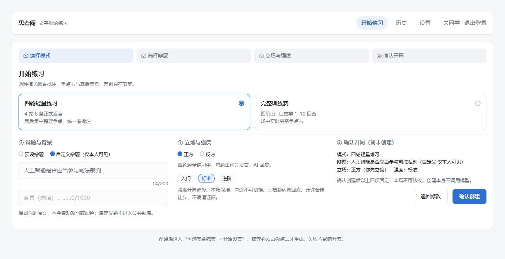
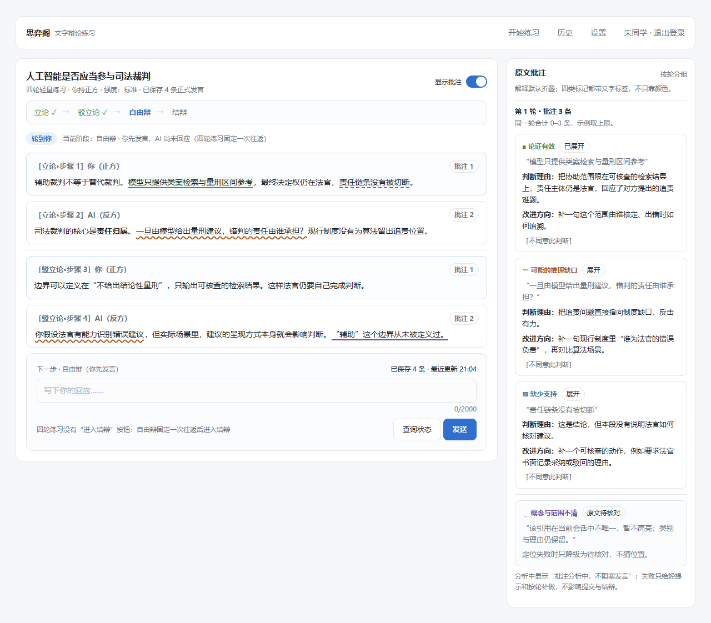
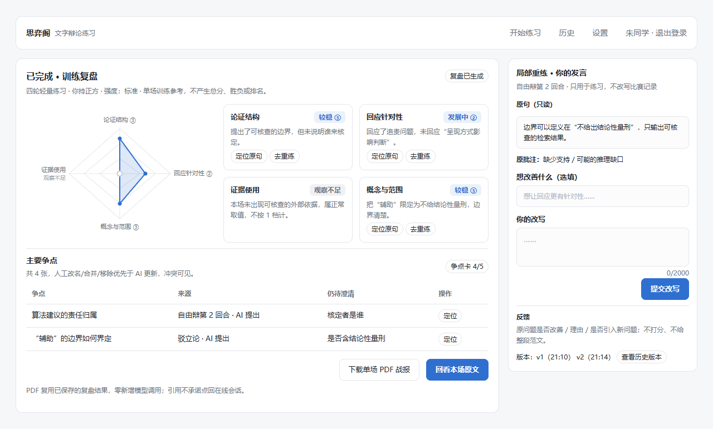
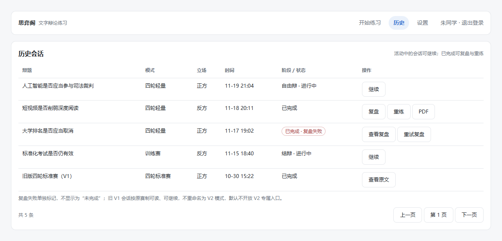
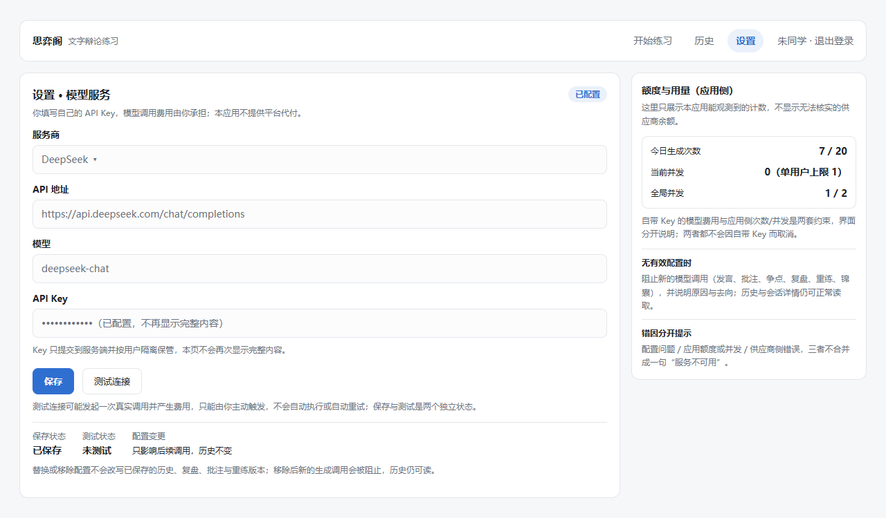

# 思弈阁 V2 页面设计与交互细化

日期：2026-11-19（本轮按页面重构为模块化）。状态：**页面与交互细化草案，随 V2 需求补充增量维护；整体未实现、未验收、未获开发阶段授权。**

## 0. 文档定位、效力与标记

- **本文只做页面与交互细化，不是产品事实源。** 产品行为、边界与验收标准（AC）仍以 [PRD V2](PRD.md) 为唯一事实源；两者冲突时以 PRD 为准并修正本文，不以本文改写 PRD 结论。
- 本文不引入新功能、不批准开发、不构成 HTTP 契约或视觉契约；不锁定具体色值、字体、组件库实现与高保真稿。色值与对比度按 [PRD §5.3](PRD.md#53-标记形式颜色--线型--文字标签q41) 留待设计验证。
- 按页面拆成模块写作：本文是入口与索引，页面线框、字段、状态与恢复写在各模块文件里。模块目录与写作约定见 [ui/README.md](ui/README.md)。
- 五类标记，逐条随文标注：

| 标记 | 含义 | 谁能改变 |
| --- | --- | --- |
| `[已确认]` | 来自 [PRD V2](PRD.md) 已确认行为（Q1–Q52），或负责人明确答复的事项（如自带 Key） | 只能由负责人新决策改变 |
| `[已实现]` | 已有代码切片交付并签收，注明切片与日期；行为仍以 PRD 为准 | 负责人或后续变更 |
| `[补充草案]` | 基于已确认方向新增的界面与规格草案（含 SUP-01～08 与 AC-V2-32～38 的界面部分）；**待负责人审阅，不是已签收** | 负责人审阅后改为 `[已确认]` |
| `[设计建议]` | 为实现已确认行为提出的界面做法，**未经负责人确认**（含本文全部线框与演示图） | 负责人或后续设计评审可改 |
| `[待决]` | 产品取舍或技术方案未定，界面不得先按某一方案写死 | 负责人确认或技术评估结论 |

- 本文不把 `[设计建议]` 或 `[补充草案]` 写成用户批准，也不把 `[待决]` 写成已定；`[待决]` 项一律给恢复动作或空态说明，不给结论。
- **归因纪律**：用户明确答复的范围是「用户自带 Key、费用用户承担、本轮只补文档」及其直接否定的「不做平台兜底代付、不把维护者公用密钥配置页作为本版必需页」。设置页字段组合、测试连接提示、密钥不回显等属于据此方向提出的补充草案，未经逐条确认；Q52 与原 31 条 AC-V2 的既有确认状态不因本文改变。
- 版本命名：本文的“V2”均指**产品 V2**；`phase3-summary-v2`（0–100 四维，T14-REPORT，未开始）与 `v2-training-reference`（1–4 档）是另外两件事，见 [ADR-027](../decisions/DECISIONS.md#adr-027-v2-需求基线与版本边界)。

## 1. 演示图

六张演示图按本轮的页面构图绘制，源文件可重新渲染：

| 演示图 | 页面 | 说明 |
| --- | --- | --- |
|  | 开始练习 | 四步同页：模式、辩题、立场与强度、确认开局 |
|  | 辩论工作台（桌面） | 左发言流右批注栏，阶段轨、四类标记、开关 |
|  | 完赛复盘 | 雷达＋四维卡＋争点卡；右侧局部重练 |
|  | 历史 | 列表、状态标记、继续/复盘/重练入口 |
|  | 设置 | 自带 Key 四项字段、保存与测试分离、额度边界 |
|  | 辩论工作台（窄屏） | 批注面板独立堆在含发言与输入区的主卡片下方 |

- **这六张图是线框示意，不是视觉稿、不是已确认设计、不代表已实现。** 布局取自本轮答复与既有 PRD 行为，具体到间距、配色、控件形态均为 `[设计建议]`。
- 图由静态 HTML 用本机 Edge 无头模式渲染，**只验证了渲染结果与布局，没有做产品代码的浏览器验证**。渲染方式见 [ui/mockup/README.md](ui/mockup/README.md)。

## 2. 页面与面板清单

| 编号 | 页面/面板 | 入口 | 主要任务 | 返回/去向 | PRD 章节 | AC-V2 | 实现状态 |
| --- | --- | --- | --- | --- | --- | --- | --- |
| P1 | 登录与恢复 | 直接访问、刷新、登录失效 | 登录/注册、恢复状态 | 登录后回到原地址或入口 | §10.1、§11.1 | AC-V2-23、30 | V1 机制已存在 |
| P2 | 开始练习·模式选择 | 登录后默认页、导航“开始练习” | 轻量／训练赛二选一 | 下一步：定题 | §2.3 | AC-V2-02 | 目标态 |
| P3 | 开始练习·辩题与背景 | P2、预设题列表 | 选预设或填私有自定义题 | 上一步：模式 | §4、§12 | AC-V2-11、12 | 预设＋自定义已实现（V2-03） |
| P4 | 开始练习·立场与强度 | P3 下一步 | 选正/反方、三档强度 | 上一步：定题 | §3.5 | AC-V2-10 | 立场已实现；强度目标态 |
| P4b | 创建前确认摘要 | P4“下一步” | 只读核对四项＋“确认创建”（只创建、不调模型） | “返回修改”回 P4 | §2.1、§4.3 | AC-V2-02、12 | 目标态 |
| P5 | 创建后：可选锦囊＋开始发言 | P4b 创建成功 | 按需主动取锦囊；开始发言 | “返回入口另开一场”（本场保留） | §7 | AC-V2-27、03 | 目标态 |
| P6 | 辩论工作台 | 创建成功、历史“继续” | 阶段推进、发言、批注、争点卡 | 完赛→复盘；退出→说明 | §3、§5、§6、§10.1 | AC-V2-03～09、13～20、23、25 | 四轮基础练习已交付；训练赛目标态 |
| P6a | 阶段轨与状态条 | 工作台顶部 | 显示阶段、回合、发言方 | — | §3.1～3.4 | AC-V2-03、05、31 | 训练赛目标态 |
| P6b | 发言输入与提交 | 工作台底部 | 输入、字数、提交、失败重试 | — | §3.6、§12 | AC-V2-09、11 | 已实现（四轮） |
| P6c | 批注侧栏／底部面板 | 点原文标记、右栏 | 看解释、异议、去重练入口 | 关闭回发言流 | §5 | AC-V2-13～17、20 | 已实现（V2-04，四轮；异议未做） |
| P6d | 争点卡面板 | 右栏、卡片入口 | 查看、改名、合并、移除、定位 | 回发言流原句 | §6 | AC-V2-18～20 | 目标态 |
| P6e | 场中显示开关 | 主卡片设置区 | 隐藏/恢复标记与批注面板 | — | §5.4 | AC-V2-14 | 已实现（V2-04） |
| P7 | 完赛复盘 | 结辩完成、历史“复盘” | 看复盘、四维、重练、PDF | 回工作台（只读）／历史 | §8、§9 | AC-V2-21、22、24、29 | 目标态 |
| P7a | 复盘失败态 | P7 载入且复盘失败 | 看失败原因、手动重试 | 仍可看原文/批注/争点 | §8.6 | AC-V2-24 | 目标态 |
| P7b | 四维与雷达 | P7 主体 | 看四维档级、原文依据 | 跳批注/重练 | §8.2～8.5 | AC-V2-21、22 | 目标态 |
| P7c | 局部重练面板 | P7 重练入口、选中本人原文 | 改写、对照反馈、多版本 | 回 P7 | §5.7 | AC-V2-17、26 | 目标态 |
| P8 | PDF 下载 | P7“下载战报” | 下载单场 PDF | 停留 P7 | §9 | AC-V2-29 | 目标态 |
| P9 | 历史 | 导航“历史” | 列表、继续、复盘、重练 | 工作台／复盘 | §10.5 | AC-V2-23 | 已实现（列表与继续）；新增列目标态 |
| P10 | 设置·模型服务 | 导航“设置” | 配置服务商/地址/模型/Key | 回上一视图 | §19 | AC-V2-32～38（草案） | 目标态 |
| P11 | 设置·额度状态 | 设置页 | 查看应用侧次数/并发 | 回设置 | §19；[待决](ui/06-settings.md#7-待决与不做) | AC-V2-37（草案） | 目标态 |

- P10/P11 为本轮补充新增，PRD 既有 AC 不覆盖它们，编号从 AC-V2-32 起顺延（见 [PRD §19](PRD.md#19-v2-需求补充用户自带模型服务2026-11-17草案待确认)）。
- 未获确认的界面（草稿自动保存、成长曲线、排行榜、争点卡自动“已驳倒”、替 AI 改写）**不设入口**，也不以“顺手加”的方式出现。

## 3. 模块导航

| 模块 | 内容 |
| --- | --- |
| [00 全局信息架构](ui/01-global.md) | 视图与路由、跨页数据与事实源、断点与桌面/移动组织 |
| [01 开始练习](ui/02-entry.md) | 模式、辩题、立场与强度、确认创建、赛前锦囊 |
| [02 辩论工作台](ui/03-workspace.md) | 阶段轨、发言流、自由辩结束、失败与放弃、批注、异议、争点卡、开关、窄屏 |
| [03 完赛复盘](ui/04-review.md) | 复盘与失败、四维雷达、局部重练、PDF 战报 |
| [04 历史](ui/05-history.md) | 列表、状态标记、继续/复盘/重练、V1 旧会话 |
| [05 设置](ui/06-settings.md) | 自带 Key 字段、保存与测试、脱敏、无配置阻止、额度边界 |
| [06 登录、失败态与退出](ui/07-common-states.md) | 登录与恢复、401/404/429 共通态、离开与未提交内容 |
| [07 追踪与未决](ui/08-traceability.md) | 需求追踪矩阵、未决项、未执行项、维护方式 |

## 4. 与当前实现的关系（现状基线）

截至本轮，应用已有注册登录、预设与自定义辩题、四轮对话、赛前策略、三数组总结与历史分页；**四轮基础练习的原文批注（V2-04）已实现并签收**，其余 V2 页面为目标态。训练赛阶段模型、争点卡、异议、复盘四维、PDF 与设置页均**未实现**。

现状核对的证据与范围见 [V2 页面设计补充验收记录](../acceptance/PRD_V2_UI_SUPPLEMENT_ACCEPTANCE.md#3-现状核对)；V2-04 的证据见 [批注自测记录](../planning/V2_04_ANNOTATION_SELF_TEST.md#18-负责人签收2026-11-19)。本文不重复审查代码。

后续设计与整合顺序见 [V2 并行设计](../planning/v2-parallel/README.md)。

## 5. 维护方式

- PRD 行为变化时先改 PRD，再改对应模块；本文不得反向覆盖 PRD。
- 新增 `[设计建议]` 时保留标记；负责人确认后改为 `[已确认]` 并注明来源，同时检查是否需要在 PRD 补 AC。
- 模块之间只通过相对链接引用，不复制对方的结论；同一事实只在 PRD 定义一次。
- 演示图更新后同步替换 `ui/mockup/shots/` 下同名文件，并在模块里核对文字线框仍一致。
