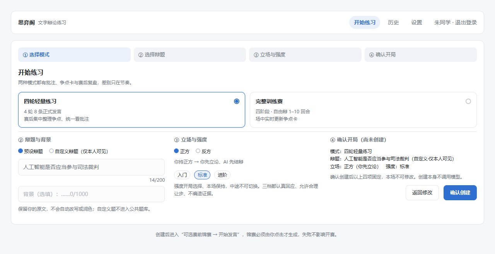

# 开始练习（P2–P5）

所属页面：P2 模式选择、P3 辩题与背景、P4 立场与强度、P4b 创建前确认、P5 创建后可选锦囊；对应 [PRD](../PRD.md#2-训练模式与入口) §2、§3.5、§4、§7、§12。实现状态：V2-03 私有自定义辩题已实现并签收（2026-11-18）；模式选择、强度、确认、锦囊仍为目标态。

## 1. 适用规格

| PRD 章节 | AC-V2 编号 | 实现状态 |
| --- | --- | --- |
| [§2 训练模式与入口](../PRD.md#2-训练模式与入口)、[§2.3 模式入口](../PRD.md#23-模式入口q36) | AC-V2-02 | `[已确认]` 二选一、首次默认轻量、训练赛无解锁；目标态，未实现 |
| [§4 辩题：预设与自定义](../PRD.md#4-辩题预设与自定义)、[§4.3 私有性](../PRD.md#43-私有性q4) | AC-V2-12 | 预设题 `[已实现]`（V1 既有）；私有自定义题 `[已实现]`（V2-03，2026-11-18） |
| [§12 输入范围与字符规则](../PRD.md#12-输入范围与字符规则) | AC-V2-11 | 辩题 1–200、背景 ≤1000、纯空白拒绝 `[已实现]`（V2-03）；每次发言 1–2000 属工作台范围 |
| [§3.2 双方完整发言序列](../PRD.md#32-双方完整发言序列按用户所选立场) | AC-V2-03 | 立场选择控件 `[已实现]`（V1 既有，非 V2 切片）；按立场决定谁先开口、谁先结辩为目标态 |
| [§3.5 训练强度三档](../PRD.md#35-训练强度三档q22q22aq21) | AC-V2-10 | `[已确认]` 三档行为要求；目标态，未实现 |
| [§7 赛前策略锦囊](../PRD.md#7-赛前策略锦囊q44) | AC-V2-27 | `[已确认]` 主动点击、失败不阻塞；目标态，未实现 |
| [§13 暂缓项与后续需求池](../PRD.md#13-暂缓项与后续需求池) | AC-V2-28 | 流派不提供新入口，旧值只读展示：`[已确认]` 暂缓，未实现 |
| [§2.1](../PRD.md#21-四轮轻量练习q31)、[§4.3](../PRD.md#43-私有性q4) | AC-V2-02、12 | 创建后四项固定：目标态；辩题与立场快照不可改 `[已实现]`（V2-03） |

- `[设计建议]` 四步同页、用步骤条分区（① 选择模式 → ② 选择辩题 → ③ 立场与强度 → ④ 确认开局），窄屏改为单列纵向；步骤划分属界面组织，PRD 只定内容。
- `[已实现]` 创建会话不调用模型、不触发审题或锦囊（V2-03，2026-11-18）。
- `[设计建议]` 把「确认创建」与「获取锦囊」拆成创建前（P4b）、创建后（P5）两个界面阶段，避免出现“锦囊先生成、会话后创建”的悬空状态。

## 2. 演示图



- `[设计建议]` 这张图展示四步同页的构图：顶部步骤条、两张模式卡片（左卡标“已选”）、辩题与背景表单（含 14/200 计数与“自定义题不进入公共题库”提示）、立场说明与三档强度，右侧为只读确认摘要与“返回修改／确认创建”。
- `[设计建议]` **这是线框示意，不是视觉稿、不是已确认设计，也不代表已实现**：间距、配色、控件形态均为设计建议；图中辩题与计数是虚构样例，不是真实会话。
- `[已确认]` 图对应的产品行为以 [PRD](../PRD.md#2-训练模式与入口) 为准；图只覆盖 P2–P4b，不包含 P5 创建后锦囊，P5 见下文文字线框。

## 3. 文字线框

`[设计建议]` 以下为四步同页的分区布局示意，仅表达信息层级与关键控件，不追求像素级一致。

```text
┌ 开始练习 ─────────────────────────────────────────────────────────────┐
│ 步骤条：① 选择模式 · ② 选择辩题 · ③ 立场与强度 · ④ 确认开局         │
│                                                                       │
│ ① 模式（首次默认：四轮轻量练习；创建后不切换）                       │
│  ┌ 四轮轻量练习 · 已选 ────────┐   ┌ 完整训练赛 ──────────────┐      │
│  │ 4 轮 8 条正式发言           │   │ 四阶段 · 自由辩 1–10 回合 │      │
│  │ 批注 / 争点 / 赛后重练      │   │ 场中实时更新争点卡        │      │
│  └─────────────────────────────┘   └───────────────────────────┘      │
│  差别说明：自由辩能否选回合、争点卡何时更新；两模式都有赛后复盘      │
│                                                                       │
│ ② 辩题与背景                                                         │
│  ( ) 预设辩题：列表显示题面与说明；创建时保存题面快照                 │
│  ( ) 自定义辩题（仅本人可见，不进入公共题库）                         │
│   辩题 *  [ 人工智能是否应当参与司法裁判               ] 12/200       │
│   背景    [ 选填                                      ] 0/1000        │
│   提示：保留你的原文，不会自动改写或润色                              │
│   注意：超限时保留已输入内容并提示修改，不静默截断                    │
│                                                                       │
│ ③ 立场与强度                                                         │
│  你的立场：( ) 正方（支持）   ( ) 反方（反对）                       │
│   说明：你持正方→你先立论、AI 先结辩                                 │
│         你持反方→AI 先立论、你先结辩                                 │
│  训练强度：( ) 入门   ( ) 标准   ( ) 进阶    本场不可切换            │
│   入门：表达直白、每次聚焦一个主要问题                                │
│   标准：围绕主要争点反驳、追问、给反例                                │
│   进阶：检验前提、概念边界、价值权衡、跨轮次一致性                    │
│   提示：三档都认真回应、允许合理让步、不编造证据                      │
│                                                                       │
│ ④ 确认开局（尚未创建会话）                                           │
│   模式：完整训练赛    辩题：……（自定义 · 仅本人可见）                │
│   立场：反方（AI 先立论）    强度：标准                               │
│   提示：确认创建后固定以上四项，本场不可修改；创建本身不调用模型      │
│              [返回修改]  [确认创建（只创建，不调模型）]               │
└───────────────────────────────────────────────────────────────────────┘
```

`[已确认]` 创建后（P5）会话已存在，页面才提供可选锦囊与“开始发言”；四项已固定，故返回按钮改为“返回入口另开一场”，不再是“返回修改”。

```text
【创建后（P5，会话已存在）】
┌ 已开局 · 可直接开始，也可先取锦囊 ────────────────────────────────────┐
│ 会话已创建：模式 / 辩题 / 立场 / 强度 已固定                          │
│ [获取赛前锦囊（可选，会发起一次模型调用）]                            │
│  ┌ 锦囊（生成后展开）────────────────────────────────────────────┐    │
│  │ 概念边界 / 可能争点 / 准备问题（各少量条目）                  │    │
│  │ 提示：仅作破题参考，不代写完整立论稿                          │    │
│  └───────────────────────────────────────────────────────────────┘    │
│ 锦囊失败：轻提示＋[重新获取]（不阻塞开赛，不自动重试）                 │
│ 提示：本场数据已保存；离开后仍可从历史继续                             │
│                    [返回入口另开一场]  [开始发言]                      │
└───────────────────────────────────────────────────────────────────────┘
```

`[设计建议]` 四步与页面编号的对应、前置条件和提交后去向如下；它只组织界面顺序，不改变 PRD 的行为约束。

| 步骤 | 页面 | 进入前提 | 完成后去向 | 状态 |
| --- | --- | --- | --- | --- |
| ① 选择模式 | P2 | 已登录（未登录见 [07-common-states.md](07-common-states.md)） | ② 选择辩题 | 目标态 |
| ② 辩题与背景 | P3 | 已选模式 | ③ 立场与强度 | 预设与自定义 `[已实现]`（V2-03） |
| ③ 立场与强度 | P4 | 辩题校验通过 | ④ 确认开局 | 立场 `[已实现]`；强度目标态 |
| ④ 确认开局 | P4b | 四项齐备 | 创建成功 → P5；返回修改 → P4 | 目标态 |
| 创建后 | P5 | 会话已创建 | 开始发言 → 工作台；返回入口另开一场 | 目标态 |

- `[设计建议]` 步骤条只标注当前位置，不允许点击跳步；已填步骤可回退修改，创建后四步整体只读。
- `[已确认]` 创建后不再提供“返回修改”，因为模式、辩题快照、立场与强度均不可改（[§2.1](../PRD.md#21-四轮轻量练习q31)、[§4.3](../PRD.md#43-私有性q4)）。

## 4. 字段与操作

| 字段/控件 | 约束 | 失败表现 |
| --- | --- | --- |
| 模式卡片（四轮轻量练习／完整训练赛） | `[已确认]` 二选一；首次默认轻量；训练赛无解锁条件；创建后不切换（§2.3） | 无失败态；未选中项不以颜色区分，另用文字“已选” `[设计建议]` |
| 预设辩题列表 | `[已实现]` 只返回启用中的预设题；`[已确认]` 创建时保存题面与说明快照，历史不随题库更新（§4.1、V2-03） | `[已实现]` 题库为空或加载失败时提示，仍可切自定义题（V2-03） |
| 自定义辩题标题 | `[已实现]` 必填 1–200 字，按解码后的 Unicode 码点计数，纯空白拒绝（§12、V2-03） | `[已实现]` 空白：行内提示并阻止提交；超限：计数告警并阻止提交，内容保留 |
| 自定义题背景 | `[已实现]` 选填 0–1000 字，保留原文、换行与首尾空白（§12、V2-03） | `[已实现]` 超限提示且不截断 |
| 立场 | `[已确认]` 二选一；决定谁先立论、谁先结辩（§3.2） | `[设计建议]` 未选时“下一步”禁用并给行内原因 |
| 训练强度 | `[已确认]` 三选一；开局选择、本场保持，界面不留中途切换控件（§3.5） | `[设计建议]` 未选时“下一步”禁用并说明三档差异 |
| 上一步／下一步 | `[设计建议]` 只校验当前步；确认前不创建会话、不调模型 | `[设计建议]` 校验不通过：按钮禁用并给行内原因 |
| 确认摘要 | `[设计建议]` 只读列出模式／辩题／立场／强度四项；`[已确认]` 创建后四项固定（§2.1、§4.3） | 无失败态；摘要与已选项不一致视为表单缺陷，须修正后再创建 |
| 确认创建 | `[已实现]` 只创建、不调用模型（V2-03）；不追加审题或锦囊调用 | `[已实现]` 结果不明时提示先查历史，禁止自动重发（V2-03） |
| 获取赛前锦囊 | `[已确认]` 用户主动点击才发起一次显式模型调用；进入、刷新、返回都不自动生成（§7） | `[已确认]` 失败只轻提示，不阻塞开赛、不自动重试 |
| 开始发言 | `[设计建议]` 用户持反方时由服务端按 AI 先立论推进，页面进入工作台等待 | `[已确认]` 会话不存在或不属于本人统一按不存在处理（§11.1） |

- `[设计建议]` 字数计数在输入时实时更新，提交以服务端校验为准；计数口径已按解码后 Unicode 码点统一 `[已实现]`（V2-03）。
- `[设计建议]` 在自定义题区域明示“默认仅本人可见、不进入公共题库”，避免用户误以为会公开。
- `[设计建议]` 立场说明按所选立场动态改写，避免用户到工作台才发现由 AI 先开场。

## 5. 状态与恢复

| 触发 | 界面表现 | 允许动作 | 禁止 |
| --- | --- | --- | --- |
| 预设题库为空或加载失败 `[已实现]`（V2-03；用例覆盖空列表） | 列表区显示空态或失败提示与重试入口，自定义题选项仍可用 | 切到自定义题照常填写并提交；重试加载 | 把加载失败当成“没有预设题”而清空已输入内容 |
| 辩题超 200 字或背景超 1000 字 `[已确认]`（§12） | 计数转警示色＋文字提示；已输入内容完整保留 | 删减到范围内后重新提交 | 静默截断、自动改写或自动补写 |
| 辩题为空或纯空白 `[已确认]`（§12） | 行内提示“请填写辩题”，提交不可用 | 继续输入至非空白 | 用纯空白绕过必填；由服务端“纠正”成其他题目 |
| 创建提交结果不明（网络中断、超时）`[已实现]`（V2-03） | 提示结果不明、请先查历史核实；不显示创建成功 | 到历史核对；确认未创建后由用户手动重试 | 自动重发创建、并排再创建第二场 |
| 锦囊生成失败 `[已确认]`（§7） | 轻提示＋“重新获取”；会话与“开始发言”保持可用 | 直接开始发言，或再次主动点击获取 | 阻塞开赛、自动重试或循环调用 |
| 锦囊生成中 `[设计建议]` | 按钮显示进行中，会话信息与摘要保留 | 等待完成 | 重复点击再发起第二次调用 |
| 刷新或离开页面（P2–P4b 尚未创建）`[已实现]`（V2-03） | 表单内容不保留，草稿不写入浏览器持久存储 | 重新填写；切换账号时旧内容清理 | 把草稿写入本地持久存储或转存为题目 |
| 未创建会话就想取锦囊 `[待决]` | 本版不提供该入口，页面无对应按钮 | 先确认创建，再在 P5 取锦囊 | 在无会话时调用锦囊模型、把锦囊暂存到会话之外 |

## 6. 不做什么与待决

本页不提供的入口（不得以“顺手加”的方式出现）：

- `[已确认]` AI 润色与改题、AI 审题、适合度判定、改题建议：不设按钮，也不作为创建前置或隐式调用（§4.2）。
- `[已确认]` 强度中途调整：本场不可切换，界面不留可切换控件（§3.5）。
- `[已确认]` 记住上次模式选择、新手任务、强制教程：均未确认，不纳入（§2.3）。
- `[已确认]` 四种辩手流派：暂缓，不提供新的选择入口；历史会话的流派值按保存值只读展示（§13）。
- `[已确认]` 草稿自动保存：属未获批准的顺带项，不做（§13）。
- `[设计建议]` 模式卡片不写预计时长：没有依据的时长估算会误导用户，本文不提供。
- `[设计建议]` 卡片内注明“轻量练习同样有批注、争点卡与赛后重练”，避免误以为只有训练赛有特色功能。

`[待决]` 项：

- `[待决]` **无会话的锦囊**（未创建会话先取锦囊、再带着锦囊创建）：需要新的调用链与会话外资源存储，属未评估的新增设计；本版不支持，须单独立项评估。归属：产品＋技术，登记见 [08-traceability.md](08-traceability.md#3-未决项)。
- `[待决]` 锦囊展示条数、对已输入背景的利用方式与生成额度口径：PRD §7 列为待细化，界面不先写死条数；额度展示口径见设置模块，不在本页承诺。

## 7. 相关模块

- [00 全局信息架构](01-global.md)：视图与路由、跨页数据与事实源（模式、立场、强度、辩题快照的消费方）。
- [02 辩论工作台](03-workspace.md)：创建后进入的阶段推进、发言与失败恢复。
- [07 追踪与未决](08-traceability.md)：本文涉及 AC 的追踪矩阵、未决项与未执行项。
- [模块目录与写作约定](README.md) · [总览与模块导航](../PRD_V2_UI_DESIGN.md) · [演示图说明](mockup/README.md)
