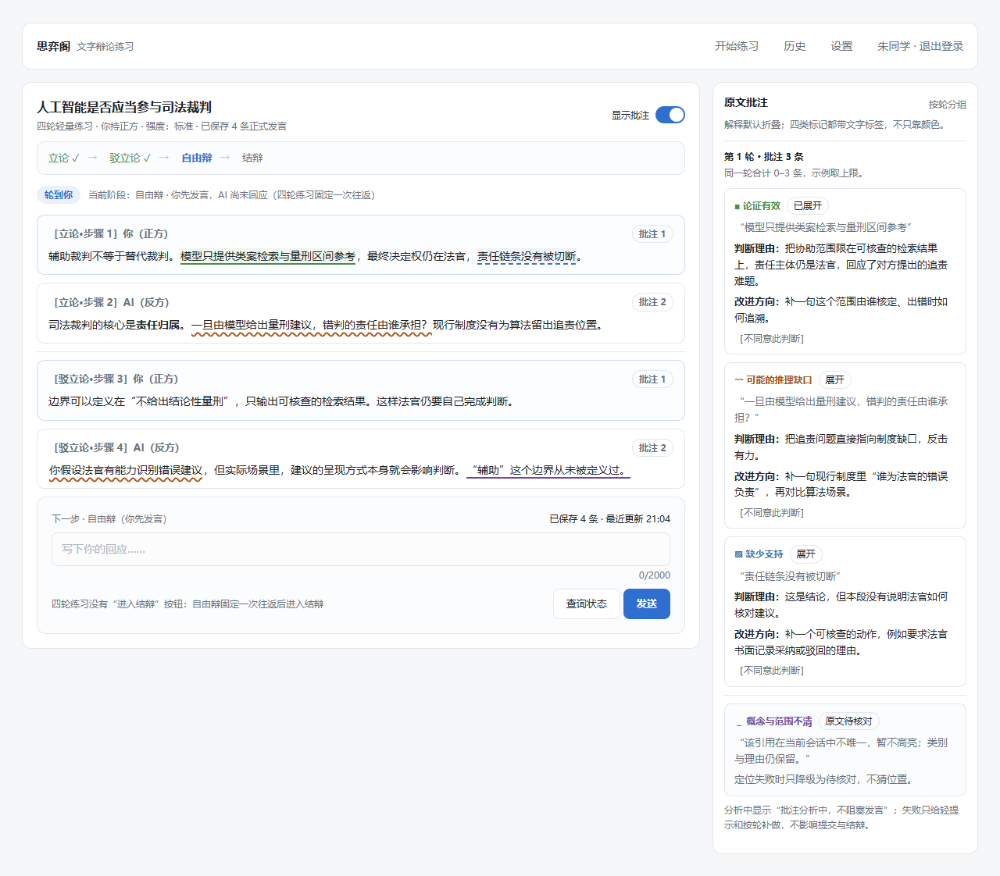

# 辩论工作台（P6）

对应 [PRD §3](../PRD.md#3-训练赛阶段发言顺序与目标状态模型)、[§5](../PRD.md#5-特色一原文批注与局部重练)、[§6](../PRD.md#6-特色二争点卡与回应定位)，覆盖 AC-V2-03～09 与 13～20。`[已实现]` 四轮基础练习的原文批注与场中显示开关已交付并签收（V2-04，2026-11-19，限四轮基础练习，完整训练赛未接入）；`[已确认]` 训练赛阶段推进、争点卡与异议的行为规范已确认，但三者均未实现，属目标态。

## 1. 适用规格

| PRD 章节 | AC-V2 | 实现状态 |
| --- | --- | --- |
| [§3.1–§3.4](../PRD.md#31-阶段与次数) 阶段、发言次序、自由辩回合、进入结辩 | AC-V2-03、05、07、08 | 四轮基础练习的发言次序 `[已实现]`；训练赛阶段轨与 1–10 回合 `[已确认]`，目标态 |
| [§3.6](../PRD.md#36-生成失败与放弃规则q11q38) 生成失败与放弃 | AC-V2-09 | 四轮练习的重试与查询状态 `[已实现]`；自由辩“放弃并进入结辩”目标态 |
| [§3.7](../PRD.md#37-目标状态模型待实施技术目标) 阶段进度由服务端推进 | AC-V2-31 | `[已确认]` 训练赛目标态 |
| [§5.1–§5.5](../PRD.md#51-双方原文都可批注q12) 批注内容、标记、展示与数量 | AC-V2-13～16 | `[已实现]`（V2-04，2026-11-19） |
| [§5.6](../PRD.md#56-异议q27) 异议 | AC-V2-20 | `[已确认]`，未实现 |
| [§6.1–§6.6](../PRD.md#61-产生时机与更新q19q26q34q31) 争点卡 | AC-V2-18～20 | `[已确认]`，未实现 |
| [§12](../PRD.md#12-输入范围与字符规则) 发言 1–2000 字 | AC-V2-11 | `[已实现]`（四轮基础练习） |
| [§10.1、§10.3](../PRD.md#103-分析失败与重试q33) 恢复与失败重试 | AC-V2-23、25 | 轮次恢复与批注补做 `[已实现]`；训练赛部分目标态 |

- `[已确认]` 阶段、回合、发言方与下一步骤只来自服务端权威进度，前端不得按轮号反推（[PRD §3.7](../PRD.md#37-目标状态模型待实施技术目标)）。
- `[已确认]` 四轮基础练习复用同一工作台：没有 1–10 回合计数、没有“进入结辩”结束操作，也不存在跨阶段连续同方；其余发言、批注与开关行为与训练赛一致（[PRD §2.1](../PRD.md#21-四轮轻量练习q31)）。
- 局部重练、复盘与四维不在本模块，入口与流程见 [完赛复盘](04-review.md)。

## 2. 演示图

| 演示图 | 构图 | 展示什么 |
| --- | --- | --- |
|  | 1280 px 级双列 | 左发言流右批注栏；辩题与立场快照、阶段轨、发言方提示、正文四类标记、逐轮分组的批注解释、主卡片上的“显示批注”开关 |
|  | 390 px 级单列 | 压缩阶段轨、正文标记和输入区位于主卡片内，批注面板堆在下方；四轮练习的争点卡在赛后集中整理 |

- `[设计建议]` 上表只描述构图与用途：两张图都是**线框示意**，不是视觉稿、不代表已实现；间距、配色、控件形态、示例辩题与批注文字均为虚构样例（见 [mockup 说明](mockup/README.md)）。图中发言次序按 [PRD §3.2](../PRD.md#32-双方完整发言序列按用户所选立场) 写（用户持正方时步骤 1 是用户立论、步骤 2 是 AI 反方立论）；2026-11-19 已修正初版图中把 AI 画在步骤 1 的错误，并与文字线框对齐。
- `[已实现]` 窄屏把批注面板**堆在主卡片下方**，不覆盖正文、不是可上拉的抽屉；开关隐藏时面板与标记一起消失。
- `[已确认]` 移动端定为**单列堆叠**，不做覆盖正文的抽屉（2026-11-19 负责人确认）：批注的核心回路是“看原句 → 看解释 → 再改”，堆叠让两者同屏可对照，抽屉每次要开合且会遮住原文；[PRD §5.3](../PRD.md#53-标记形式颜色--线型--文字标签q41) 与 AC-V2-14 措辞已同步为“底部区块／单列堆叠”。

## 3. 整体布局

`[设计建议]` 本节及以下全部文字线框只表达布局与关键控件，不是已确认设计，也不代表已实现；具体文案、间距与配色待视觉设计验证。

```
桌面（双列）
┌ 顶栏：思弈阁 · 文字辩论练习 ───────────────── 历史 设置 用户 ┐
├ 辩论主卡片（左列）─────────────────────┬ 批注面板（右栏）───────┤
│ 辩题 · 模式 · 立场 · 强度 · 已保存条数   │ 原文批注               │
│ 显示批注开关                            │ 第 1 轮 · 批注 k 条    │
│ 阶段轨：立论 → 驳立论 → 自由辩 → 结辩   │ 条目（默认折叠）       │
│ 现在：轮到你 / 轮到 AI                  │ 第 2 轮 · 批注 k 条    │
│ 发言流：正式消息 + 正文标记             │ …                      │
│ 当前回合 · 输入框 · 字数 · 提交按钮      │                        │
└─────────────────────────────────────────┴────────────────────────┘

窄屏（单列堆叠）
┌ 辩题 · 模式 · 立场 · 强度 · 已保存条数 ┐
│ 阶段轨（压缩）· 显示批注开关           │
│ 发言流：正式消息 + 正文标记            │
│ 当前回合 · 输入框 · 字数 · 提交按钮     │
└────────────── 主卡片结束 ─────────────┘
┌ 批注面板（在主卡片下方，不是抽屉）     ┐
│ 第 N 轮 · 批注 k 条 → 条目默认折叠     │
└────────────────────────────────────────┘
```

| 区域 | 桌面 | 窄屏 |
| --- | --- | --- |
| 主列 | 发言流、输入区、阶段控件的唯一列 | 单列，从上到下 |
| 右栏 | 批注解释；训练赛另含争点卡（目标态） | 主卡片下方的独立区块 |
| 开关位置 | 主卡片头部 | 主卡片头部，与阶段轨同一屏内 |
| 输入区 | 主列底部 | 主卡片底部，批注面板在其之后 |

- `[设计建议]` 桌面双列可从 1000 px 起，右栏占 30% 且最窄 280 px。断点与栏宽留待视觉设计验证。
- `[已实现]` 当前实现在 1000 px 断点切换双列，右栏 `minmax(280px, 30%)`；窄屏时面板排在整个主卡片之后（含输入区）。
- `[已确认]` 工作台按会话 ID 直达，刷新后由服务端状态重建，不依赖本地暂存（[全局信息架构 §2](01-global.md#2-视图与路由)）。

## 4. 阶段轨与头部状态（P6a）

`[已确认]` 当前阶段、发言方、回合数、消息条数都来自服务端；完整训练赛中用户选反方时 AI 先开场；四轮轻量练习每轮由用户先发言。

```
┌ 辩题：人工智能是否应当参与司法裁判 ─────────────────────────────┐
│ 完整训练赛 · 你持反方 · 强度：标准 · 已保存 12 条正式发言        │
│ 阶段轨： 立论 ✓ → 驳立论 ✓ → 自由辩（第 3/10 回合）→ 结辩       │
│ 现在： 自由辩 · 轮到 AI 回应（你已发言）                         │
└─────────────────────────────────────────────────────────────────┘
```

`[已确认]` 下表四类元素的数据来源均为服务端，界面不得自行推导：

| 元素 | 数据来源 | 说明 |
| --- | --- | --- |
| 阶段轨 | 服务端阶段进度 | 只显示已完成 / 当前 / 未开始，不用轮号反推 |
| 回合计数 | 服务端自由辩回合 | “第 k/10 回合”，k 为已完成或进行中的回合 |
| 发言方 | 服务端下一步骤 | “轮到你”或“轮到 AI 回应 / AI 已完成” |
| 消息条数 | 已保存正式消息 | 与回合数分开显示，避免混用概念 |

- `[已确认]` 消息条数不等于回合数；失败步骤不占编号、不计条数（[PRD §3.2](../PRD.md#32-双方完整发言序列按用户所选立场)）。
- `[已确认]` **合法的“同一方连续发言”只有两种**（[PRD §3.2](../PRD.md#32-双方完整发言序列按用户所选立场)）：
  - **用户持正方**：自由辩最后一回合的 AI 回复（步骤 `2n+4`）→ AI 反方结辩（步骤 `2n+5`），连续两次 AI，且跨阶段。
  - **用户持反方**：用户驳立论（步骤 4）→ 用户自由辩首发（步骤 5），连续两次用户，且跨阶段。
- `[已确认]` 其余“连续同方”都是**错误序列**，界面不得出现；尤其 AI 正方立论（步骤 1）之后必须紧跟用户反方立论（步骤 2），中间不存在“AI 紧接 AI 驳立论”。
- `[设计建议]` 出现连续同方时用阶段分隔加发言方标签标注（如“以下为结辩，仍由 AI 先发言”），不伪造“第 N 轮”，也不暗示漏了一条用户发言。
- `[已确认]` 训练赛一场最多 26 条正式消息、双方各 13 次发言；四轮练习固定 8 条，不得沿用旧“四轮赛制”的固定条数假设。

## 5. 发言流与提交（P6b）

```
┌ 发言流（示例：用户持正方）────────────────────────────────────┐
│ ［立论·步骤 1］你（正方）                              批注 1 │
│   正文……（纯文本渲染；正文标记可点击）                        │
│ ［立论·步骤 2］AI（反方）                              批注 2 │
│   正文……                                                      │
│ ── 驳立论 ─────────────────────────────────────────────────── │
│ ┌ 当前回合 · 自由辩第 3 回合 ───────────────────────────────┐ │
│ │ 轮到你（AI 已回应），可追问、回应或补充                    │ │
│ └────────────────────────────────────────────────────────────┘ │
│ ┌ 你的发言 ──────────────────────────────────────────────────┐ │
│ │ [输入框……………………………………]                 318/2000  │ │
│ └────────────────────────────────────────────────────────────┘ │
│ [发送]  [查询状态]  [进入结辩（不可用）]                        │
└────────────────────────────────────────────────────────────────┘
```

| 规则 | 内容 | 标记 |
| --- | --- | --- |
| 长度 | 每次发言 1–2000 字，训练赛与四轮练习一致 | `[已确认]` |
| 计数 | 显示字数；超限保留内容并提示修改，不静默截断 | `[已确认]` |
| 空白 | 纯空白不可提交，不能用空白绕过必填 | `[已确认]` |
| 提交中 | 提交中与生成中控件禁用，避免重复提交 | `[已确认]` |
| 草稿 | 未提交输入不自动保存，界面不得宣传“已自动保存” | `[已确认]` |
| 重试 | 不做隐式自动重试；失败后由用户点击重试或查询状态 | `[已确认]` |

- `[已实现]` 四轮基础练习按 Unicode 码点计数并在输入区显示 `n/2000`；纯空白禁用提交；提交中按钮进入忙碌态。
- `[设计建议]` 输入框上方固定显示“轮到你 / 等待 AI”，减少误判；等待期间不显示可点击的“抢占”；正文按原文保留换行与空白，用户与模型内容一律转义，不渲染不可信 HTML。

`[已确认]` 下表六种状态的业务规则均来自 PRD，按钮文案与位置为 `[设计建议]`：

| 状态 | 界面表现 | 允许动作 | 禁止 |
| --- | --- | --- | --- |
| 待发言 | 输入框可用，显示“轮到你” | 输入、提交 | 替用户生成发言 |
| 提交中 | 按钮忙碌，输入框只读 | 等待，失败后重试 | 重复提交、双发 |
| AI 回复中 | 进度提示，提交控件禁用 | 等待、查询状态 | 中途抢占、跳过该步 |
| 流式片段 | 标注“临时片段，未保存” | 停止等待并查询 | 把片段计入正式消息 |
| 该步失败 | 失败块、错误类别、重试入口 | 重试、查询状态、保存退出 | 把失败步骤当有效发言 |
| 已到上限 | 输入区关闭并说明原因 | 进入结辩 | 第 11 回合、自动进入结辩 |

## 6. 自由辩结束与十回合上限

`[已确认]` 只有当前回合完整结束才能进入结辩；0 回合不能跳过自由辩；10 回合是上限。

| 情形 | 界面 | 允许动作 | 禁止 |
| --- | --- | --- | --- |
| 0 个完整回合 | “至少完成 1 回合才能进入结辩”，按钮禁用并说明原因 | 继续发言 | 跳过自由辩、0 回合结束 |
| 已完成 ≥1 回合、AI 回复中 | 按钮不可用，提示“本回合完成后可进入结辩” | 等待、查询状态 | 中途切换阶段、自动预约切换 |
| 已完成 ≥1 回合、回合完整 | “进入结辩”可用 | 用户点击，服务端确认 | 自动生成结辩、自动切换 |
| 第 10 回合刚完成 | “已完成 10 回合，请进入结辩”，停止接收新发言 | 阅读最后回复、点击进入结辩 | 第 11 回合、自动生成结辩 |
| 结束与发言竞争 | 以服务端结果为准，显示最终状态 | 查询状态 | 前端自行决定谁先成功 |

- `[已确认]` 结束自由辩是服务端业务操作；重复点击不重复切换、不产生模型调用；与发言提交竞争时由服务端版本与事务保证只有一个先成功（[PRD §3.4](../PRD.md#34-正常结束与进入结辩q7q37)）。
- `[已确认]` 未完成回合（用户尚未发言或 AI 回复失败）不计完整回合，也不能当作“AI 无法反驳”的证据（[PRD §3.3](../PRD.md#33-自由辩回合定义与限制q3q6q13)）。
- `[设计建议]` 第 10 回合完成时保留最后一条 AI 回复的阅读位置，不自动滚动离开。
- `[已确认]` 四轮基础练习的自由辩固定一次往返，不提供 1–10 回合选择，也没有本节这组按钮（[PRD §2.1](../PRD.md#21-四轮轻量练习q31)）；本节状态全部属训练赛目标态。

## 7. 生成失败与放弃

`[已确认]` 各阶段失败的处理不同，界面必须按阶段给不同按钮，不能统一成“跳过”。

| 阶段/情形 | 界面 | 允许动作 | 禁止 |
| --- | --- | --- | --- |
| 立论 / 驳立论 / 结辩生成失败 | 失败块、错误类别、重试、保存并退出 | 重试、保存退出 | 跳过该阶段、改发言次序、把失败当有效发言 |
| 自由辩失败且已完成 ≥1 回合 | 同上，另给“放弃本次回应并进入结辩” | 放弃并进入结辩、重试、保存退出 | 把失败回应当“AI 无法反驳”的证据 |
| 自由辩失败且 0 完整回合 | 只给重试、保存退出 | 重试、保存退出 | 进入结辩 |
| 正常生成中 | 进度提示，控件禁用 | 等待、刷新后查询 | 中途跳过、直接进入结辩 |
| 等待流式片段 | 显示“临时片段，未保存” | 停止等待并查询 | 声称已取消上游、声称未计费 |

- `[已确认]` “停止等待”只停止本地等待与展示，**不代表取消上游生成或不计费**；文案不得暗示已退款、已取消或一定不产生费用。
- `[已确认]` 失败块的保存说明必须**按服务端已保存记录动态生成**，不能一律写“你的发言原文已保存”：
  - 用户在本步骤已发言成功、随后 AI 生成失败 → 可说明“你本步骤的发言已保存”。
  - **AI 先开场失败**（用户持反方、步骤 1 立论）或该步骤本就没有用户发言 → **不得**声称“你的原文已保存”，只说明本步骤尚未产生有效 AI 发言、已有记录不受影响。
  - 说明内容以服务端返回的已保存消息与步骤状态为准，前端不得凭空推断或伪造“已保存”。
- `[已确认]` 失败记录须保留可见；不自动隐式重试，也不因失败把整场标记为未完成（[PRD §3.6](../PRD.md#36-生成失败与放弃规则q11q38)）。
- `[设计建议]` 失败块给出对当前阶段的明确下一步，避免用户误以为整场作废。
- `[已实现]` 四轮基础练习的失败块显示错误码与当前尝试版本，提供“重试本轮”与“查询状态”；该轮用户发言已提交成功，故按已保存记录说明“你的发言原文已保存”。

## 8. 批注（P6c）

### 8.1 布局与入口

```
桌面：主列 + 右栏                             窄屏：主卡片下方堆叠
┌ 发言流 ────────────┬ 批注（3）────────┐   ┌ 发言流（含输入区）──┐
│ …他这样说是错的…    │ 第 1 轮 · 批注 3 条│   │ …标记可点击…       │
│  ~~~~~~~~~~~~~~~    │ ■ 论证有效         │   └────────────────────┘
│  ^^^橙色波浪线^^^   │   原句 + 理由 + 方向│   ┌ 批注（3）─────────┐
│                     │   [展开] [定位原文] │   │ 第 1 轮 · 批注 3 条│
│                     │ ▲ 缺少支持 …       │   │ ■ 论证有效 …       │
└─────────────────────┴────────────────────┘   └────────────────────┘
```

- `[已实现]` 标记渲染在**正式消息原文**上，面板只放解释，不复制第二份原文；桌面右栏与窄屏主卡片下方是同一组件、同一读写逻辑。
- `[已实现]` 点正文标记会展开并聚焦对应解释；点面板条目或“定位原文”会滚回并聚焦正文标记。
- `[设计建议]` 展开状态用列表级状态记录，不写进地址栏，刷新后回到全部折叠。

### 8.2 批次、分组与数量

- `[已确认]` 每次 AI 发言完成后，对本次双方新增发言合计生成 **0–3 条**批注，优先选择最有训练价值的地方，**不凑数量**（[PRD §5.5](../PRD.md#55-生成频率与数量q25q14)）。
- `[已确认]` 允许空结果；没有批注不等于没有问题；界面不得显示“0 条＝无问题”。
- `[已实现]` 批注按轮次批次生成与保存：一轮一个批次、批次内 0–3 条、空数组合法；批次与轮次、总结、策略各自独立，不改变完成轮数与阶段。
- `[已实现]` 面板按轮分组，标题为“第 N 轮 · 批注 k 条”；条目默认折叠，只显示类别标签与原句，点击展开判断理由与改进方向。
- `[已实现]` 空批次显示“本次没有批注，这不代表没有问题”；旧会话没有批次时显示“本场暂无批注记录”，不报错。
- `[已确认]` 跨轮次问题可关联此前原句；AI 先发言或阶段边界没有新增用户发言时，不重复评价旧文凑数。
- `[设计建议]` 批次标题固定显示条数，展开解释时不再重复计数，避免两个数字口径不一致。

### 8.3 四类标记

`[已确认]` 下表四类标记的视觉与文字标签组合来自 PRD；具体色值与图形实现为 `[设计建议]`：

| 类别 | 视觉 | 文字标签示例 |
| --- | --- | --- |
| 论证优点 | 淡绿底色 + 实线 | 论证有效 |
| 可能的逻辑问题 | 橙色波浪线 | 具体问题类型（如“可能推理缺口”） |
| 证据或支持不足 | 淡蓝底色 + 虚线 | 缺少支持 |
| 定义或范围不清 | 紫色下划线 | 定义待明确 |

- `[已确认]` 四类都必须同时给出线型与文字标签，**颜色不是唯一信息**，保证色觉差异、低对比度与灰度阅读可用（[PRD §5.3](../PRD.md#53-标记形式颜色--线型--文字标签q41)）。
- `[已确认]` 具体谬误类型用文字标签表达，不为每种谬误单独配色；同一片段有多条批注时共用一个入口并列出全部标签，不把颜色层层叠加；色值与对比度待设计验证。
- `[已实现]` 四类样式派生与文字标签同现已在 V2-04 交付，含 0 条批次与开关语义的组件级验证。

### 8.4 长引用标记（2026-11-19）

- `[已实现]` 引用较长时标记改为**随文字换行的下划线**，跨三行或五行时线条跟随每一行文字，不再是“整段底部一条线”；标记支持点击、Tab 聚焦、Enter 与空格激活，且只用文字装饰渲染在原文上，不额外插入第二份文本。
- `[设计建议]` 焦点框用 3 px 外框并带偏移，与普通链接焦点区分；具体值与对比度待视觉验证。

### 8.5 教练视角（2026-11-19）

- `[已确认]` 无论用户持正方或反方，批注始终服务**当前练习者**；引用练习者发言时建议补强论证、补充证据或改写表达，引用对方发言时给可执行的回应、追问或反击（[PRD §5.1](../PRD.md#51-双方原文都可批注q12)，2026-11-19 已与该条及 AC-V2-13 同步更新）。
- `[已确认]` 不强制双方批注数量相等，不设双方或类别配额；批注不等于对错裁定，引用存在不证明判断正确。
- `[已实现]` 生成提示词已按练习者视角升级，并用合成发言对正反两种持方各做一次真实模型验证：双方均收到一条针对本人论证的补强建议与一条针对对方论证的回应建议，四条引用均精确。该批样例只覆盖推理缺口，不写入真实会话，不能据此推断四类自然生成或所有轮次的质量（[V2-04 §17](../../planning/V2_04_ANNOTATION_SELF_TEST.md#17-多行标记和练习者视角2026-11-19)）。

### 8.6 状态与恢复

`[已确认]` 下表的业务规则来自 PRD，界面文案与摆放为 `[设计建议]`：

| 状态 | 界面表现 | 允许动作 | 禁止 |
| --- | --- | --- | --- |
| 未开始 | “第 N 轮批注尚未开始，可手动补做” | 手动补做 | 自动补做、阻塞发言 |
| 生成中 | “批注分析中，不阻塞发言” | 继续发言、进入结辩 | 阻塞提交、占正式生成配额 |
| 已生成 | 按轮分组列出条目，默认折叠 | 查看、展开、定位原文 | 把旧条目当本轮新增 |
| 失败 | 轻提示加错误码，按轮给补做入口 | 手动补做一次、继续辩论 | 自动无限重试、覆盖已成功批次 |
| 场中已关闭 | 正文标记与面板同时消失 | 重新开启后查看 | 暗示暂停分析或节省费用 |

- `[已确认]` 批注不阻塞辩论：AI 回复完成即可继续发言，批注随后补上；失败只显示轻提示，不影响发言、进入结辩或保存比赛；已有批注仍可查看。
- `[已确认]` 补做粒度是**按轮次批次重跑**：失败的单位是“某一轮的批注批次”，补做只重跑该轮整批生成，不是只补批次内失败的条目，也不整场重新生成；已有成功批次不被覆盖（[AC-V2-25](../PRD.md#14-可测试验收标准)）。
- `[已实现]` 手动补做最多一次：首次分析为 v1，唯一一次补做为 v2，此后失败批次保持失败、只允许查询；批次忙时返回生成中而不排队。
- `[已实现]` 未开始与失败两种批次都提供可执行的手动补做；补做是唯一写入口，界面不自动 POST、不自动重试。
- `[设计建议]` 失败提示与补做按钮放在对应轮次分组内，不用全局横幅，避免用户以为整场分析失效。

### 8.7 待核对降级

- `[已实现]` 引用在当前会话不唯一、坐标缺失或越界、按坐标回读的切片与保存引用不一致、浏览器无法判定字素边界时，显示“原文待核对”且**不高亮**，不猜位置；该条目仍保留类别、原句、判断理由与改进方向，只失去定位能力。
- `[设计建议]` 待核对提示固定在条目内而非面板顶部，避免用户以为整轮批注失效。

### 8.8 待决

- `[待决]` 赛后按类型筛选批注：PRD 列为建议、未单独确认，本文**不设筛选器**，留作后续确认。
- `[待决]` 受控试用期间是否隐藏手动补做按钮：改造方案提议增加服务端开关字段，未定；定稿前按现状保留按钮，不承诺长期行为。

## 9. 异议（P6c 内）

`[已确认]` 「不同意此判断」可写选填理由，保留原判断与异议标记，可取消；首版不自动 AI 复议。**尚未实现**，属目标态。

```
┌ 批注详情 ─────────────────────────────────────┐
│ 类别标签：缺少支持                             │
│ 判断理由：……   改进方向：……                   │
│ [不同意此判断]                                 │
│ 异议中（理由：……）  [取消异议]                │
└────────────────────────────────────────────────┘
```

- `[已确认]` 异议是**附加标记**：原判断文本不变、不删除，不得把异议渲染成“已纠正”；异议不触发新一轮模型调用、不自动学习、不做多模型复议（[PRD §5.6](../PRD.md#56-异议q27)）。
- `[设计建议]` 提交异议后立即本地标记，失败时回退并提示，不自动重试；理由输入框选填并设长度上限。
- `[已确认]` 争点卡异议同此规则，保留原判断、可取消（[PRD §6.5](../PRD.md#65-异议q27)）。

## 10. 争点卡（P6d）

`[已确认]` 默认最多 5 张；训练赛在双方驳立论完成后首次整理，此后每个完整自由辩回合结束后更新，结辩后再更新一次；四轮基础练习赛后集中整理。**未实现**，属目标态（[PRD §6.1](../PRD.md#61-产生时机与更新q19q26q34q31)、AC-V2-18）。

```
┌ 争点卡（4/5）────────────────────────────────────────┐
│ ┌ 卡 1  自由辩第 2 回合 · AI 提出 ──────────────────┐ │
│ │ 争点：……（可改名）                                 │ │
│ │ 提出位置：…… [定位]   相关回应：…… [定位]          │ │
│ │ 仍待澄清：……                                       │ │
│ │ [改名] [合并到…] [移除] [不同意此判断]             │ │
│ └────────────────────────────────────────────────────┘ │
│ ⓘ 卡片不判定“已驳倒”；引用存在不证明判断正确          │
└────────────────────────────────────────────────────────┘
```

`[已确认]` 下表四类操作的业务约束来自 PRD，交互细节为 `[设计建议]`：

| 操作 | 交互 | 约束 |
| --- | --- | --- |
| 改名 | 行内编辑并保存，界面只显示当前人工值 | 不在面向用户的卡片上展示“原名 / 历史名”对照；后续更新不得覆盖人工值 |
| 合并 | 选目标卡 → 预览合并后文本 → 确认 | 合并后保留双方原句链接；被合并卡不复活 |
| 移除 | 二次确认，说明“将从本场视图移除” | `[已确认]` 移除不因更新复活；能否恢复属未决 |
| 定位 | 点击跳到双方原句并高亮 | `[已确认]` 定位失败显示“待核对”，不高亮、不猜（[PRD §6.4](../PRD.md#64-回应定位)） |

- `[已确认]` 更新不阻塞辩论，也不是进入下一阶段的前提；AI 更新只追加“相关回应 / 仍待澄清”，与人工编辑冲突时以人工为准且**冲突可见**，不静默还原或改名（[PRD §6.6](../PRD.md#66-人工编辑与-ai-更新的优先级)）；不自动判定“已驳倒”，结辩后整理也不产生胜负裁判，解释回应是否切中问题必须链接双方原句。
- `[设计建议]` 卡面固定三块：提出位置 / 相关回应 / 仍待澄清；定位按钮与标签同行，便于核对交锋关系。
- `[待决]` 移除后能否恢复、合并与移除是否需要“撤销”、改名是否保留可审计的原名记录（如需，只作内部记录）：均未确认，**不得**写进面向用户的确认对话框或线框文案。

## 11. 场中显示开关（P6e）

- `[已实现]` 开关在辩论主卡片上，标签为“显示批注”；关闭时面板与标记一起消失，已有批次继续在后台生成，重新开启即可读到当前批次（V2-04，2026-11-19）。
- `[已确认]` 开关同时隐藏正文标记与批注面板；关闭后仍生成并保存批注，重新开启或从历史打开会话即可查看（[PRD §5.4](../PRD.md#54-折叠展开与关闭展示q8q17q31)、AC-V2-14）。
- `[已确认]` 关闭只控制展示，**不暂停分析、不节省费用**；不得暗示已暂停或已省下调用。
- `[设计建议]` 开关旁给一行提示：“关闭后隐藏标记和侧栏，批注仍会保存”，避免被理解为暂停分析或节省费用。

| 开关状态 | 正文标记 | 批注面板 | 生成与保存 | 禁止 |
| --- | --- | --- | --- | --- |
| 开启 | 显示四类标记 | 显示逐轮分组 | 正常生成并保存 | 用颜色单独表意 |
| 关闭 | 隐藏 | 隐藏 | 照常生成并保存 | 声称已取消、已省钱、已暂停 |

## 12. 不做什么

- `[已确认]` 不做草稿自动保存，界面不得宣传“已自动保存”。
- `[已确认]` 不提供替 AI 改写的入口；局部重练只作用于用户本人发言（见 [完赛复盘](04-review.md)）。
- `[已确认]` 不做隐式自动重试、不自动无限重试；未批准“点击结束即自动预约生成”或自动切换阶段。
- `[已确认]` 不伪造“已保存”：失败块说明按服务端已保存记录生成。
- `[已确认]` 争点卡不判“已驳倒”；工作台不判胜负、不给总分、不做排名。
- `[已确认]` 异议不自动触发 AI 复议、不自动纠正模型判断、不做自动学习。
- `[已确认]` 不因关闭场中显示而跳过生成或声称节省费用；颜色不单独承载批注语义。
- `[已确认]` 不引入抢麦、计时、多人打断等正式赛事机制（[PRD §2.2](../PRD.md#22-完整训练赛)）。

## 13. 相关模块

- [开始练习](02-entry.md)：模式、辩题、立场与强度、创建后锦囊，即本页入口 P2–P5。
- [完赛复盘](04-review.md)：完赛与复盘失败、四维雷达、局部重练入口 P7。
- [登录、失败态与退出](07-common-states.md)：登录恢复、401/404/429 共通态、离开与未提交内容。
- [全局信息架构](01-global.md)：视图与路由、跨页事实源、桌面与移动组织。
- [追踪与未决](08-traceability.md)：需求追踪矩阵、未决项与未执行项。
- 证据：[V2-04 批注自测记录与签收](../../planning/V2_04_ANNOTATION_SELF_TEST.md#18-负责人签收2026-11-19) · [接口契约](../../api/API.md) · [演示图源文件与效力](mockup/README.md)。
