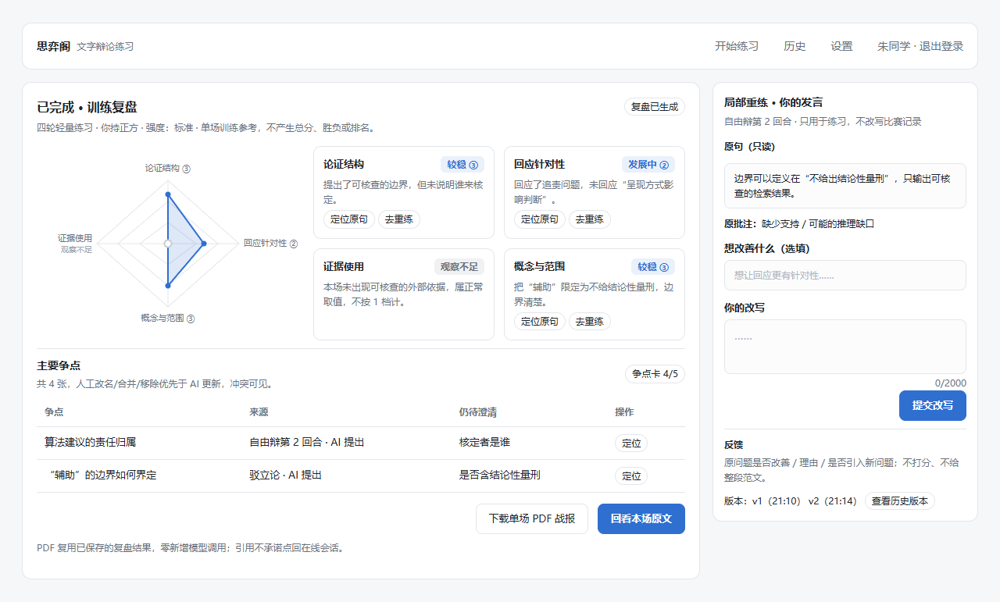

# 完赛复盘（P7、P8）

对应 [PRD §8](../PRD.md#8-赛后复盘与四维训练参考)、[§9](../PRD.md#9-pdf-战报q47)、[§5.7](../PRD.md#57-局部重练q16q28q32q39)，验收标准 AC-V2-21、22、24、29；本模块**均未实现**，全文为目标态细化，没有任何已交付切片。

## 1. 适用规格

| 面板 | 内容 | PRD 章节 | AC-V2 | 实现状态 |
| --- | --- | --- | --- | --- |
| P7 完赛复盘 | 整页构图、复盘状态、四维、争点回顾、重练与 PDF 入口 | [§8](../PRD.md#8-赛后复盘与四维训练参考)、[§8.6](../PRD.md#86-复盘生成与失败q30q33) | AC-V2-21、24 | 未实现 |
| P7a 复盘失败态 | 失败独立展示、手动重试、仍可查看原文/批注/争点 | [§8.6](../PRD.md#86-复盘生成与失败q30q33)、[§10.2](../PRD.md#102-比赛完成与复盘失败q30) | AC-V2-24 | 未实现 |
| P7b 四维与雷达 | 四维档级、观察不足、原文依据、跳批注与重练 | [§8.2](../PRD.md#82-四个维度q43)～[§8.5](../PRD.md#85-图表与原文联动q42) | AC-V2-21、22 | 未实现 |
| P7c 局部重练 | 原句与批注只读、改写、对照反馈、多版本 | [§5.7](../PRD.md#57-局部重练q16q28q32q39)、[§12](../PRD.md#12-输入范围与字符规则) | AC-V2-17、26 | 未实现 |
| P8 PDF 战报 | 单场 PDF、主动下载、复用已保存结果 | [§9](../PRD.md#9-pdf-战报q47) | AC-V2-29 | 未实现 |

- `[已确认]` 现状基线中 P7、P7a、P7b、P7c、P8 均列为目标态，不含已交付切片；已交付的 V2-04 只覆盖工作台的原文批注与场中开关，不包含本模块任何内容，见 [README §4](README.md#4-已交付切片的现状基线)。
- `[已确认]` 页面定位是“单场训练参考”：展示主要争点、论证优点、优先改进的问题及对应原文与重练入口，不判胜负、不给总分（[PRD §8.1](../PRD.md#81-复盘范围q23)、AC-V2-21）。

## 2. 演示图



- `[设计建议]` 上图是**线框示意**，不是视觉稿、不代表已实现；间距、配色、控件形态均为设计建议，可由设计评审调整。
- `[设计建议]` 构图：主卡片内**雷达图与四维卡片并排**（雷达在左，四张维度卡在右侧成两列）；**主要争点卡**表格位于四维下方；页脚为“下载单场 PDF 战报”与“回看本场原文”。**局部重练**在右栏独立面板，与原句、批注、改写框、反馈、版本顺序排列。
- `[设计建议]` 图中的示例数据（辩题、原句、档级、批注文字、争点数）均为虚构样例，不是真实会话记录，也不构成产品文案；渲染方式与效力见 [mockup/README.md](mockup/README.md#效力)。

`[设计建议]` 页面区块与位置：

| 区块 | 位置 | 承载内容 | 标记 |
| --- | --- | --- | --- |
| 头部摘要 | 主卡片顶部 | 完成状态、模式、持方、单场训练参考说明 | `[已确认]` 字段来源见 [PRD §10.5](../PRD.md#105-历史体验q48)；是否加显著强度标识属 `[设计建议]` |
| 复盘状态块 | 头部下方 | 已生成／生成中／生成失败与重试 | `[已确认]` |
| 四维区 | 主卡片主体 | 雷达图与四张维度卡片并排 | `[设计建议]` 布局 |
| 争点区 | 四维区下方 | 主要争点表格、来源与“仍待澄清”、定位 | `[已确认]` 内容，`[设计建议]` 表格形态 |
| 页脚操作 | 主卡片底部 | 下载单场 PDF、回看本场原文 | `[已确认]` 能力，`[设计建议]` 位置 |
| 局部重练面板 | 右栏（窄屏在下方） | 原句、批注、改写、反馈、版本 | `[设计建议]` 位置 |

- `[已确认]` 入口两条：结辩完成后进入复盘，或从历史列表的已完成会话进入；完成后可进复盘与重练（AC-V2-23、[PRD §10.5](../PRD.md#105-历史体验q48)）。
- `[设计建议]` 返回去向（工作台只读或历史）、是否在结辩完成后自动跳转本页，均属界面做法：先按“完成后给出进入复盘的明确入口”处理，不写死自动跳转；页面编号与入口列以[总览 §2](../PRD_V2_UI_DESIGN.md#2-页面与面板清单)为准。

## 3. 完赛与复盘失败（P7a）

- `[已确认]` 双方结辩完成即“比赛已完成”；复盘**独立生成**，失败单独显示并可重试，原文、批注与争点卡仍可查看（[PRD §8.6](../PRD.md#86-复盘生成与失败q30q33)）。
- `[已确认]` 比赛完成状态与复盘生成状态是两个独立事实：复盘失败或尚未生成**不得把比赛标为未完成**，也不要求重新辩论（[PRD §10.2](../PRD.md#102-比赛完成与复盘失败q30)、AC-V2-24）。
- `[已确认]` 复盘失败**不自动无限重试**，只提供手动重试入口（AC-V2-24）。
- `[设计建议]` 重试的频率与额度按服务端限制约束，口径沿用分析重试的同类处理（[PRD §10.3](../PRD.md#103-分析失败与重试q33)），具体数值不在界面锁定。
- `[已确认]` 未完成结辩的训练不生成完整复盘、不开放局部重练；可查看已保存的发言、批注与争点卡并继续训练（[PRD §10.4](../PRD.md#104-未完成训练的范围q35)、AC-V2-26）。

`[设计建议]` 顶部状态块骨架（所有内容在其下方照常可读）：

```text
┌ 已完成 · 训练复盘 ─────────────────────────────────────┐
│ 复盘状态：已生成 / 生成中 / 生成失败（可重试）          │
│ 失败时：受控错误 → [重试生成复盘]                      │
│        “原文、批注与争点卡仍可查看”                     │
│ 不自动重试；比赛完成状态不因复盘失败改变                 │
└────────────────────────────────────────────────────────┘
```

| 状态 | 界面表现 | 允许动作 | 禁止 |
| --- | --- | --- | --- |
| 比赛未完成 | 不显示完整复盘与重练入口，保留已保存内容 | 继续训练 | 生成完整复盘、开放局部重练 |
| 复盘未开始 | 展示“可生成复盘”空态，`[待决]` 是否由服务端自动生成一次未定 | 手动触发生成 | 无限轮询、把比赛标为未完成 |
| 复盘生成中 | 进度提示，页面其余内容可看 | 等待、查询状态 | 重复点击触发新生成 |
| 复盘失败 | 独立失败块＋受控错误＋手动重试；原文/批注/争点仍可查看 | 重试、查看原文与批注、查看争点卡 | 把比赛标为未完成、自动无限重试 |
| 复盘成功 | 展示复盘、四维、争点回顾与 PDF 入口 | 阅读、跳转原文、下载 PDF、局部重练 | 显示总分、胜负或排名 |

- `[设计建议]` 生成中把重试按钮置为不可用，避免重复触发；失败块与比赛状态条分开展示，避免读者把“复盘失败”读成“比赛失败”。
- `[待决]` “复盘未开始”时是否自动生成一次，属产品取舍，见第 7 节与 [08 追踪与未决](08-traceability.md)。

## 4. 四维与雷达（P7b）

`[设计建议]` 主体骨架（雷达与维度卡片并排，卡片承担文字解释）：

```text
┌ 四维训练参考（单场）────────────────────────────────────┐
│  雷达图（四轴）              维度卡片 ×4                 │
│  ┌────────────────┐        ┌─────────────────────────┐ │
│  │      论证结构 ③ │        │ 论证结构 · 较稳 ③       │ │
│  │ 证据使用 ◇      │        │ 依据：…… [定位原句]     │ │
│  │  （观察不足）    │        │ 建议：…… [去重练]       │ │
│  │ 回应针对性 ②     │        └─────────────────────────┘ │
│  │ 概念与范围 ③     │        ……其余三维同构，观察不足维  │ │
│  └────────────────┘        卡片写“为什么观察不足”       │ │
│ ⓘ 训练参考，不是客观测量；不产生总分、胜负或排名          │
└──────────────────────────────────────────────────────────┘
```

| 档级 | 标签 | 界面含义 |
| --- | --- | --- |
| 1 | 起步 | 该维当前表现的最低档 |
| 2 | 发展中 | 低于“较稳”的中间档 |
| 3 | 较稳 | 主要行为标准基本成立 |
| 4 | 充分 | 还能处理前提、边界或追问 |
| 非档级 | 观察不足 | 本场缺少足够观察依据，不占档位、不按 0 分 |

- `[已确认]` 四维固定为**论证结构 / 回应针对性 / 证据使用 / 概念与范围**；各维须有行为标准、原文依据与改进建议，无依据不强行赋档（[PRD §8.2](../PRD.md#82-四个维度q43)、[§8.4](../PRD.md#84-四维行为标准q49-初版须以真实样例验证)、AC-V2-22）。
- `[已确认]` 档级 1–4 对应起步／发展中／较稳／充分，另设**观察不足**且**不按 0 分处理**；三档训练强度使用相同评价标准（[PRD §8.3](../PRD.md#83-档级形式q46)）。
- `[设计建议]` 雷达图四个轴按 1–4 由内向外对应档位，观察不足轴留空并附文字说明；具体映射方向与图形样式待设计确认，`[设计建议]` 不锁定。
- `[已确认]` **观察不足是合法的四维结果**：雷达图上该维留空或灰底标注“观察不足”，**不落到 1 档、不画成 0**；维度卡片仍要写出“为什么观察不足”（[PRD §8.5](../PRD.md#85-图表与原文联动q42)）。
- `[已确认]` **观察不足 ≠ 复盘结果缺失**：前者是“本场该维缺少足够观察依据”的正常取值，后者是复盘尚未成功生成。二者不得混用，**也不得因观察不足禁用 PDF、逼模型凑值或补一个档级**。
- `[已确认]` 点击维度卡片可跳到对应批注与局部重练入口；不跨场累计、不做能力画像（[PRD §8.1](../PRD.md#81-复盘范围q23)、[§8.5](../PRD.md#85-图表与原文联动q42)）。
- `[已确认]` 不产生总分、胜负或排名；档级是训练参考，不是经校准的客观测量（[PRD §8.1](../PRD.md#81-复盘范围q23)、[§8.3](../PRD.md#83-档级形式q46)、AC-V2-21）。
- `[已确认]` 判定纪律：不因未引用统计数据就判“证据薄弱”，不因合理修正观点就判“前后矛盾”；证据使用不等于联网事实核查（[PRD §8.2](../PRD.md#82-四个维度q43)、[§8.4](../PRD.md#84-四维行为标准q49-初版须以真实样例验证)）。
- `[设计建议]` 维度卡片结构：维度名与档级标签、原文依据摘句（`[定位原句]`）、改进建议（`[去重练]`）；观察不足卡片的依据区域改为“为什么观察不足”的说明，不提供档级标签。
- `[设计建议]` **移动端同样提供雷达图**，不能由维度卡片替代或降级为可选：窄屏把雷达图置于顶部并自适应尺寸，维度卡片作为其下方的详细说明。实现方式（缩略图＋放大，或全宽重排）**待定**，属设计选择，本文不写死。

## 5. 局部重练（P7c）

- `[已确认]` 入口两条：从批注进入，或主动选中自己的一段原文进入（不要求该原文已有批注）；可选填“想改善什么”（[PRD §5.7](../PRD.md#57-局部重练q16q28q32q39)）。
- `[已确认]` 对象仅限**用户本人发言**；AI 原文不改写。选中的是 AI 原文时，只提供批注、定位与异议，**不提供改写入口**（AC-V2-17）。
- `[已确认]` 流程：先展示原句、批注与改进提示 → 用户先自行改写 → 提交后再比较原问题是否改善、说明理由，以及是否引入新问题。
- `[已确认]` 不打分、不给整段标准答案；允许多次重练并保留各版本的改写与反馈。
- `[已确认]` 不覆盖比赛：原稿保留，改写不覆盖比赛记录、不重新计算后续辩论、不作为“发生过的比赛发言”。
- `[已确认]` 未完成结辩的训练不开放局部重练；改写长度 1–2000 字，与发言同规则，超限保留内容并提示，不静默截断；次数受服务端额度约束（[PRD §12](../PRD.md#12-输入范围与字符规则)、AC-V2-26）。

`[设计建议]` 面板骨架（右栏；入口来自维度卡片、批注或主动选段）：

```text
┌ 局部重练 · 你的发言（自由辩第 2 回合）───────────────┐
│ 原句：……（只读）                                     │
│ 原批注：缺少支持 / 可能的推理缺口（如有）             │
│ 想改善什么（选填）：[________________________]        │
│ 你的改写：[__________________________________] 152/2000│
│ [提交改写]                                            │
│ ── 反馈（提交后出现）─────────────────────────────── │
│ 原问题是否改善：…… 理由：…… 是否引入新问题：……        │
│ 版本：v1（21:10） v2（21:14） [查看历史版本]           │
│ ⓘ 只用于练习，不改写比赛记录；不打分、无整段范文        │
└───────────────────────────────────────────────────────┘
```

| 情形 | 界面表现 | 约束 |
| --- | --- | --- |
| 选中的是 AI 原文 | 不提供“改写”，只提供批注／定位／异议 | 不替 AI 改写 |
| 未完成结辩 | 不显示重练入口 | 未完成训练不开放 |
| 改写为空／纯空白／超 2000 | 行内提示，内容保留 | 不静默截断、不用空白绕过必填 |
| 反馈生成失败 | 保留改写与旧版本，给手动重试 | 不自动重试、不覆盖旧反馈 |
| 改写提交成功 | 先落版本，再展示对照反馈 | 先改写后反馈，不先给范文 |
| 重练完成后 | 只影响重练版本，比赛记录保持原样 | 不覆盖比赛、不重算后续辩论 |
| 多次重练 | 追加版本，可切换查看 | 不覆盖、不改比赛记录 |

- `[设计建议]` “想改善什么”为**可选填**输入框，置于改写框上方；PRD 已确认“可选填想改善什么”，但该输入在界面上的具体位置与形态属设计建议，不是逐字确认的字段规格。
- `[已确认]` 若产品决定不展示“想改善什么”输入框，须在 PRD 层面另议；界面细化不擅自删除该入口。
- `[设计建议]` 反馈区只在提交成功后出现，顺序固定为“改写 → 反馈 → 版本”，避免用户先看到反馈再改写。

## 6. PDF 战报（P8）

- `[已确认]` 单场 PDF，内容含：辩题、立场、模式、四维图及解释、主要争点、优点、改进建议、相关原文引用（[PRD §9](../PRD.md#9-pdf-战报q47)、AC-V2-29）。
- `[已确认]` 用户**主动下载**，不自动公开。
- `[已确认]` **复用已保存的复盘结果，零新增模型调用**；不得为生成 PDF 触发任何新分析（可用调用计数证明）。
- `[已确认]` 完整聊天记录与全部重练版本默认**不**放入战报；PDF 中的原文引用**不承诺**跳回在线会话，界面不宣传“可点击回看”。
- `[已确认]` 中文字体、长文分页与图表清晰度需验证，属待评估项。

`[设计建议]` 入口骨架（位于复盘页脚）：

```text
┌ 战报 ────────────────────────────────────────────────┐
│ [下载单场 PDF]   状态：准备中 / 已开始下载 / 失败     │
│ ⓘ 使用已保存的复盘结果生成，不触发新的模型分析        │
└───────────────────────────────────────────────────────┘
```

| 情形 | 界面表现 | 依据 |
| --- | --- | --- |
| 复盘成功、含四维 | 可下载，正常生成 | `[已确认]` |
| 四维中若干为**观察不足** | **仍可下载**，PDF 照实标注“观察不足”，不补档、不凑值 | `[已确认]`：观察不足是合法结果，不是缺失 |
| **复盘尚无结果**（生成中／失败／未开始） | `[设计建议]` 禁用下载并说明“复盘尚未生成完成”，不下载半份战报 | 设计建议，PRD 未规定该禁用 |
| 下载失败 | 受控错误＋可再次手动点击 | `[设计建议]`，不自动重试 |

- `[待决]` 复盘失败时是否允许导出“仅争点与原文”的**精简版**：这是新增功能，未获批准，不在本版实现，也不得写成已确认能力。

## 7. 不做什么与待决

- `[已确认]` 不做总分、胜负、排名、跨场累计、能力画像与成长曲线（[PRD §8.1](../PRD.md#81-复盘范围q23)、[§13](../PRD.md#13-暂缓项与后续需求池)）。
- `[已确认]` 不做 AI 裁判式评分；AI 裁判式评分、胜负属暂缓项，不是本版目标（[PRD §13](../PRD.md#13-暂缓项与后续需求池)）。
- `[已确认]` 不替 AI 改写；选中 AI 原文只给批注、定位与异议。
- `[已确认]` 不自动无限重试复盘生成或重练反馈；不用低分、凑值或补档替代观察不足。
- `[已确认]` 不把完整聊天与全部重练版本放进 PDF，不自动公开 PDF；不因观察不足禁用下载。
- `[已确认]` 未获批准的顺带项不设入口：成长曲线、排行榜、争点卡自动“已驳倒”、草稿自动保存等（[PRD §13](../PRD.md#13-暂缓项与后续需求池)）。
- `[待决]` 复盘未开始时的自动生成策略：PRD 只定“独立生成、可重试”，未定是否自动生成一次；界面空态先给“可生成复盘”与手动入口，不写死自动行为。
- `[待决]` 复盘失败时是否导出“仅争点与原文”的精简版 PDF：属新增功能，未获批准，不实现。
- `[待决]` 复盘失败态 PDF 入口的呈现（禁用／隐藏／保留说明）：PRD 未规定，本文按 `[设计建议]` 给禁用方案，拍板后再改为已确认。
- `[设计建议]` 移动端雷达图的实现方式（缩略图＋放大或全宽重排）待设计评审，不在本文锁定。
- 上述 `[待决]` 项统一登记在 [08 追踪与未决](08-traceability.md)，本文不重复维护状态。

## 8. 相关模块

- [02 辩论工作台](03-workspace.md)：批注、异议与争点卡是复盘与局部重练的数据来源；结辩完成后的跳转入口也在该模块。
- [04 历史](05-history.md)：列表的“已完成／复盘失败”标记，以及进入复盘与重练的入口条件。
- [07 追踪与未决](08-traceability.md)：本模块 `[待决]` 项、AC-V2 追踪与维护方式。
- [V2 页面设计模块索引](README.md)：写作约定、标记含义与已交付切片基线；页面清单位于总览 [PRD_V2_UI_DESIGN.md](../PRD_V2_UI_DESIGN.md)。
