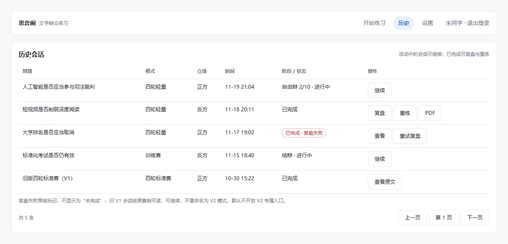

# 历史（P9）

对应 [PRD §10.5](../PRD.md#105-历史体验q48)、[§17](../PRD.md#17-与-v1-的关系) 与 AC-V2-23。列表与“继续”`[已实现]`；V2 新增的状态列（复盘生成中／失败／成功）与复盘、重练、PDF 入口为目标态。

## 1. 适用规格

| PRD 章节 | AC-V2 | 实现状态 |
| --- | --- | --- |
| [§10.5 历史体验（Q48）](../PRD.md#105-历史体验q48) | AC-V2-23 | 列表、分页与继续 `[已实现]`；模式列与状态列目标态 |
| [§17 与 V1 的关系](../PRD.md#17-与-v1-的关系) | AC-V2-23 | 旧会话按 V1 原赛制可读、可继续 `[已实现]` |
| [§10.2 比赛完成与复盘失败（Q30）](../PRD.md#102-比赛完成与复盘失败q30) | AC-V2-24 | 复盘失败独立标记目标态 |
| [§10.4 未完成训练的范围（Q35）](../PRD.md#104-未完成训练的范围q35) | AC-V2-26 | 继续训练 `[已实现]`；重练禁用目标态 |

- `[已确认]` 列表展示辩题、模式、立场、时间、当前阶段、完成状态；未完成可继续，完成后可进复盘与重练。
- `[已确认]` 比赛完成与复盘状态是两个独立事实；复盘失败单独标记，**不把比赛显示为未完成**。
- `[已确认]` 旧 V1 会话保持原有赛制语义，不重命名、不换算。

## 2. 演示图



- `[设计建议]` 上图展示表格化列表、进行中／已完成／“已完成·复盘失败”三类状态标记、行内操作按钮，以及一条旧 V1 会话的“查看原文”入口；它是**线框示意**，不是视觉稿，间距、配色与控件形态未定。
- `[设计建议]` 图中辩题、时间与轮次均为虚构样例，不是真实会话记录。

## 3. 列表结构

```text
历史会话
  辩题                 模式          立场   时间         阶段 / 状态            操作
  ……                   完整训练赛    反方   11-17 21:04  自由辩 3/10 · 进行中   [继续]
  ……                   四轮轻量练习  正方   11-16 20:11  已完成                 [复盘][重练][PDF]
  ……                   完整训练赛    正方   11-15 19:02  已完成 · 复盘失败      [查看][重试复盘]
  旧版四轮标准赛（V1）  四轮标准赛    正方   10-30 15:22  已完成                 [查看原文]
  共 N 条               上一页 / 第 1 页 / 下一页
```

| 列 | 内容 | 依据 | 状态 |
| --- | --- | --- | --- |
| 辩题 | 会话创建时的辩题快照 | [§10.5](../PRD.md#105-历史体验q48) | `[已实现]` |
| 模式 | V2 会话显示“四轮轻量练习／完整训练赛”；V1 会话显示原赛制“四轮标准赛／三轮快速赛” | [§2.1](../PRD.md#21-四轮轻量练习q31)、[§2.2](../PRD.md#22-完整训练赛)、[§17](../PRD.md#17-与-v1-的关系) | 语义 `[已确认]`；列本身 `[设计建议]` |
| 立场 | 用户所选立场（正方／反方） | [§10.5](../PRD.md#105-历史体验q48) | `[已实现]` |
| 时间 | 创建或更新时间，按当前设备本地时区展示 | [§10.5](../PRD.md#105-历史体验q48) | `[已实现]`；显示哪一个 `[设计建议]` |
| 阶段或状态 | 进行中显示当前阶段＋回合；已完成显示复盘状态 | [§3.7](../PRD.md#37-目标状态模型待实施技术目标)、[§10.5](../PRD.md#105-历史体验q48) | 目标态 |
| 操作 | 继续／查看／复盘／重试复盘／重练／PDF | [§10.5](../PRD.md#105-历史体验q48) | 准入见第 5 节 |
| 分页 | 每页 20 条，上一页／页码／下一页，越界或空页给说明 | 当前实现（T11） | `[已实现]` |

- `[已实现]` 当前实现为卡片列表，含辩题、双方立场、陪练流派、完成轮数 `n / total`、创建与更新时间、仅“进行中／已完成”两态状态，每页 20 条并按创建时间倒序；表格化并补模式、阶段／状态、操作列属目标态。
- `[设计建议]` 当前每行只有一个“查看会话”按钮，未按状态拆成“继续／复盘／重练”；目标是按状态给行内操作。这只是入口形态调整，不改变“未完成会话可继续”的既有行为。
- `[已确认]` 模式列在 V2 会话显示“四轮轻量练习／完整训练赛”；V1 旧会话显示原赛制，不重命名为 V2 模式。
- `[设计建议]` 宽屏用表格、窄屏改为卡片堆叠；时间列只显示本地时间，完整时间放详情或悬停说明。
- `[设计建议]` 列表只放摘要与入口，不在行内展开完整聊天记录或复盘全文。

## 4. 状态标记

| 状态 | 标记 | 判定依据 | 允许动作 | 禁止 | 依据 |
| --- | --- | --- | --- | --- | --- |
| 进行中 | 当前阶段＋回合，如“自由辩 3/10 · 进行中” | 会话未完成结辩 | 继续训练、查看已保存内容 | 生成完整复盘、开放重练 | `[已确认]`（[§10.4](../PRD.md#104-未完成训练的范围q35)、[§10.5](../PRD.md#105-历史体验q48)） |
| 已完成·复盘生成中 | “已完成 · 复盘生成中” | 结辩完成且复盘生成中 | 查看原文／批注／争点卡，等待或查询 | 重复触发复盘、显示为未完成 | `[已确认]`（[§8.6](../PRD.md#86-复盘生成与失败q30q33)） |
| 已完成·复盘失败 | “已完成 · 复盘失败”独立标签 | 结辩完成且复盘失败 | 查看内容、手动“重试复盘” | 显示为“未完成”、删掉复盘入口、自动无限重试 | `[已确认]`（[§8.6](../PRD.md#86-复盘生成与失败q30q33)、[§10.2](../PRD.md#102-比赛完成与复盘失败q30)） |
| 已完成·复盘成功 | “已完成”（可附“复盘已生成”） | 结辩完成且复盘已生成 | 复盘、重练、PDF | 显示总分、胜负或排名 | `[已确认]`（[§8.1](../PRD.md#81-复盘范围q23)、[§10.5](../PRD.md#105-历史体验q48)） |

- `[已确认]` 复盘失败**不得**显示为“未完成”，也不得删掉复盘入口；原文、批注与争点卡仍可查看（[PRD §8.6](../PRD.md#86-复盘生成与失败q30q33)、[§10.2](../PRD.md#102-比赛完成与复盘失败q30)）。
- `[已实现]` 当前列表只区分“进行中／已完成”，未读取复盘状态；复盘生成中、失败、成功三态为目标态。
- `[设计建议]` 状态以文字标签表达，不只靠颜色；失败标签与“已完成”同行内联展示，不另加一列。

## 5. 操作与准入

| 操作 | 准入条件 | 不满足时 | 去向与依据 |
| --- | --- | --- | --- |
| 继续 | 会话未完成 | 已完成的会话不显示该操作 | 工作台恢复当前阶段与回合（[§10.1](../PRD.md#101-中途退出与续练q29)）`[已实现]` |
| 查看 | 任意本人会话 | — | 工作台重读详情的总入口 `[已实现]`；旧 V1 会话标注“查看原文”属 `[设计建议]` |
| 复盘 | 比赛已完成（双方结辩完成） | 未完成时不显示复盘入口 | 复盘页；复盘失败仍进入失败态（[§8.6](../PRD.md#86-复盘生成与失败q30q33)）`[已确认]` |
| 重试复盘 | 复盘状态为失败 | 生成中禁用并提示，不重复点击 | 就地重试，不离开列表（[§8.6](../PRD.md#86-复盘生成与失败q30q33)）`[已确认]` |
| 重练 | 已完赛且含本人原文；未完成训练不开放 | 禁用并说明原因 | 复盘页重练面板（[§5.7](../PRD.md#57-局部重练q16q28q32q39)）`[已确认]` |
| PDF | 复盘已成功，复用已保存结果 | 复盘生成中／失败时禁用并说明“复盘尚未生成完成” | PDF 下载（[§9](../PRD.md#9-pdf-战报q47)）`[设计建议]`：PRD 未规定该禁用 |

- `[已确认]` 重练须满足“完赛＋本人原文”；不满足时禁用并说明，不隐藏成“没有这项能力”。
- `[已确认]` 未完成训练不生成完整复盘、不开放局部重练。
- `[设计建议]` 复盘失败时“重试复盘”为主操作，“查看”为次操作；重试结果未知时以查询为准，不自动重发。
- `[设计建议]` 复盘的自动生成策略未定，列表不因此自行触发复盘生成，只提供入口。

## 6. V1 旧会话

- `[已确认]` 旧历史（V1 `standard_4`／`quick_3`）仍可读、可继续，且保持 V1 原有赛制语义。
- `[已确认]` 旧会话继续训练按 V1 原赛制恢复：同一会话、同一轮次模型，不中途换算成 V2 阶段模型，也不把旧会话改写成 V2 会话。
- `[已确认]` 列表与详情按原始赛制标注“四轮标准赛／三轮快速赛”，不重命名为“四轮轻量练习／完整训练赛”。
- `[设计建议]` 旧会话默认不提供 V2 专属能力入口（批注、争点卡、局部重练），因为旧数据到 V2 的映射未定；操作列只给“查看原文”，未完成时给“继续”。
- `[设计建议]` 文档倾向与当前实现不一致：已实现的行为是旧会话打开后仍渲染批注面板，只是没有可读批次而显示“本场暂无批注记录”空态；按本节倾向应默认不显示该面板。是否补“旧会话不提供批注面板”的判断，待负责人选定口径后统一；未定前不把空态写成“旧会话没有批注能力”。
- `[待决]` 旧会话的阶段映射与“是否可开启 V2 专属能力”属 TE-13，未评估；不因未定阻止旧会话按 V1 语义继续。

## 7. 不做什么与待决

| 事项 | 结论或归属 | 状态 |
| --- | --- | --- |
| 成长排行榜、复杂统计面板 | 不自动新增（[§10.5](../PRD.md#105-历史体验q48)） | `[已确认]` 不做 |
| 复盘失败时导出“仅争点与原文”的精简 PDF | 新增功能，未获批准，本版不实现 | `[待决]`（产品） |
| 旧 V1 历史的阶段映射与 V2 能力开放 | [TE-13](../../planning/PRD_V2_TECHNICAL_ASSESSMENT.md#5-集中登记的技术待评估项) 未评估 | `[待决]`（技术） |
| 历史默认排序是否改为按最近更新 | 当前按创建时间倒序；改口径是新需求 | `[待决]`（产品） |
| 状态标签的具体形式与配色 | 留待设计验证，不锁定色值（[§5.3](../PRD.md#53-标记形式颜色--线型--文字标签q41)） | `[设计建议]` |

- `[设计建议]` 不做历史批量删除、批量归档或跨用户可见的列表；本文不新增 PRD 未确认的功能入口。

## 8. 相关模块

- [辩论工作台](03-workspace.md)：“继续”后的恢复位置、阶段推进与生成失败重试
- [完赛复盘](04-review.md)：复盘失败态、局部重练与 PDF 战报
- [登录、失败态与退出](07-common-states.md)：历史加载失败、401、空列表与离开页面
- [模块目录与写作约定](README.md)
